# TrackAI Rough Product Roadmap

**Portfolio index — intentionally non-committal on delivery dates**
Last updated: **2026-10-12** (portfolio re-plan with the founder: Task7/Task11/Task12 deferred to the pilot milestone, Task8 re-scoped, Task17 and Task18 added, new execution graph)

This document records major product programs, their dependencies and their
recommended Codex-task ownership. Individual task trackers remain authoritative
for implementation detail. Status represents discovery/implementation maturity,
not a promised release date.

> **Working style (2026-10-07):** agents follow [`AGENTS.md`](AGENTS.md) (agent-kit 0.1.0). Session-level status, the remaining plan with estimates and actuals, and the integration test registry live in [`docs/plan/STATUS_BOARD.md`](docs/plan/STATUS_BOARD.md); each Task starts with a plain-language primer in [`docs/plan/primers/`](docs/plan/primers/) or a plan in `docs/plan/TASK<N>.md`. The 2026-10-12 re-plan is recorded in [`docs/plan/ROADMAP_REPLAN_2026-10-12.md`](docs/plan/ROADMAP_REPLAN_2026-10-12.md).

## Status legend

| Symbol | Meaning |
|---|---|
| 🟢 ✅ | Program outcome implemented and verified for its stated scope |
| 🟡 ◐ | Active discovery, partial foundation or incomplete implementation |
| 🔴 ☐ | Idea/backlog; dedicated implementation has not begun |
| ⚪ — | Not applicable |

## Portfolio matrix

| ID | Program | Status | Intended outcome | Major workstreams | Dependencies / gates | Recommended horizon | Manual involvement | Codex-task ownership |
|---|---|---:|---|---|---|---|---|---|
| **Ongoing Lab** | Lifecycle Correctness Lab | 🟡 ◐ | Continuously prove that Generated, Committed, In-PR, Merged, Production, Reworked and Churned metrics remain truthful across agents and SCM operations. | Controlled fixtures; provider/model coverage; correction semantics; scale tests; release regression; customer-reproducible evidence. | Current Task2; every later program that changes telemetry, SCM or UI. | **Permanent** | High: live IDE, GitHub, tenant and deployment experiments remain essential. | **This Codex task remains the owner.** |
| **Task4** | Robustness, Security, Administration and Operations | 🟡 ◐ | Make telemetry transport, credentials, tenant/repository policy, retention and operations production-safe. | Durable delivery; encryption; key lifecycle; repository grants; quarantine; admin UI; retention/export; monitoring. | Post-E13 checkpoint and Task2 metric invariants. | **Begins after E13** | High for secrets, GitHub App, multi-tenant, offline and admin verification. | Separate Task4 task; canonical tracker is [`TASK4.md`](TASK4.md). |
| **[Task5](TASK5.md)** | Evidence Explorer and Intention Intelligence | 🟡 ◐ | Let authorized customers traverse intention → prompt/session/tool activity → code/commit/PR/production and reverse that path for diagnosis and learning. | Evidence taxonomy; privacy; graph; raw evidence; visual explorer; pain analytics; semantic intention review. | Engineering and controlled verification complete and approved for `main`; T5.9a intention research and product-owner UX acceptance continue in parallel. External work-item linkage remains deferred. | **Merge foundation; continue explicit follow-ups** | Hands-on product feedback remains; certification and provider expansion continue in their owning tasks. | [`TASK5.md`](TASK5.md) is the authoritative implementation/status tracker; this roadmap retains only the portfolio summary. |
| **Task6 Security** | Coding-Agent Security | 🟡 ◐ | Detect reviewed coding-agent threats locally and deliver privacy-safe, tenant-isolated monitor findings without claiming unsupported prevention. | Normalized security events; Numbat rule discovery; embedded pinned evaluator; safe findings; access/audit UI; agent/OS conformance. | Task4 delivery/authorization, Task5 privacy floor and Task13 route capabilities. Canonical tracker: [`TASK6_SECURITY.md`](TASK6_SECURITY.md). | **Begin now; monitor-only first** | High: rule review, false-positive evaluation and real agent/host experiments. | Active Task6 track. |
| **Task6 Policy** | Organization Policy Engine | 🔴 ☐ | Later express, simulate, distribute and enforce customer-defined capture, upload, redaction, retention, access, export and authorization policy. | Cedar-like model; inheritance; exceptions; approvals; simulation; signed endpoint bundles; data lifecycle controls. | Customer requirements plus stable Task4/5/6-Security contracts. Canonical tracker: [`TASK6_POLICY.md`](TASK6_POLICY.md); compatibility index: [`TASK6_POLICY_SECURITY_BUNDLE_ARCHITECTURE.md`](TASK6_POLICY_SECURITY_BUNDLE_ARCHITECTURE.md). | **Deferred until customer-driven** | Very high: vocabulary, defaults, signing trust, failure modes and compliance review. | Deferred Task6 track. |
| **[Task7](docs/plan/TASK7.md)** | SCM and CI/CD Integrations | 🔴 ☐ | Bring the PR, merge and production stages, and CI/CD signals, to providers beyond GitHub; provider order GitLab → Azure DevOps → Bitbucket, chosen by the pilot pipeline. | Provider adapters (GitLab first); MR/PR, stacked-diff and merge-train semantics; deployment signals from CD tools (Argo CD, Jenkins, GitLab environments); CI results for quality outcomes. | Task2 lifecycle contracts; Task4 delivery/idempotency. | **Deferred to the pilot milestone** (pulled in if a pilot uses GitLab or Azure DevOps) | High: provider accounts, installations, live merges/deployments. | Codex; scope in `docs/plan/TASK7.md`. |
| **[Task8](docs/plan/TASK8.md)** | Pilot Readiness: Identity and Onboarding | 🔴 ☐ | Move a pilot customer from contract to verified first metrics without TrackAI staff: company login, roles, enrollment, first-data diagnostics, a sample tenant and acceptance runbooks. | Okta/Entra/Google OIDC with issuer/audience checks; group-to-role mapping and break-glass; JIT users (SCIM deferred); SCM installation; custodian assignment; self-service enrollment; role acceptance; first-data diagnostics and verification lab (ex-T12.2); sample tenant (ex-T12.3); acceptance runbooks (ex-T12.4); auditor invitations (ex-Task16 A16.9). | Task4 admin/identity; Task9 enrollment; Task16 audit contract. | **After Task10; before Task18** | Very high: IdP configuration, role trials. | Codex or Claude; plan in `docs/plan/TASK8.md`. |
| **Task9** | MDM and Managed Developer Fleet | 🔴 ☐ | Let enterprise administrators deploy, configure, inventory, update and revoke TrackAI/Git AI across managed macOS, Windows and Linux devices. | Signed packages/profiles; unattended install; device identity/posture and assigned-user evidence; managed configuration; fleet inventory; update/rollback; offboarding; OS secret-store integration. | Task4 developer keys, machine identity, repository grants and offline queue; Task14 secret-store adapter contract. | **After Task4 machine enrollment** | Very high: managed-device access, MDM vendor profiles, user/device reconciliation and restart/offboarding tests. | Separate Task9 task. |
| **Task10** | UX/UI and Design-System Overhaul | 🔴 ☐ | Deliver a coherent, accessible customer/operator experience capable of explaining both lifecycle outcomes and complex evidence. | Information architecture; design system; responsive/accessibility; customer/operator modes; visualizations; progressive disclosure. | Research may start early; connected Evidence Explorer depends on Task5 and policy/admin UX depends on Tasks4/6. | **Research early; implementation after core workflows stabilize** | Very high: design critique, customer workflow testing and accessibility review. | Separate Task10 product-design/implementation task. |
| **[Task11](docs/plan/TASK11.md)** | Public API, SDK and Integration Platform | ⚪ — | Expose stable, versioned TrackAI capabilities to customer automation. | API tokens for customer automation (first piece); read APIs for audit, findings and attestations; SIEM/webhook delivery; OpenAPI/SDKs later. | Triggers in `docs/plan/TASK11.md`. | **Deferred until a customer asks** (after Task14 at the earliest) | Medium/high. | Not scheduled. Conventions (AP-1) are applied by every Task's new routes meanwhile. |
| **[Task12](docs/plan/TASK12.md)** | Trust Center and Buyer Content | 🔴 ☐ | Marketing and trust content for security, legal and procurement buyers, built on verified evidence (Attesta packs, audit exports). | Trust center; technical/admin documentation; architecture and security evidence; buyer narratives. (Verification lab, sample tenant and acceptance runbooks moved to Task8.) | Task14; Task15/16 evidence; pilot learnings. | **After Task14, with Task11; customer-driven** | Very high: customer language, security review. | Claude-led content; scope in `docs/plan/TASK12.md`. |
| **Task13** | Agent and Surface Coverage | 🟡 ◐ | Includes AI agents that run in CI and the cloud (capture inside CI runners, AC-BG routes). Capture and validate every supported path by which an AI agent can change code, without confusing model provider, agent family, host surface or capture channel. | Route taxonomy; IDE/CLI/desktop/cloud adapters; host provenance; evidence fidelity; cross-platform conformance; customer verification. | Task2 lifecycle contracts; Task4 host-neutral delivery/enrollment; Task5 raw-evidence policy; Task9 managed deployment. | **Matrix now; adapters and validation in route-priority waves** | Very high: each claimed route and operating system requires a real host experiment. | Separate Task13 implementation task; the Lifecycle Lab remains independent acceptance authority. Canonical tracker: [`AGENT_COVERAGE.md`](AGENT_COVERAGE.md). |
| **Task15** | Attesta: Signed Provenance and Shared Trust Layer | 🔴 ☐ | Make TrackAI's evidence tamper-evident and independently verifiable: hash-chained records, signing with tenant-controlled keys, anchoring to an RFC 3161 timestamp authority and Sigstore Rekor, offline verification; own the signer, key hierarchy, rotation and revocation reused by Task6 D6.1, Task6 Policy bundles, Task9 and Task14 T14.7. | Ported from SushiCorp (EV-1, EV-2, SG-1, TR-1, RP-1; `docs/plan/REUSE_MAP.md`). Plan and sub-task graph: [`docs/plan/TASK15.md`](docs/plan/TASK15.md); brief: [`docs/founder/ATTESTA_BRIEF.md`](docs/founder/ATTESTA_BRIEF.md). | Task4 audit and exports; Task2 attribution records. | **Next, Claude-led** | High: key custody, external TSA/Rekor, auditor verification. | Claude (TrackAI-Orchestrator), primer pending the founder's brief. |
| **Task16** | Audit and Auditor Experience | 🔴 ☐ | One home for audit: every security-relevant event (Task4 admin, Task6 findings, D6.1 activation, policy bundles, signed artifacts) recorded, searchable, exportable and verifiable by a read-only auditor, separate from Administration. | Auditor surface, audit event catalog, exports and reports; API parts may move to Task11. Plan: [`docs/plan/TASK16.md`](docs/plan/TASK16.md). | Task4 audit log; Task15 for tamper evidence. | **With or after Task15** | High: auditor workflows, report content. | Claude-led; scope to be defined. |
| **[Task17](docs/plan/TASK17.md)** | GitAI Upstream Sync and Fork Hygiene | 🔴 ☐ | One-time catch-up with public Git AI (upstream stopped at 1.7.6 on 2026-09-09: 302 upstream-only and 71 fork-only commits), plus the fork to-dos no other Task owns. | Daemon reliability fixes; attribution/notes regression review; metrics fixes; agent/editor changes before Task13; GITAI_FUTURE_TODO G5, G6. MDM login-start kit stays in Task9. | Task9 (MDM kit port); Task2 semantics. | **After Task9; before Task13** | Medium: native runs per OS. | Codex leads; Claude product review; Muse ports. Plan in `docs/plan/TASK17.md`. |
| **[Task18](docs/plan/TASK18.md)** | Real-World Validation (Simulated Organization) | 🔴 ☐ | Prove the core product end to end on a realistic organization before a pilot: 10 repositories, 3 users and machines (macOS, Windows), large real code changes. | Lifecycle correctness at scale (Task2); evidence exploration (Task5); security monitoring (Task6.a); productivity metrics and the 20-question list; Attesta and audit evidence; Playwright automation; runs on the pilot hosting slice of Task14 (T14.1). | Task8 onboarding; Task14 T14.1; Tasks 2/5/6.a/15/16. | **After Task8; before the rest of Task14** | Very high: rented hardware, sustained real usage. | Codex leads with founder-live runs; plan in `docs/plan/TASK18.md`. |
| **[Task19](docs/plan/TASK19.md)** | Customer and Auditor Q&A Delivery | 🔴 ☐ | Turn every question in [`docs/plan/CUSTOMER_AUDITOR_QA.md`](docs/plan/CUSTOMER_AUDITOR_QA.md) (20 code, 18 security and policy, ranked) into an answerable one: live for admins, verifiable or signed for auditors. | Q&A contract and question registry; admin live answers and Questions screen (ex-T10.9); gap dispatch to owning Tasks (G1–G13); review gates for Task16 A16.13 and Task15o/15p; Task6.a/6.b strategy. | Task2/4/6 data; Task15 statements; Task16 A16.13; Task10 design system. | **Phase 1 now (alongside Task16); answers as gaps close** | Medium: founder walkthrough of top questions. | Claude leads; Muse builds; owning Tasks build gaps. Plan in `docs/plan/TASK19.md`. |
| **Task14** | Production Readiness and Deployment Certification | 🔴 ☐ | T14.1 (pilot hosting) is pulled forward before Task18; the rest follows the pilot milestone. Turn verified product capabilities into an operable GCP SaaS service and portable customer-VPC/self-hosted releases with repeatable security, recovery and rollout evidence. | Deployment architecture; secret/KMS and endpoint keyring adapters; TLS/service identity; PostgreSQL/DR; HA/capacity; supply chain; staging/canary/rollback; SLO/incident operations; deployment conformance. | Consumes Task4's completed security/operations contracts plus Task8 onboarding, Task9 packaging and Task13 platform evidence; it does not re-own those programs. | **Build adapters early; certify after the supported release scope is frozen** | Very high: cloud accounts, recovery drills, platform hosts, customer-network and self-hosted acceptance. | Separate Task14 task. Canonical tracker: [`TASK14.md`](TASK14.md); plain-language companion: [`prod-checklist-for-dummies.md`](prod-checklist-for-dummies.md). |

## Permanent Lifecycle Correctness Lab

This task remains an independent verification function even while other Codex
tasks implement new capabilities.

| Responsibility | Operating rule |
|---|---|
| Metric contracts | Own the definitions and invariants for lifecycle metrics; implementation tasks must not silently redefine them. |
| Controlled experiments | Maintain deterministic small fixtures plus realistic E15-scale scenarios. |
| Cross-provider verification | Re-run attribution, usage and lifecycle tests when an agent, model, SCM provider or client transport changes. |
| Correction semantics | Preserve observed evidence and validate explicit audited overlays, exclusions and availability states. |
| Release regression | Consume checkpoint commits from other tasks and run affected lifecycle/E2E cases before their release gates turn green. |
| Customer reproducibility | Prefer tests and evidence that a customer can understand and independently repeat. |

## Task5 — Evidence Explorer and Intention Intelligence

Task5 turns currently internal evidence into a permission-aware customer
investigation surface. Raw content is sensitive customer intellectual property,
not ordinary low-risk telemetry.

Authoritative status, execution waves and evidence gates are maintained in
[`TASK5.md`](TASK5.md). Semantic implementation details and diagrams are in
[`docs/TASK5_SEMANTIC_EVIDENCE_DESIGN.md`](docs/TASK5_SEMANTIC_EVIDENCE_DESIGN.md).

| ID | Subtask | Status | Outcome | Dependencies / privacy gate | Manual involvement |
|---|---|---:|---|---|---|
| **T5.1** | Evidence Taxonomy and Identity | 🟢 ✅ | Preserve GitAI commit/session/checkpoint/trace meanings and add separate evidence-event, intention, relationship, evidence-state and availability contracts. | Task2 session/trace/commit identity findings; E15. | Domain model accepted; future changes require review. |
| **T5.2** | Fixed Evidence Safety Contract | 🟢 ✅ | Enforce tenant opt-in, separation of metadata/content, encryption, always-on secret scanning, audited privileged raw access and 30-day deletion. Deferred Task6 Policy owns later configurability. | Task4 encryption, identity, policy and retention contracts. | Controlled security acceptance passes; customer-specific review belongs to Tasks12/14. |
| **T5.3** | OpenCode Evidence Ingestion and Storage | 🟢 ✅ | Accept idempotent OpenCode prompt/response/reasoning/tool evidence, retain provider identities and store encrypted content separately from metadata. | T5.1–T5.2; Task4 delivery/encryption/retention. | Verified with the isolated GitAI/OpenCode collector; other providers wait for Task13. |
| **T5.4** | Work-Item Linkage | ⚪ — | Deferred. Reconsider GitHub Issue, Jira and Linear linkage with a customer or a later integration task; do not infer ticket relationships now. | Customer configuration and provider authorization. | Customer-led future decision; Task14 may certify deployment but does not own this feature. |
| **T5.5** | Evidence Graph APIs | 🟢 ✅ | Support forward and reverse traversal with tenant-safe filters, pagination, evidence/confidence and availability while keeping GitAI entities authoritative. | T5.1–T5.3; Task11 may later publish selected contracts. | Live database traversal and pagination gates pass. |
| **T5.6** | Visual Evidence Explorer | 🟢 ✅ | Provide a functional summary, supporting graph/timeline, code-provenance drill-down, semantic search and explicit privileged raw-content reveal. | T5.5; Task10 owns later design-system polish. | Role-appropriate walkthroughs pass through one focused, progressive-disclosure workspace; Task10 owns styling. |
| **T5.7** | Pain-Point and Quality Analytics | 🟢 ✅ | Explain failed/retried/slow tools, prompt loops, Task2 rework, abandoned sessions and weak outcomes using transparent evidence rather than employee scores. | T5.3, T5.5; Task2 metric invariants. | Synthetic interpretation gates pass; customer-specific wording may evolve later. |
| **T5.8** | Code-to-Intention Reverse Engineering | 🟢 ✅ | Navigate commit/file/line → GitAI range/checkpoint/trace/session → provider evidence/intention, exposing gaps without inventing causality. | T5.1, T5.3, T5.5; Git Notes/range attribution. | Exact and missing-attribution API/browser audits pass. |
| **T5.9** | Semantic Intention Review | 🟢 ✅ | Provide tenant-isolated encrypted intention indexing, exact/semantic retrieval and repository/commit/file/session/tool/model filters. | T5.2–T5.5; Task4 deletion/retention. | Pinned-model relevance, hard-negative, deletion and tenant-isolation gates pass. |
| **T5.10** | Continuous Verification | 🟢 ✅ | Continuously verify taxonomy, privacy, authorization, redaction, collector mapping, semantic behavior and Task2/Task4 regressions. Customer-grade bundles/certification remain Tasks12/14. | T5.1–T5.9; Task12 verification UX. | Engineering gates and controlled walkthrough pass; product-owner E5-12 sign-off is pending. |

### Task5 safety defaults

- Raw prompts, responses and tool payloads are **not** returned by existing
  dashboard APIs and are not enabled merely because metadata is available.
- Metadata-only local prototypes may precede Task4; production content storage
  waits for encryption, access control, retention/deletion and audit.
- Semantic indexes are tenant-isolated, permission-aware and opt-in. Customer
  content is never used for cross-customer training by default.
- Inferred work-item or intention links always expose method and confidence;
  unresolved evidence remains unresolved.
- Insights diagnose systems and workflows. They must not silently become
  employee-surveillance scores or unsupported productivity judgments.

## Future program workstreams

| Program | Referenceable workstreams |
|---|---|
| **Task6 Security — active** | **S6.1** event/capability contract; **S6.2** Numbat inventory/provenance; **S6.3** embedded pinned evaluator; **S6.4** privacy-safe finding delivery; **S6.5** storage/access/audit/UI; **S6.6** agent/OS conformance; **S6.7** optional later blocking pilot. |
| **Task6 Policy — deferred** | **P6.1** vocabulary/inheritance; **P6.2** repository/branch/agent/model rules; **P6.3** approvals/exceptions; **P6.4** simulation; **P6.5** enforcement adapters; **P6.6** policy evidence/audit; **P6.7** compliance reporting; **P6.8** signed bundle provisioning; **P6.9** capture/upload/redaction/retention/access/export families. |
| **Task7 — SCM and CI/CD (deferred)** | **T7.1** provider-neutral contract; **T7.2** GitLab App/OAuth; **T7.3** Azure DevOps; **T7.4** Bitbucket; **T7.5** webhook/event parity; **T7.6** MR/PR, merge-train and stacked-diff semantics; **T7.7** deployment signals from CD tools; **T7.8** CI results for quality outcomes; **T7.9** cross-provider conformance suite. |
| **Task8 — Pilot readiness** | **T8.1** Okta/Entra/Google login setup; **T8.2** issuer/audience/callback/claims verification; **T8.3** group-to-role, initial admin and break-glass; **T8.4** JIT users (SCIM deferred); **T8.5** SCM/repository onboarding; **T8.6** audited machine custodian; **T8.7** self-service enrollment; **T8.8** role acceptance; **T8.9** first-data diagnostics and verification lab (ex-T12.2); **T8.10** sample tenant (ex-T12.3); **T8.11** acceptance runbooks (ex-T12.4); **T8.12** auditor invitations and expiry (ex-A16.9). |
| **Task9 — MDM/Fleet** | **T9.1** signed macOS/Windows/Linux packages; **T9.2** unattended deployment; **T9.3** device identity/posture and assigned-user evidence; **T9.4** managed configuration and policy provisioning; **T9.5** inventory/health; **T9.6** staged update and rollback; **T9.7** revocation/offboarding; **T9.8** OS secret-store adapter integration; **T9.9** MDM-to-TrackAI assignment reconciliation; **T9.10** fleet security/E2E. |
| **Task10 — UX/UI** | **T10.1** information architecture; **T10.2** design system; **T10.3** responsive/accessibility baseline; **T10.4** customer/operator modes; **T10.5** lifecycle visualizations; **T10.6** Evidence Explorer UX; **T10.7** scalable repository/fleet policy administration; **T10.8** usability and performance verification; ~~**T10.9** questions & answers~~ moved to Task19 (T19.3–T19.5) on 2026-10-14; Task10 keeps the design system it builds on. |
| **Task11 — API/SDK (deferred)** | **T11.0** API tokens for customer automation (first piece when triggered); **T11.1** public resource model; **T11.2** OpenAPI/versioning; **T11.3** TypeScript SDK; **T11.4** Python SDK; **T11.5** CLI; **T11.6** callbacks/webhooks and SIEM delivery; **T11.7** pagination/quotas/errors (applied early as AP-1 conventions); **T11.8** examples and compatibility suite. |
| **Task12 — Trust center and buyer content** | **T12.1** security/trust center; **T12.5** technical/admin documentation; **T12.6** architecture/security evidence; **T12.7** customer and buyer-facing narratives. (T12.2–T12.4 moved to Task8 as T8.9–T8.11.) |
| **Task13 — Agent/Surface Coverage** | **T13.1** taxonomy and route catalog; **T13.2** normalized host/evidence contract; **T13.3** IDE/chat/completion; **T13.4** CLI/TUI; **T13.5** desktop apps; **T13.6** remote/cloud/background; **T13.7** gateways/Agent V1; **T13.8** macOS/Linux/Windows/WSL; **T13.9** conformance harness; **T13.10** coverage health and customer runbooks. |
| **Task14 — Production Readiness** | **T14.1** GCP SaaS and portable deployment reference; **T14.2** server secret/KMS adapters; **T14.3** endpoint secret-store contract; **T14.4** TLS/service identity/networking; **T14.5** PostgreSQL/pooling/migrations/DR; **T14.6** HA/load/rate/capacity; **T14.7** supply-chain and artifact signing; **T14.8** staging/canary/rollback; **T14.9** SLO/incident operations; **T14.10** SaaS/VPC/self-hosted certification. |

### Task8 and Task9 identity boundary

Human SSO identity and machine identity are deliberately separate. A person
authenticates with an IdP subject; a machine authenticates with its own
installation credential. Task8 owns an audited, time-bounded assignment that
records a machine's primary user or custodian. That assignment helps an
administrator understand responsibility, but it grants neither human nor
machine access by itself. Task9 may attest or reconcile the assignment using
MDM device/user evidence; it must not replace either authentication system or
infer authority from an email domain.

### Task10 repository and fleet administration UX backlog

Task4 provides a safe functional baseline: focused administration sections,
compact repository summaries, one-repository-at-a-time access detail, active
grants separated from collapsed revoked history, and explicit danger zones.
Task10 owns the product-scale experience rather than expanding Task4 into a
general policy designer.

| Area | Pending Task10 outcome | Dependency / acceptance evidence |
|---|---|---|
| Information hierarchy | Dedicated list/detail routes with stable URLs and preserved search, filter, selection and navigation state. Repository summaries show enrollment, active-machine count, branch-coverage summary, health and last policy change without rendering grant history inline. | Task4 resource identities and Task6 policy identities must be stable; test browser back/forward and deep links. |
| Scale and performance | Server-side search, status filters, sorting, cursor pagination and bounded page sizes for hundreds or thousands of repositories, machines, grants and audit records. Use virtualization only where measured rendering cost warrants it. | Task11 pagination/error conventions; performance fixtures at representative enterprise size. |
| Access inspection | Searchable active-machine table per repository; grouped branch rules, effective windows and policy source; revoked/expired history collapsed and separately pageable by default. Provide the inverse machine-centric view of all repository access. | Task4 grant/revocation contracts; cross-check repository-centric and machine-centric results. |
| Safe editing | Structured branch-rule editor with validation, previews and clear `all branches` semantics. Display an impact preview before revoking a credential, machine, grant or repository policy, including exact cascaded resources and unaffected resources. | Task4 fail-closed enforcement and audit; usability tests must distinguish every revocation scope. |
| Bulk administration | Select/filter many repositories or machines, stage bulk grants/revocations, preview the complete diff and impact count, require an audit reason, execute with partial-failure reporting and exportable results. No silent all-or-nothing assumption. | Task6 policy model and Task11 async/batch contract; Company A/B isolation and retry tests. |
| Policy-engine integration | Replace raw JSON editing with human-readable organization/team/repository/branch/agent/model policies, inheritance, exceptions and approvals. Include Cedar-like `why allowed/denied`, dry-run simulation, conflict detection, effective-policy view and before/after diff. JSON remains a versioned transport/debug representation, not the primary administrator experience. | Task6 vocabulary, evaluator and simulation APIs; policy decision conformance fixtures. |
| Roles and modes | Deliberately distinct tenant-admin, auditor, operator and customer-reader experiences. Hide unavailable mutations but always explain permissions and effective tenant context; do not infer authority from email domain. | Task4 subject-bound roles; role-by-action accessibility and security matrix. |
| Audit and history | Link every resource state to its immutable audit trail without mixing historical rows into current access. Support actor/action/resource/time filters, correlated bulk-operation IDs and export. | Task4 audit/retention plus Task11 export contracts. |
| Accessibility and responsive behavior | Keyboard-complete tables, drawers and dialogs; visible focus; semantic labels; screen-reader announcements; contrast and zoom compliance; responsive detail presentation without hiding security context. | WCAG review, automated checks and manual keyboard/screen-reader testing. |
| Design system | Reusable status, scope, policy-source, confirmation, danger-zone, empty-state and partial-failure components with consistent language across machine, repository, GitHub App and historical-import workflows. | T10 design tokens/component library and content guidelines. |
| Usability verification | Task-based studies for first machine, first repository grant, credential rotation, single-grant revoke, whole-machine revoke, repository-policy revoke, historical import and recovery from partial failure. Measure completion, errors, comprehension and time—not visual preference alone. | Representative novice and experienced administrators; single-machine and enterprise-scale fixtures. |

Task10 must preserve the Task4 security rule that the server is authoritative.
Client filtering, disabled buttons, previews and policy simulations improve safety
but never replace tenant-bound server enforcement or immutable audit.

### Task6 Security and Policy split

The active Security track evaluates a curated, pinned subset of the Numbat
candidate corpus locally. It records source/license/provenance, required
evidence, host fidelity, false-positive behavior and safe finding output. The
first release supports explicit `off` or `monitor` only, ships rules with GitAI
and does not depend on dynamic signed bundles. The accepted inventory and exact
rule count remain discovery outputs.

The deferred Policy track owns Cedar-like organization authorization, policy
inheritance, conflicts, exceptions, simulation and signed distribution. It
also owns future customer-authored capture, upload, redaction, retention,
access and export policy. It may tighten but cannot weaken Task5's fixed safety
floor.

Task4's editable branch set remains a high-level resource-access foundation.
It must not grow ad hoc agent/model/compliance semantics ahead of the relevant
Task6 Security or deferred Task6 Policy contract.

## Dependency and execution model

Re-planned with the founder on 2026-10-12 (`docs/plan/ROADMAP_REPLAN_2026-10-12.md`). Two agent lanes run in parallel; the pilot milestone marks where customer acquisition starts and which deferred Tasks a pilot can pull in. Task11 is not on the graph (deferred until a customer asks).

```mermaid
flowchart LR
    subgraph Done["Done (merged)"]
        T1["Task1"] --> T2["Task2 + Lifecycle Lab"]
        T2 --> T4["Task4"]
        T4 --> T5["Task5"]
        T5 --> T6S["Task6.a Security"]
    end
    subgraph LaneA["Codex + Muse lane"]
        T9["Task9 MDM/Fleet"] --> T17["Task17 GitAI upstream sync"]
        T17 --> LAB["Task2 regression check (Lab session)"]
        LAB --> T13["Task13 Agent/Surface Coverage"]
    end
    subgraph LaneB["Claude + Muse lane"]
        T15["Task15 Attesta"] --> T16["Task16 Audit"]
    end
    T6S --> T9
    T6S --> T15
    T13 --> T10["Task10 UX/UI (with Task5/Task6.a clean-up)"]
    T16 --> T10
    T10 --> T8["Task8 Pilot readiness"]
    T8 --> T141["Task14 T14.1 pilot hosting"]
    T141 --> T18["Task18 Real-world validation"]
    T18 --> PILOT{{"Pilot milestone: customer acquisition starts"}}
    PILOT --> T14["Task14 rest: production certification"]
    T14 --> T12["Task12 Trust center and buyer content"]
    PILOT -. "if the pilot needs it" .-> T7["Task7 SCM and CI/CD"]
    PILOT -. "if the pilot needs it" .-> T6P["Task6.b Policy"]
    PILOT -. "if the pilot needs it" .-> P2["Attesta phase 2, SCIM, Task11 API"]
```

### Recommended portfolio sequence (2026-10-12)

1. **In parallel now:** Codex + Muse run Task9 (Windows remainder may stay 🟡 until hardware is available) → Task17 → a Task2 Lifecycle Lab regression check → Task13. Claude + Muse run Task15 → Task16.
2. **Then:** Task10, in parallel with clean-up and enhancement of Task5 and Task6.a (to be scoped with the founder), then finish Task10.
3. **Then:** Task8 (pilot readiness), the pilot-hosting slice of Task14 (T14.1), and Task18 (real-world validation on that hosting).
4. **Pilot milestone:** customer acquisition begins. Deferred work a pilot can pull forward: Task7 (GitLab or Azure DevOps customer), Task11 (SIEM integration or API request), Task6.b (policy enforcement), Attesta phase 2, SCIM.
5. **After the pilot starts:** the rest of Task14 (production certification), then Task12 and, when triggered, Task11.
6. The Lifecycle Lab keeps running; any Task that changes telemetry, SCM handling or the GitAI client asks for a Lab regression check.

## Multi-task coordination

- Every major program uses a dedicated branch, worktree, Codex task, tracker
  and versioned handoff.
- This roadmap is the portfolio index; it does not replace `Task2.md`,
  `TASK4.md`, `TASK5.md`, `TASK6_SECURITY.md`, `TASK6_POLICY.md`,
  `AGENT_COVERAGE.md`, `TASK14.md` or future program trackers.
- Shared schemas and public contracts integrate only at named checkpoint SHAs.
- The implementing task records what changed; the Lifecycle Lab independently
  reruns affected metric scenarios.
- Handoffs contain paths, SHAs, contracts, tests and known defects—never secret
  values or customer raw content.

## Assumptions

- Task2 remains the lifecycle metric-semantics authority.
- Task5 is complete under its canonical tracker; active coding-agent security
  belongs to Task6 Security, while customer-driven organization policy remains
  deferred in Task6 Policy.
- Raw prompts, responses and tool content are sensitive customer data.
- Task13 owns route implementation status; Task2 retains bridge tests and the
  Lifecycle Lab independently validates every route.
- Task14 consumes verified Task4 controls as release prerequisites; it does not
  redefine or duplicate Task4 retention, export, monitoring, audit, encryption
  or credential-lifecycle semantics.
- Roadmap status reflects maturity, not staffing, commercial commitment or a
  promised date.
