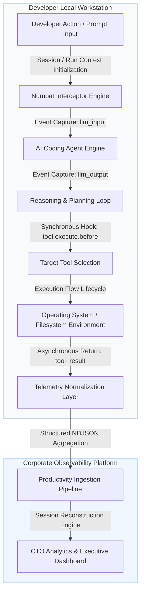
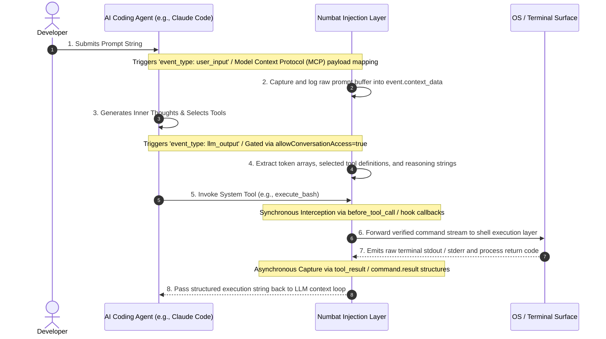

# Technical Specification: Reusing Numbat for Developer-Agent Observability & Workflow Analytics

## 1. Executive Summary & Core Concept

While **Perplexity AI's Numbat** is primarily architected as a runtime endpoint security framework, its underlying data collection architecture acts as a highly structured interception engine. It captures the comprehensive, end-to-end transactional execution loop of an AI Developer Agent. 

This document serves as an engineering blueprint to help internal platform or software vendor engineering teams reuse Numbat's open-source plumbing to extract **Developer Productivity Analytics, Observability Timelines, and Agent Efficiency Metrics** without focusing on security threat indicators.

By parsing Numbat's unified telemetry stream, organizations can reconstruct step-by-step developer-to-agent timelines, measure model efficiency, and identify developer friction points out of the box.

---

## 2. Low-Level Core Execution Flow & Code Mapping

A standard AI agent iteration involves a prompt, model reasoning, tool invocation, and an execution response. Numbat instruments this entire loop. Below is the mapping of how these lifecycle stages translate to Numbat's internal API schemas, variable structures, and telemetry output fields.

### Technical Mapping of Log Fields to Lifecycle Stages

To extract productivity workflows instead of security threats, configure Numbat with `--emit all` and `allowConversationAccess: true`. Your log ingestion engine should look for the following specific fields inside Numbat’s JSON outputs:

#### A. Initial Developer Input / Intent Capture
*   **Target Log Object:** `event_type == "user_input"` or `event_type == "llm_input"`
*   **Key Code/API Fields to Parse:**
    *   `event.context_data.prompt`: The raw prompt string typed by the developer. This establishes the baseline intent or requirement.
    *   `event.session_id`: Global unique identifier tracking the macro-level workspace conversation over multiple hours or days.
    *   `event.run_id`: Iteration identifier tracking a single prompt-response turn.

#### B. Agent Reasoning & Target Tool Selection
*   **Target Log Object:** `event_type == "llm_output"`
*   **Key Code/API Fields to Parse:**
    *   `event.context_data.reasoning_steps`: Contains the agent's inner chain-of-thought steps before executing an action. Useful for auditing agent decision-making latency.
    *   `event.tool_calls[]`: An array of intended tool objects containing:
        *   `tool_name`: The structural function chosen by the model (e.g., `view_file`, `search_grep`, `execute_command`).
        *   `arguments`: The exact parameters or script strings the agent generated.

#### C. Tool Execution Interception
*   **Target Log Object:** `event_type == "file.write"`, `event_type == "command.exec"`, or `event_type == "network.connect"`
*   **Key Code/API Fields to Parse:**
    *   `event.observed_actor`: Explicitly set to `"assistant"`. This guarantees the action was driven autonomously by the model, not manually typed by the human engineer.
    *   `event.target_path` / `event.command`: The absolute path of the targeted file or the literal bash script passed down by the execution loop.

#### D. Execution Outcomes & Failure Auditing
*   **Target Log Object:** `event_type == "tool_result"` or `event_type == "command.result"`
*   **Key Code/API Fields to Parse:**
    *   `event.result.status`: Returns `"success"` or `"error"`.
    *   `event.result.exit_code`: The integer process code emitted by the operating system shell (e.g., `0` for success, `1` or `127` for standard system errors).
    *   `event.result.output_preview`: Captures the first bounded characters of the standard output or standard error (`stderr`). This tells your analytics engine exactly why an agent's patch execution or build command failed.

---

## 3. Surface-to-Agent Observability Compatibility Matrix

The table below maps out every distinct combination of development environment surface and tool target supported by Numbat. It details exactly how an engineering team can leverage Numbat's plumbing to extract productivity metrics from each surface.

| Surface Environment | Agent / Tool Target | Numbat Integration Vector | Observability Extraction Capability & Available Data Data Streams |
| :--- | :--- | :--- | :--- |
| **CLI (Command Line)** | **Claude Code** | Native Lifecycle Hook | **Full Operational Timeline:** Captures exact user prompt strings, internal model reflection paths, sequential terminal tool outputs, and complete build command failure traces. |
| **CLI (Command Line)** | **Gemini CLI** | User-Space Terminal Hook | **Command Optimization Auditing:** Captures the initialization prompt and parses the structural tool execution states before they execute on the host filesystem. |
| **CLI (Command Line)** | **GitHub Copilot CLI** | Permission Callback Filter | **Developer Interruption Analytics:** Tracks how often an agent generates a command that forces a human developer to stop and click "Approve" or "Deny." |
| **CLI / Daemon** | **Aider** | Git Lifecycle Git Hook | **Code Generation Ratios:** Monitors codebase churn metrics by tracking how many lines of code Aider attempts to read versus how many files it rewrites per session. |
| **IDE Extension** | **VS Code (GitHub Copilot)** | OTLP/HTTP Log Receiver | **Background Context Metrics:** Ingests asynchronous OpenTelemetry data capturing background token index loops, context file gatherings, and passive text code completions. |
| **IDE Extension** | **VS Code (Continue / RooCode)** | OTLP Async Stream | **Prompt and Token Flow Mapping:** Measures complete multi-turn interaction loops, capturing how background model decisions map to real-time developer code edits. |
| **AI-Native IDE** | **Cursor** | Local Profile SQLite Sync | **Forensic Session Reconstruction:** Extracts full historic developer conversation sessions directly from Cursor’s local database schema, linking code generations to specific project workspaces. |
| **AI-Native IDE** | **Windsurf** | Workspace Profile Interceptor | **Tab & File Context Auditing:** Logs active file exploration behavior, detailing which code files the agent indexes to build its local context model. |
| **Desktop App** | **OpenAI Codex CLI** | Managed Client Hook | **Desktop Automation Profiling:** Tracks system-level tool call arrays, capturing how the desktop agent translates high-level prompts into precise filesystem interactions. |
| **Desktop App** | **Kilo Code** | Global Plugin Module | **Action Execution Timelines:** Measures microsecond-level latency between the moment an agent triggers a tool execution and when the operating system returns a success/failure signal. |
| **Cloud / Local GUI** | **OpenHands** | Repository JSON Mapping | **Workspace Boundary Tracking:** Tracks agent behavior inside local workspace roots, profiling file edit rates and build compilation success loops. |
| **AI Gateway / Proxy** | **OpenCode / Team Routers** | Team Proxy OTLP Stream | **Central Team Usage Ratios:** Aggregates macro-level token streams across your entire developer ecosystem, highlighting which teams run the most interactive tool-heavy loops. |

---

## 4. Executive Use Cases for the CTO & Engineering VP

By building a data visualization layer over Numbat’s telemetry logs, platform engineering teams can deliver high-value productivity dashboards tailored for engineering leadership.

### Use Case 1: Agent Efficiency & Loop Defect Analytics
*   **The Problem:** AI agents frequently get trapped in "infinite loops"—for example, running a broken test script, reading the compiler error, writing an incorrect fix, and running the broken script again. This burns cloud token budgets and wastes developer time.
*   **The Numbat Metric Solution:** By tracking identical `event.command` executions mapped inside the same `event.session_id` alongside `event.result.status == "error"`, your dashboard can flag when an agent is caught in a loop.
*   **CTO Value:** Dramatically cuts API token spend and alerts developers when they need to stop the agent and manually steer the code context.

### Use Case 2: Codebase Discovery & Context Profiling
*   **The Problem:** Engineering leaders don't know which parts of their enterprise code repository are the most complicated or difficult for new developers to understand.
*   **The Numbat Metric Solution:** Track the density of `tool_name == "view_file"` and `tool_name == "search_grep"` actions grouped by specific project directories.
*   **CTO Value:** Automatically highlights legacy code bottlenecks or poorly documented directories. If an AI agent has to scan a specific file 45 times before making a successful edit, that file is a prime candidate for refactoring.

### Use Case 3: Prompt Engineering Optimization & ROI Auditing
*   **The Problem:** Companies buy expensive AI tool seats but lack clear visibility into whether engineering teams are writing high-quality prompts or just using the tools for simple autocomplete tasks.
*   **The Numbat Metric Solution:** Extract and run text-analytics over `event.context_data.prompt` strings and correlate them with the complexity of subsequent `event.tool_calls`.
*   **CTO Value:** Identifies high-performing prompt patterns across the engineering organization. This enables teams to build internal libraries of optimized prompt templates, maximizing the ROI of enterprise AI investments.

### Use Case 4: Human-in-the-Loop Velocity Tracking
*   **The Problem:** Engineering VPs need to measure how much actual cognitive load is shifted from developers to AI agents.
*   **The Numbat Metric Solution:** Compare the ratio of events where `observed_actor == "assistant"` against events where `observed_actor == "user"`. Additionally, calculate the precise latency from an agent's tool request to a user's manual approval action.
*   **CTO Value:** Provides cold, empirical data on engineering velocity gains, showing precisely what percentage of code updates are generated autonomously by the model versus driven by manual developer interventions.