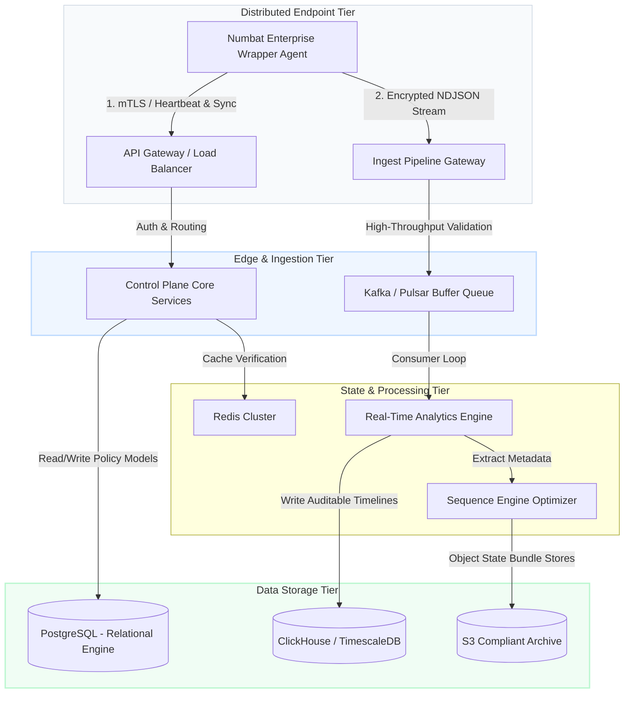
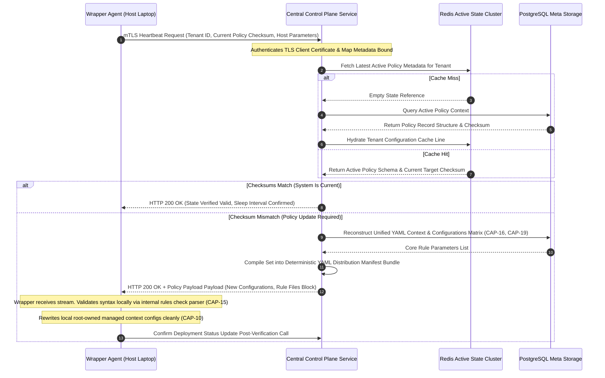

# Architecture Design Document: Numbat Enterprise Central Server

This document outlines the system architecture, database schemas, API contracts, and sync protocols for the Centralized Enterprise Management Plane designed to control, version, and ingest telemetry from a fleet of distributed Numbat Enterprise Agents.

---

## 1. System Architecture Blueprint

The centralized server acts as a multi-tenant, horizontally scalable Control Plane and Ingest Pipeline. It manages policy distributions, collects system telemetry, and maintains deterministic state across thousands of endpoints.



## Architecture Subcomponent Reference Matrix

This matrix explains the functional role of each distributed subcomponent in a high-volume, multi-tenant enterprise control plane. Use this to perform a gap analysis against your existing Git AI backend infrastructure to determine which components add net-new value.

| Subcomponent Name               | Functional Role / Simple Terms Description                                                                                      | Engineering Purpose & Core Customer Value Justification                                                                                                                                       |
| :------------------------------ | :------------------------------------------------------------------------------------------------------------------------------ | :-------------------------------------------------------------------------------------------------------------------------------------------------------------------------------------------- |
| **Ingest Pipeline Gateway**     | The "front door" API endpoint that receives HTTPS telemetry streams from the host wrappers deployed across the developer fleet. | Handles edge perimeter network security, rate-limiting, and tenant routing. It ensures malformed or malicious network payloads are dropped before hitting internal services.                  |
| **Kafka / Pulsar Buffer Queue** | An asynchronous distributed messaging layer that acts as a "shock absorber" for high-frequency logs.                            | Prevents backend crashes during sudden traffic spikes (e.g., thousands of developer agents triggering concurrent workspace index operations). It decouples ingestion from storage processing. |
| **Redis Cluster**               | An ultra-fast, in-memory cache and ephemeral key-value store.                                                                   | Manages real-time state flags, distributed locks, client rate-limiting variables, and caches dynamic YAML validation hashes to eliminate heavy database lookups.                              |
| **Real-Time Analytics Engine**  | A stream-processing microservice (e.g., Flink or internal workers) that scans incoming logs immediately.                        | Evaluates multi-host sequence correlations and immediately dispatches critical alerts to enterprise SIEM platforms when high-risk patterns emerge.                                            |
| **Sequence Engine Optimizer**   | A memory-efficient state manager dedicated to evaluating cross-session and cross-agent threat timelines.                        | Links decoupled data nodes together. It tracks temporal conditions (e.g., Agent read file, then executed network request 4 minutes later) across distributed sessions.                        |
| **PostgreSQL (Relational)**     | The transactional database engine acting as the global system ledger.                                                           | Serves as the single source of truth for high-integrity corporate structures: tenant accounts, configuration profiles, metadata registries, and policy catalogs.                              |
| **ClickHouse / Columnar DB**    | A high-density columnar analytics database optimized for lightning-fast lookups on raw text fields.                             | Drastically reduces operational cost. Relational databases choke on billions of raw string logs; ClickHouse compresses telemetry data up to 10x and enables sub-second lookups.               |
| **S3-Compliant Archive**        | Long-term, cold-tier blob storage (e.g., AWS S3, MinIO) for immutable audit data.                                               | Delivers legal compliance and forensic durability. Offloads historic data from active databases into cheap, durable storage blocks to satisfy retention requirements.                         |

---

## 2. Capability Mapping Matrix & Relational Storage Layout

To handle the 21 unique core capabilities natively surfaced by the Numbat binary engine, the database translates runtime parameters into deterministic, versioned capabilities.

### Capability Enforcement & Engine Registry

| Capability ID | Feature Group                    | Storage Optimization Target                   | Engine Vector Mode      |
| :------------ | :------------------------------- | :-------------------------------------------- | :---------------------- |
| **CAP-01**    | Dual Active/Passive Ingestion    | PostgreSQL (Policy) / ClickHouse (Logs)       | Hooks & OTLP Streams    |
| **CAP-02**    | Ultra-Low Latency Execution      | Cache Validation Bypass (Client-Side Only)    | Local CEL Runner        |
| **CAP-03**    | Integrated Secret Redaction      | Regular Expression Token Vault (PostgreSQL)   | Masked Stream           |
| **CAP-04**    | Broad Agent & Surface Matrix     | Surface Matrix Enumeration Catalog            | multi-surface Plugin    |
| **CAP-05**    | Unified Event Normalization      | Standardized JSONB Document Schema            | Structural Normalizer   |
| **CAP-06**    | Multi-Step Dynamic Sequences     | Graph Database / Stateful Session Cache       | Sequence Manager        |
| **CAP-07**    | Universal Path Abstraction       | OS Invariant Profile Regex Patterns           | Path Normalizer         |
| **CAP-08**    | 52 Production-Ready Rules        | Rule Registry Table (Versioned UUID)          | Embedded Catalog        |
| **CAP-09**    | Contextual Metadata Logging      | Partitioned Columnar Timeline Storage         | Rich Schema             |
| **CAP-10**    | Machine Policy Configuration     | Target Machine Profile Schema                 | Managed Deployment      |
| **CAP-11**    | At-Least-Once Local Shipping     | Transaction Log Idempotency Cache             | Local Tail Sync         |
| **CAP-12**    | MCP Integration Mapping          | JSON Schema Registry for Extensions           | Protocol Parser         |
| **CAP-13**    | Fail-Closed Execution Safeguard  | Dead-letter Circuit Breaker Flags             | Metric Watcher          |
| **CAP-14**    | Content Access Control           | Boolean RBAC Permission Matrices              | Payload Gate            |
| **CAP-15**    | Idempotent Deployment Loop       | State Machine Verification Hashes             | Deployment Orchestrator |
| **CAP-16**    | Policy Isolation Topology        | Tenant-Isolated Virtual Policy Layers         | Rule Concatenation      |
| **CAP-17**    | Authenticated Data Transport     | Key Management System (KMS) Vault             | HMAC/mTLS Sync          |
| **CAP-18**    | Egress Volumetric Guardrail      | Rate Limiting Bucket Configurations           | Circuit Breaker         |
| **CAP-19**    | Targeted Policy Hot-Swaps        | Version Override Registry Table               | Dynamic ID Replacement  |
| **CAP-20**    | Static Dependency Free Footprint | Binary Fingerprint Manifest Store             | Compliance Engine       |
| **CAP-21**    | Bandwidth Optimization Mode      | Compression Strategy / Thin-Telemetry Toggles | Indicator Stream        |

---

## 3. Database Schema Blueprint (PostgreSQL DDL)

The data model enforces strict multi-tenant schema design patterns to track client registration, policy versions, rule configurations, and individual engine capabilities.

```sql
-- Core Tenants Initialization
CREATE TABLE enterprise_tenants (
    tenant_id UUID PRIMARY KEY DEFAULT gen_random_uuid(),
    company_name VARCHAR(255) NOT NULL,
    created_at TIMESTAMPTZ DEFAULT CURRENT_TIMESTAMP NOT NULL
);

-- Capability Master Enumeration Catalog
CREATE TABLE capabilities_catalog (
    capability_code VARCHAR(50) PRIMARY KEY, -- e.g., 'CAP-01'
    feature_name VARCHAR(100) NOT NULL,
    description TEXT,
    engine_vector VARCHAR(50) NOT NULL
);

-- Versioned Policies Container
CREATE TABLE versioned_policies (
    policy_id UUID PRIMARY KEY DEFAULT gen_random_uuid(),
    tenant_id UUID REFERENCES enterprise_tenants(tenant_id) ON DELETE CASCADE,
    version_major INT NOT NULL,
    version_minor INT NOT NULL,
    version_patch INT NOT NULL,
    is_active BOOLEAN DEFAULT FALSE NOT NULL,
    checksum_sha256 CHAR(64) NOT NULL,
    created_by VARCHAR(255) NOT NULL,
    created_at TIMESTAMPTZ DEFAULT CURRENT_TIMESTAMP NOT NULL,
    UNIQUE(tenant_id, version_major, version_minor, version_patch)
);

-- Individual Rule Matrix (Compiled to Numbat YAML)
CREATE TABLE policy_rules (
    rule_id UUID PRIMARY KEY DEFAULT gen_random_uuid(),
    policy_id UUID REFERENCES versioned_policies(policy_id) ON DELETE CASCADE,
    numbat_rule_id VARCHAR(255) NOT NULL, -- e.g., 'persistence.ssh_authorized_keys'
    rule_version VARCHAR(50) NOT NULL,
    severity VARCHAR(50) CHECK (severity IN ('low', 'medium', 'high', 'critical')) NOT NULL,
    enforcement_mode VARCHAR(50) CHECK (enforcement_mode IN ('monitor', 'enforce')) NOT NULL,
    cel_expression TEXT NOT NULL,
    created_at TIMESTAMPTZ DEFAULT CURRENT_TIMESTAMP NOT NULL
);

-- Capability Settings/Overrides Per Active Policy
CREATE TABLE policy_capability_configurations (
    config_id UUID PRIMARY KEY DEFAULT gen_random_uuid(),
    policy_id UUID REFERENCES versioned_policies(policy_id) ON DELETE CASCADE,
    capability_code VARCHAR(50) REFERENCES capabilities_catalog(capability_code),
    configuration_payload JSONB NOT NULL, -- Holds flags like allowConversationAccess, etc.
    updated_at TIMESTAMPTZ DEFAULT CURRENT_TIMESTAMP NOT NULL
);

-- Managed Fleet Nodes Registry
CREATE TABLE registered_endpoints (
    endpoint_id UUID PRIMARY KEY DEFAULT gen_random_uuid(),
    tenant_id UUID REFERENCES enterprise_tenants(tenant_id),
    hostname VARCHAR(255) NOT NULL,
    os_type VARCHAR(50) NOT NULL,
    hardware_architecture VARCHAR(50) NOT NULL,
    current_assigned_policy_id UUID REFERENCES versioned_policies(policy_id),
    last_heartbeat TIMESTAMPTZ,
    agent_wrapper_version VARCHAR(50) NOT NULL,
    numbat_binary_checksum CHAR(64) NOT NULL
);
```

---

## 4. Operational Ingestion Telemetry Schema (ClickHouse DDL)

High-volume output datasets generated by Numbat’s normalized JSON stream are written straight to structured, partitioned database partitions to provide near zero-latency analytical queries for the security operations terminal.

```sql
CREATE TABLE numbat_telemetry_ingest (
    tenant_id UUID,
    endpoint_id UUID,
    timestamp DateTime64(6, 'UTC'),
    record_type Enum8('event' = 1, 'finding' = 2, 'enforcement' = 3),
    event_id String,
    session_id String,
    run_id String,
    source_agent String,
    source_type LowCardinality(String),
    observed_actor Enum8('unknown' = 0, 'user' = 1, 'assistant' = 2),
    tool_name LowCardinality(String),
    observed_command String,
    target_path String,
    matched_rule_ids Array(String),
    decision LowCardinality(String),
    severity LowCardinality(String),
    redacted Boolean,
    payload_json JSON
) ENGINE = MergeTree()
PARTITION BY toYYYYMM(timestamp)
ORDER BY (tenant_id, record_type, timestamp, endpoint_id);
```

---

## 5. Synchronization Protocol Sequence (Agent to Server)

The distributed secure sync model controls configuration management tasks securely, safely applying code transformations to endpoints over public transport networks without disrupting code execution profiles.



---

## 6. API Transport Contracts & Control Actions

### A. Endpoint Synchronization Inbound Hook (`POST /api/v1/fleet/sync`)

**Request Payload From Wrapper Agent:**

```json
{
  "tenant_id": "8f3b6d0c-fa24-42b7-84bc-de903a2a34f8",
  "endpoint_id": "c1be6f0c-659d-060e-7c99-3a73fa0a4148",
  "metadata": {
    "hostname": "dev-workstation-09",
    "os": "darwin",
    "architecture": "arm64",
    "wrapper_version": "v1.4.2",
    "numbat_checksum": "6780eeb53603bd5da1c0ec3e25d9e94d8be668392f24def8903a2a34f8e3fcb0"
  },
  "current_policy": {
    "version": "2.4.1",
    "checksum_sha256": "e3b0c44298fc1c149afbf4c8996fb92427ae41e4649b934ca495991b7852b855"
  }
}
```

**Response Payload (When Updates are Present):**

```json
{
  "status": "UPDATE_REQUIRED",
  "target_policy": {
    "version": "2.5.0",
    "checksum_sha256": "4a21d1b95f2d34e89bcdef3421a71c3b123456789abcdef123456789abcdef12"
  },
  "capabilities_overrides": {
    "CAP-14": { "allowConversationAccess": false },
    "CAP-18": { "max_payload_size_mb": 64 }
  },
  "rules_bundle": [
    {
      "id": "persistence.ssh_authorized_keys",
      "version": "1.4",
      "severity": "high",
      "enforce": true,
      "expr": "event.event_type == 'file.write' && event.target_path.endsWith('authorized_keys')"
    },
    {
      "id": "exfiltration.secret_leak",
      "version": "2.1",
      "severity": "critical",
      "enforce": false,
      "expr": "event.event_type == 'network.indicator' && (event.tags.contains('attack.t1048') || event.url.contains('collector.invalid'))"
    }
  ]
}
```

---

## 7. Edge Cases & Fault Recovery Models

- **Offline Mode Execution Resiliency (CAP-11):** If the agent experiences transient network issues or is operating in a disconnected environment, the wrapper agent relies on its **local hardware-backed SQLite and transactional filesystem cache** to accumulate logs. It maintains enforcement rules using the last known active policy, completely bypassing network sync checks until a secure connection is re-established.
- **Race Conditions on Rule Evaluation Updates (CAP-15 / CAP-19):** To prevent local AI agent tool requests from failing or running without protection during a security policy transition, the wrapper uses **atomic pointer swaps** during configuration loads. The new rule matrix is compiled and verified in an isolated memory buffer. The engine switches context only after the new manifest passes local compliance parsing checks (`numbat rules check`), ensuring zero downtime or protection gaps.
- **Volumetric Telemetry Throttling Circuit Breaker (CAP-18 / CAP-21):** If a misconfigured local agent enters an infinite tool-call execution loop, it can generate an overwhelming volume of log data. The local wrapper monitors throughput thresholds. If event frequency exceeds standard developer norms, the wrapper automatically triggers a local throttling policy. It scales down logging configurations dynamically by activating thin metric reporting (`--emit indicators`), protecting the centralized server's ingestion gateway from getting DDOSed by its own clients.

---

This document serves as the implementation blueprint for the software engineering team building the enterprise-grade central infrastructure plane.
