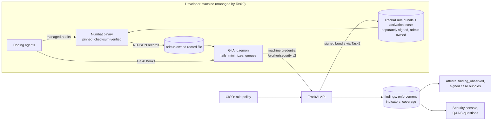

# Numbat adoption review

*Written 2026-10-16 by the Task19 lead (Claude), at the founder's request (T19.7, Task6 strategy). Sources: Numbat at `perplexityai/numbat` `20a5a52` (2026-10-15; `git describe`: `v0.2.0-14-g20a5a52`, i.e. **14 commits after the last release, unreleased**), its `docs/` and `rules/`; the founder's four primers in `docs/founder/`; TrackAI `main` at `67c903f`; GitAI fork `main` at `d1838619c`. Numbat's code and docs are the authority; the primers are input. The founder approved §10 on 2026-10-16, with the refinements in §13; this is now the decision record for Task20.*

## 1. Bottom line

**The founder is right on the main point.** Numbat has already done most of the engineering that Task6.a's review called hard: parsing shell commands, handling paths across operating systems, adapters for many agents, multi-step sequences, a rule test framework, and CI on macOS, Linux and Windows. TrackAI should **run Numbat itself on the developer machine**, as it runs Git AI, and add the enterprise layer around it. It should not re-implement Numbat rules inside GitAI.

The primers overstate some things, and a few claims in them are wrong (§3). Four limits matter for the plan:
- **Blocking is fail-open and host-dependent.** Numbat asks the agent to deny; it is a guardrail, not a security boundary.
- **OpenCode is monitor-only in Numbat.** It is the only route TrackAI validated in Task6.a.
- **Records carry redacted commands, paths, URLs, hostnames and usernames.** That collides with TrackAI's raw-content rule (AGENTS.md rule 6) and needs a founder decision.
- **Numbat is young and moves fast.** Its first commit was 2026-07-29; the schema went from 0.2 to 0.5 in eleven weeks, and the version reviewed here (`20a5a52`) is 14 commits past the last release (v0.2.0).

**Task6.a is not all throw-away.** Its server side carries over:
- the findings table and the `/worker/security` route;
- tenant activation and audit;
- admin and auditor access;
- the privacy and honest-state wording.

So does GitAI's delivery queue. What is replaced is the GitAI rule evaluator (`src/security/mod.rs`, about 900 lines) and the plan for "rule wave 2" (gap G9).

## 2. What Numbat is, verified against its code

| Area | Fact | Where |
|---|---|---|
| Shape | One Go binary (no cgo), Apache-2.0, about 47,000 lines of Go plus 150 test files; CI on Ubuntu, macOS and Windows | `go.mod`, `.github/workflows/ci.yml`, `LICENSE` |
| Inputs | Three: on-disk session artifacts (`scan`, `timeline`), synchronous hooks or generated plugins (`hook install`), and OTLP/HTTP logs (`collect`; logs only, not traces or metrics) | `README.md`, `docs/agent-coverage.md` |
| Agents | **27** in the coverage matrix. Hooks for nearly all of them; enforcement on 25 (not Claude Cowork or OpenCode). Unsupported today: Zed/ACP hosts, Aider, Trae, Continue CLI, Codebuff | `docs/agent-coverage.md` "Matrix", "Evaluated but unsupported" |
| Managed (admin-owned) install | 8 agents: Claude Code, Codex, Cursor, Copilot CLI, Gemini CLI, Windsurf, Qwen Code, Auggie. Not OpenCode | `docs/agent-coverage.md` "Managed hooks" |
| Event model | Closed vocabulary (`command.exec`, `file.read/write/delete`, `network.indicator`, `tool.call`, results, `permission.*`, prompt and assistant messages, `config.mcp`). Semantic paths use `/` on every OS | `docs/event-model.md`, `docs/schema/v0.5.0/` |
| Rules | **51** built-ins in 12 groups. Each is YAML plus a CEL expression or a `sequence`, with companion tests (`numbat rules test`). All ship monitor-only | `rules/*/*.yaml`, `docs/rule-catalog.md`, `docs/rules.md` |
| Command understanding | `shell_commands`, a parsed view of the command for POSIX shells, PowerShell and cmd (`mvdan.cc/sh`). Blocking uses a stricter static subset | `docs/rules.md` "Parsed command rules", `docs/enforcement.md` |
| Paths | `canonical_path()`, plus Windows and macOS spellings written into the rules | `docs/rules.md` |
| Sequences | Ordered steps within `within` (time) or `within_events` (up to 4096). Hook callbacks persist the window in `~/.numbat/state.db`. Only the final step can be blocked | `docs/rules.md` "Sequence rules" |
| Blocking | Per rule (`enforce: true`), through operator rules that replace a built-in of the same id; only on synchronous pre-action hooks. **Fail-open:** any error withholds the deny. The host makes the final decision | `docs/enforcement.md` |
| Output | Versioned NDJSON records: event, finding, enforcement, indicator, diagnostic, scan summary (schema 0.5.0) | `docs/schema/v0.5.0/` |
| Delivery | Direct HTTP is best-effort (no disk queue). `numbat ship` tails the file with a checkpoint and delivers at least once (bearer or HMAC) | `docs/cli.md` "ship" |
| Content | The default is redacted previews of at most 200 characters; `--content full` adds redacted bodies, `--content raw` unredacted ones. Redaction "is not a declassification boundary". Project-path hashes are unsalted | `docs/cli.md`, `SECURITY.md` |
| Investigation | `agents` (read-only inventory), `timeline`, and `case build`/`verify` (bundles with SHA-256 manifests). Unsigned bundles do not prove authenticity | `README.md`, `docs/cli.md` |
| Tamper resistance | None of its own. User-scope hooks and outputs can be edited by the user; managed scope protects only the policy file | `docs/deployment.md` "Fleet rollout" |
| Fleet | Explicitly out of scope: "the endpoint platform remains responsible for binary distribution, target selection, re-running installs, injecting sink credentials, and supervising `ship`" | `docs/deployment.md` |

## 3. Corrections to the primers

| Primer claim | What the code and docs say |
|---|---|
| 52 rules | 51 (`rules/*/*.yaml`) |
| "55–60% of rules can block" | Not a Numbat figure. **Any** rule can be set to `enforce: true`. Whether it blocks depends on the **surface**: a synchronous pre-action hook can, while OTLP and at-rest scans never can. Shell-based rules block only inside the static subset, and a sequence blocks only at its final step |
| Example rule using `event.target_path` and `file.write` | The field is `file_path`. The real rule matches `canonical_path(event.file_path)` against the macOS, Linux and Windows spellings of `authorized_keys` (`rules/persistence/ssh_authorized_keys.yaml:10-13`). Many other rules are far longer, because they encode false-positive exclusions (`rules/chains/secret_read_then_egress.yaml`) |
| Aider, VS Code Continue/RooCode, "OpenAI Codex Security CLI" supported | Aider and Continue CLI are listed as **unsupported**. Roo is not listed. Codex is supported as one agent (app, CLI and IDE share a root) |
| Windsurf monitor-only; OpenCode a gateway with full monitoring | Windsurf **can** enforce. OpenCode is a local plugin and **monitor-only**, with no managed install |
| "Fail-closed execution safeguard, 10-second deadlines" | Numbat is **fail-open** by design. The 9/10-second note is OpenClaw-specific |
| `allowConversationAccess` as a general content gate | It is an OpenClaw setting. The general controls are `--content preview|full|raw` and `--content-scope` |
| Observability fields `context_data.prompt`, `reasoning_steps`, `result.status`, `output_preview` | They do not exist. The real fields are `content`/`content_preview` (prompts and assistant text, opt-in), `tool_input`/`tool_result` (opt-in bodies), `exit_code`, `duration_ms`, `model`, `approval_*`, `permission.*` events and `git_branch` |
| "Drops payload when offline" (enterprise primer) | True for direct HTTP only. `numbat ship` is at-least-once with a checkpoint |
| Kafka, ClickHouse, Redis, mTLS server tier | Not needed at TrackAI's scale. Postgres, Task4's machine credentials and Task9's fleet cover it (the founder already agrees) |
| No-code rule builder; "simulate before enforcing" | Both are feasible and valuable. Simulation needs stored events (privacy trade-off, §10 Q4) or a local replay with `numbat rules test` |

## 4. Why Task6.a stayed small, and what Numbat changes

Task6.a's approved review (`docs/TASK6_SECURITY_REMAINING_RULE_REVIEW.md`) deferred 48 of Numbat's 51 rules. Set against Numbat's code:

| Codex's reason | Rules | Does Numbat solve it? |
|---|---|---|
| Multi-step tracking | 6 | **Yes:** the sequence engine and persisted hook state |
| Command understanding | 15 | **Yes:** `shell_commands` for POSIX, PowerShell and cmd, with a static enforcement subset |
| Path handling across platforms | 10 | **Yes, largely:** `canonical_path` and per-OS patterns in the rules. Symlinks and variables are still not resolved, by design |
| Better agent evidence | 8 | **Yes:** 27 agent adapters instead of one (OpenCode) |
| Looks like normal development | 7 | **No.** This is product policy, not engineering. `secrets.agent_read_env` fires on ordinary `.env` reads, and `persistence.git_hook_write` would fire on **Git AI's own hook installs**. TrackAI must tune these per tenant (enable, severity, allow-lists) |
| Needs Numbat state or blocking | 2 | **They become meaningful** once Numbat itself runs (`tamper.detector_state_write`, `tamper.guardrails_off`) |

So about 39 of the 48 deferrals were engineering gaps that Numbat closes; 7 remain policy questions. The mistake was the approach (re-implement in Rust from the rule catalog page), not Codex's caution, which was right for that approach.

**What carries over from Task6.a:**

| Part | Keep? |
|---|---|
| Server: `security_findings` table, `/worker/security`, tenant monitor setting, admin and auditor reads, audit events, alert wording | **Keep and widen.** A new contract version and a migration lift the three-rule check constraint (`schema.ts:525-533`) |
| GitAI: `src/security/activation.rs`, `delivery.rs`, `delivery_queue.rs` (about 1,200 lines) | **Keep.** They become the shipper for Numbat records |
| GitAI: `src/security/mod.rs` evaluator (912 lines) and its three rules | **Retire** once Numbat covers them |
| Task6.a contracts `docs/contracts/task6/` | Frozen; superseded by a new version, never edited |
| Gap G9 "rule wave 2" | **Cancelled:** replaced by adopting Numbat's catalogue |

## 5. Proposed architecture (for discussion)

1. **Numbat runs unmodified.** It is a pinned upstream release (or a reproducible build of a pinned tag from a TrackAI mirror), distributed by Task9 with its checksum verified, and installed with `--managed` where the agent supports it.
2. **GitAI is the shipper, not `numbat ship`.** GitAI already has the machine credential, the durable queue and activation (Task4, Task6.a). It tails the record file and applies the tenant's **data-minimization policy before upload** (§10 Q1), then sends records to a v2 `/worker/security`. There are no new endpoint secrets: `NUMBAT_HTTP_TOKEN` is never used.
3. **Policy is Numbat's own rule format.** TrackAI policy means:
   - which built-ins are enabled;
   - severity overrides;
   - allow-lists;
   - which rules enforce, on which agents;
   - customer rules (`acme.*`).

   It compiles to a rules directory, signed with the platform `policy_bundle` key of Attesta's trust layer (A15.12) and placed admin-owned and read-only by Task9. Activation is a separate, per-machine `activation_lease` (D6.1), which also carries the security data settings (§14). This replaces most of Task6.b's design (`TASK6_POLICY.md`).
4. **The server stores findings, enforcement decisions, indicators and coverage.** Raw events are not stored by default. Attesta signs `finding_observed` statements (Task15o), designed against **Numbat's finding schema**, not Task6.a's.
5. **Git AI and Numbat keep separate hooks** in the same agents: attribution and security respectively. Both must be measured for latency, since each agent tool call launches two short processes.

## 6. What Numbat makes possible (proposed features and CISO questions)

New or much stronger answers for `CUSTOMER_AUDITOR_QA.md` (numbering is the lead's proposal, to be ranked with the founder):

| # | Question a CISO would ask | Numbat source | Value |
|---|---|---|---|
| S19 | **Which AI agents are installed on our machines, which versions, and which are unapproved (shadow AI)?** | `numbat agents` inventory | High: day-one visibility, before any hook |
| S20 | **Were we already exposed before TrackAI arrived?** A retroactive scan of existing session artifacts at enrolment | `numbat scan` over at-rest artifacts | High: "day-one assessment" sales motion |
| S21 | Which agents run in **reduced-approval or bypass modes**, and how often? | `tamper.guardrails_off`, `exec.agent_runtime_bypass_flags`, `permission.*` | High |
| S22 | Which **MCP servers** are configured and used, and did any send data out? | `config.mcp`, `mcp_server`/`mcp_tool`, the egress sequences | High: MCP supply chain |
| S23 | Which **external domains and URLs** did agents reach, and do any match threat intelligence? | `--emit indicators` (deduplicated, redacted) | Medium–high |
| S24 | What did we **block**, under which policy version, and what did the developer do next? | enforcement records plus later events | High, after the enforce pilot |
| S25 | Give me a **signed incident case** for session X | `numbat case build` plus Attesta signing | High: Numbat says unsigned bundles prove nothing, and Attesta fills exactly that gap |
| S26 | How often do agents **ask permission**, how often are they denied, and how long does approval take? | `permission.requested/approved/denied` | Medium: both a security and a productivity signal |

The existing rows change too:
- **S3 and S4** (tampering; secrets read, then egress) move from "not captured" to answerable, through Numbat's tamper, secrets, exfiltration and chain rules.
- **S9** (platforms) becomes macOS, Linux and Windows once Task9 ships Numbat there.
- **S12** (blocked) becomes real once the enforce pilot runs.

## 7. Observability and Task13: what is real

- **Real:** events give the agent, model, tool, `exit_code`, `duration_ms`, approvals and permission events, and session/sub-agent identity across 27 agents. That supports content-free metrics:
  - tool-failure and retry loops (the same command failing repeatedly in one session);
  - approval friction;
  - model and agent usage;
  - an agent census.

  These feed Task5 and Task10 dashboards and Task13's coverage picture.
- **Not real:** line-level AI attribution. Numbat sees "agent wrote file F" (with `diff_sha256` and `diff_bytes`), not which lines ended up in a commit. **Git AI stays the attribution engine.** Where Git AI has no preset for an agent that Numbat supports, Numbat can at least say "agent X edited files in this repository at time T": a coverage signal for Task13, not attribution.
- **Privacy:** prompt-text analytics (the observability primer's use case 3) conflicts with rule 6 and the no-surveillance rule. Keep it out.

## 8. Modular product (the vision's new requirement)

The proposal is one endpoint agent (the GitAI fork) with **modules switched on per tenant**: attribution, evidence, security (Numbat) and Attesta. Server routes and console sections are gated by a tenant **entitlement** catalogue (CF-1 pattern).
- **Security-only:** GitAI runs as shipper and fleet agent with attribution off. Numbat plus GitAI's queue is all that is needed on the machine.
- **Attesta:** signs whichever modules are on (code statements, finding statements, audit seals).

Entitlements are new cross-cutting work. They touch Task4 (tenant model), Task8 (onboarding), Task9 (endpoint config), Task10 (console) and Task14. The plan should give them an owner.

## 9. Effect on other Tasks

| Task | Change |
|---|---|
| Task6.a | Server and GitAI queue reused; the evaluator retired; G9 cancelled; the support boundary (AGENTS.md §9 item 11) rewritten when the new route is validated |
| Task6.b | Re-scoped: policy is Numbat rule bundles (`policy_bundle` signature) plus the D6.1 activation lease (`activation_lease` signature), signed and verified separately (§14). The Cedar/OPA design is shelved unless a customer needs it |
| Task9 | Ships and updates the Numbat binary, managed hook installs, the rule bundle and an admin-owned output path; adds health checks (Numbat's "four-layer" check) |
| Task13 | Uses Numbat's coverage matrix for security coverage and `numbat agents` for inventory; Git AI presets stay the attribution coverage |
| Task15 | **Task15o waits:** `finding_observed` and `security-finding/v1` must be designed against Numbat's finding schema. Task15p follows. Signed case bundles become a new Attesta item |
| Task16 | Audit events for policy publish, activate and acknowledge are already reserved; add the enforce-mode change |
| Task19 | T19.4 (live security answers) and gap dispatch for G7, G8 and G10 **pause** until the Numbat ingest contract exists. S19–S26 are added after ranking. Code questions (Task19b) are unaffected |
| Task5, Task10 | Content-free agent activity metrics (phase 2) |

## 10. Decisions for the founder (brainstorm)

| # | Question | Lead's recommendation |
|---|---|---|
| Q1 | **What may leave the machine?** Numbat findings carry redacted command previews, file paths, URLs, hostname and username | Per-tenant setting, applied in GitAI before upload. **Default:** findings and enforcement records with rule, agent, model, session, repository, OS and **redacted** command/path/URL previews (needed for a usable incident register); hostname and username replaced by TrackAI's machine id. Indicators on. Raw content and full bodies never uploaded (Task5's reveal stays the only path). This is a deliberate, founder-approved change to rule 6's scope for security findings |
| Q2 | Shipper: GitAI daemon or `numbat ship`? | **GitAI daemon** (existing credential, queue, activation, minimization) |
| Q3 | Fork or synced clone? | **A mirror fork with no product changes:** reproducible builds of pinned upstream tags, fixes sent upstream, TrackAI glue kept outside Numbat. Upstream moves too fast for a divergent fork |
| Q4 | Upload full events (enables simulation and observability)? | **Not in phase 1.** Findings, enforcement, indicators and scan summaries only. Content-free event metrics in phase 2 |
| Q5 | Retroactive scan at enrolment (S20)? | **Yes**, opt-in per tenant, findings only |
| Q6 | Which agents and platforms first? | **Claude Code, Codex, Cursor, Copilot CLI, Gemini CLI** (managed install, enforcement capable) on **macOS first**, then Windows and Linux with Task9f/9g. OpenCode stays monitor-only |
| Q7 | Blocking | Monitor first; then an **enforce pilot** of 3–5 high-signal rules (e.g. `persistence.ssh_authorized_keys`, `exec.reverse_shell`, `exec.download_pipe_shell`) on managed hooks, with rollback through Task9 |
| Q8 | Where does this work live? | **A new Task ("Task20 Numbat security subsystem")**, Claude leading, with Codex on GitAI and the server. It supersedes Task6.a's rule work, G9 and most of Task6.b. Task19 keeps the Q&A and reviews |
| Q9 | Modular entitlements (§8) | Accept the principle now; give it an owner in the Task20 plan (likely a small cross-cutting session in Task4/Task8) |
| Q10 | What to pause now | Pause Task15o/15p design, T19.4 and the G7/G8/G9/G10 gap sessions. Continue Task19b (code answers), Task15n and Task16 |

## 11. Risks

1. **Upstream churn.** Numbat is pre-1.0. The last release, v0.2.0 (2026-08-17), carries record schemas 0.2 and 0.3 only. The 14 commits since (to `20a5a52`) add schemas 0.4 and 0.5 and change content retention (#64), enforcement (#66, #70), path handling (#69) and `ship` (#56). **This review describes `20a5a52`, not v0.2.0.** Ingest must accept versioned records and pin a tested range.
2. **Coexisting hooks.** Two hooks per tool call (Git AI and Numbat) add latency and can conflict in agent settings files. This needs a measured budget (AGENTS.md §9 item 7 spirit).
3. **Noise.** Several built-ins fire on normal development, Git AI's own hook installs included. A default TrackAI policy must ship tuned, or the first customer sees false alarms.
4. **Tamper resistance** is only as good as managed scope and Task9's file permissions. Wording must stay honest: "observed", "requested", "denied by request", never "prevented".
5. **Licence and branding.** Apache-2.0 allows redistribution with the licence and notices (`docs/TASK6_SECURITY_NUMBAT_LICENSE_PLAN.md` needs updating for binary redistribution). It grants no trademark: say "powered by Numbat (Apache-2.0)", not that TrackAI is Numbat.

## 12. Next step

After the founder's answers to §10, the lead writes the Task20 primer (`docs/plan/primers/Task20_PRIMER.md`): subtasks, sizes, the sub-task graph and owners. The founder marks it up, then the plan is written as for Task19. Codex reviews the GitAI and server parts, because it owns Task6.a and GitAI.

## 13. Founder decisions (2026-10-16)

1. **§10 Q1–Q10 approved as recommended,** with the refinements below. The pause and continue list in Q10 stands.
2. **Monitor mode is the product.** Blocking is opt-in, one rule at a time, because false positives and interruptions cost developers time. Fail-open is accepted.
3. **What leaves the machine (Q1)** is built as a **per-tenant on/off setting** for each field group (command, path, URL previews; host identity). The default is decided later. Until then the build ships the most conservative setting: no previews, and host identity replaced by TrackAI's machine id.
4. **Upstream cadence:** sync **once a month** through the mirror fork (Q3). **The pin (Codex review, 2026-10-16):** v0.2.0 lacks schema 0.5 and the enforcement, path and content fixes this review relies on. So Task20 develops against the **audited commit `20a5a52`**, tagged in the mirror fork as `v0.2.0-trackai.1`. The first customer build moves to the first upstream release that contains `20a5a52`, after re-running Numbat's own tests and TrackAI's fixtures. If no such release exists by then, the build ships the mirror tag. **Founder confirmed 2026-10-16.**
5. **Rules, first wave:** the 42 rules (39 that Numbat's engineering unlocks plus the 3 already in Task6.a), using Numbat's own definitions. Task6.a's three Rust rules (`trackai.exec.*`) are **retired**, not kept. The 7 rules that look like normal development come in a later wave, so they do not add noise during TrackAI's own development. The 2 tamper rules (`tamper.detector_state_write`, `tamper.guardrails_off`) are in the first wave too (**founder, 2026-10-16: 44 rules**), because they are no longer noisy once Numbat runs and they answer S21.
6. **OpenCode:** not a serious enterprise route. Numbat's own OpenCode plugin gives monitor-only coverage of every rule, which is all Task6.a gave, so nothing of Task6.a is kept for it.
7. **Approvals are in scope from the start.** "Which rule-breaking actions did the developer approve?" is a key CISO question. This refines Q4: phase 1 uploads **content-free permission events** (`permission.requested/approved/denied`, `approval_*`) alongside findings, so a finding can be joined to the developer's decision where the agent supplies a per-action id.
8. **Rules policy UI:** the 51 built-ins are enough. **No customer-authored rules and no rule editor for now.** Admins manage the existing rules through toggles (on/off, severity, monitor/block per agent), never YAML.
9. **Task6.b is shelved** under the name `customerPolicyForDataAccess`, and so is its policy-distribution infrastructure (§14).
10. **Task13 is held** until Task20 is done. Then Task13 is revisited, including:
    - letting Git AI use Numbat's agent adapters and events for the attribution and evidence that other agents do not give Git AI today;
    - removing duplicate hooks;
    - linking findings to Git AI sessions through the shared agent `session_id`.
11. **Coverage inventory:** TrackAI keeps a running inventory of what Numbat supports per agent and platform, taken from Numbat's `docs/agent-coverage.md` at each monthly sync, rather than testing every agent itself.
12. **Task20 "Numbat security subsystem"** is created, Claude leading (Q8).

## 14. Glossary: which policy, which signing

**Policies.** Always name which one is meant.

| Name | What it is | Who sets it | Status |
|---|---|---|---|
| **Numbat built-in rules** | Numbat's 51 shipped rules (YAML and CEL), monitor-only | Numbat upstream | Adopted, pinned per monthly sync |
| **TrackAI security rule settings** | Per tenant: which built-ins are on, severity overrides, allow-lists, and monitor or block per rule and agent. The server compiles them into Numbat override files (same id, `enforce: true`, bumped version) | CISO, through toggles in the console | Task20 |
| **TrackAI security data settings** | Per tenant: which field groups leave the machine (§13 item 3) | CISO | Task20 |
| **`customerPolicyForDataAccess`** (was Task6.b) | Organization AI-usage policy: approved agents and models, a Cedar/OPA-style engine, exceptions | — | **Shelved** |

**Signing.** There are five different kinds; they are not the same thing.

| Kind | What is signed, by whom | Why | Owner |
|---|---|---|---|
| **OS code signing** | The GitAI and Numbat executables and installers: Apple Developer ID plus notarization, Windows Authenticode | macOS and Windows let them run without warnings or blocks | Task9 packaging, Task14 |
| **Build provenance** | TrackAI's release artifacts and SBOM (Sigstore-style) | A customer can check that TrackAI built what they install | Task14 (T14.7) |
| **Attesta statements** | Evidence about commits, merges, deployments, findings and audit seals, signed server-side with the tenant's keys and anchored in Rekor and a timestamp service | An auditor can prove the records were not changed later | Task15 |
| **Rule bundle signing** (`policy_bundle` key) | The compiled TrackAI security rule settings (Numbat override files and enabled set), signed by the server's platform `policy_bundle` key (A15.12) and verified by GitAI before install | A forged bundle cannot change rules. On `rejected`, refuse the bundle; on `unavailable`, keep last-known-good (`docs/contracts/attesta/trust.md` "Consumers") | Task20 |
| **Activation lease signing** (`activation_lease` key; this is D6.1) | Per machine: tenant, machine, agents, monitor or block mode, expiry, the rule bundle's digest, **and the TrackAI security data settings** (what may leave the machine), signed by the platform `activation_lease` key and verified by GitAI | A forged or edited lease cannot switch monitoring on or off, widen scope, or enable command, path or URL upload. On `rejected` or `unavailable`: stay off and upload nothing beyond the most conservative settings (fail closed) | Task20, on Task15's trust layer |
| **Case bundle signing** (S25) | The digest of a Numbat case bundle for one incident, as an Attesta statement | Numbat itself says unsigned bundles prove nothing | Task20 with Task15 |

Machine credentials (Task4) authenticate uploads; they are not signatures over content. Numbat's own HMAC upload option is not used.

**What D6.1 is, and how it fits (corrected after Codex's review, 2026-10-16).** Today the server tells GitAI "monitoring is on for this repository" through a short-lived value kept in memory (`docs/TASK6_SECURITY_ACTIVATION_REVIEW.md`). D6.1 makes that value a signed, machine-bound, expiring **activation lease**.

The frozen trust contract (`docs/contracts/attesta/trust.md` "Hierarchy" and "Consumers") deliberately gives `activation_lease`, `fleet_config` and `policy_bundle` **separate keys and separate failure rules**: a bad lease means off; a bad bundle means keep the last good one. So TrackAI keeps **two signed documents**, the rule bundle and the activation lease. They may travel in one Task9 delivery, but each is verified on its own, and the lease names the bundle digest it activates.

The **security data settings live inside the lease**, so a local edit cannot enable command, path or URL upload. The server also re-checks every upload against the tenant's current data settings and strips or refuses fields beyond them (AGENTS.md rule 9).

None of this needs Task6.b's distribution infrastructure: two small signed files, Task9's existing rollout channel, and Task15's existing trust layer.

## 15. Founder decisions, round 2 (2026-10-16)

1. **Numbat pin:** develop on the audited commit `20a5a52`; move to the first upstream release that contains it before the first customer build (§13 item 4). Confirmed.
2. **First wave: 44 rules** (§13 item 5). Confirmed.
3. **Binary sizes (measured on the founder's Mac):**
   - the installed GitAI fork binary is **69 MB** (`~/.git-ai/bin/git-ai`);
   - Numbat v0.2.0 for darwin/arm64 is a **6.2 MB** `.tar.gz` download. A static Go binary of this kind typically unpacks to about 3× that, so roughly 18–20 MB; Task20 measures it unpacked.

   Task20 sets a size budget and checks whether GitAI's release build is stripped of debug symbols.
4. **Task15n gate 6** (the Task6.a acceptance walkthrough) is **removed**. It validated Task6.a's OpenCode route and its three Rust rules, which Task20 retires, and Task15o now waits for Task20. Its replacement is Task20's own acceptance walkthrough on Numbat.
5. **Task9 manual validation is paused** where it covers the endpoint package and install. Task20 adds the Numbat binary, managed hooks and the two signed files to the package, so those checks are re-run once, after Task20's Task9 item. Task9 resumes from there. The Task9 lead (Codex) updates its own tracker.
6. **Task19b proceeds** (code questions). Task19a needs no change from the Numbat decision. Q11 (security findings behind code) moves from Task19b to Task19c, which waits for Task20's ingest contract.
