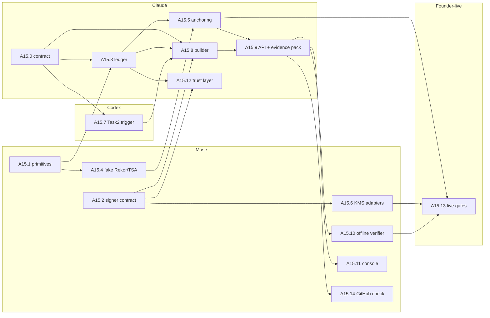

# Task15 — Attesta: signed AI-code provenance and the shared trust layer

*Tracker and plan. Written 2026-10-08 by TrackAI-Orchestrator from the founder's brief (`docs/founder/ATTESTA_BRIEF.md`), `docs/plan/REUSE_MAP.md` and the code. Symbols per AGENTS.md §11. The founder approved section 1 on 2026-10-08 (section 7).*

**In one paragraph.** For every commit and pull request TrackAI already knows, from Task2, which lines were AI-assisted, by which agent and model, in which session, and who committed. Who merged and which organization policy was in force are not captured yet (`merged_by`, gap G4; AI-usage policy, gap G2 in `docs/plan/CUSTOMER_AUDITOR_QA.md`), and their statement fields start as `unavailable`. Attesta turns that knowledge into **evidence a third party can check without trusting TrackAI**: a signed statement per commit and PR, kept in a tamper-evident ledger, timestamped by an independent authority and anchored in a public transparency log, and exportable as an evidence pack with an offline verifier. Attesta also owns the signer, key hierarchy, rotation and revocation that Task6 (signed activation, policy bundles), Task9 and Task14 reuse.

**Customer story.** Priya, CISO at Acme, gets a due-diligence questionnaire from an acquirer: "What share of your codebase was AI-generated, by which tools, and can you prove it?" She opens TrackAI, filters `payments-service` for the last 12 months, exports an evidence pack and sends it. The acquirer's counsel runs the included verifier on a laptop with no TrackAI account: every statement's signature checks out, nothing in the ledger was altered or removed, and each batch was timestamped and logged publicly at the time. What Priya still cannot claim after phase 1: that the attribution itself is correct beyond what TrackAI observed (honest states stay: observed, partial, Unavailable).

---

## 1. Business review of the brief (approved 2026-10-08)

The brief is strong on the wedge: generation-time provenance that scanners (SCANOSS, FOSSA, Sonar) cannot see, built on Sigstore rather than around it. Recommended changes:

| # | Brief says | Recommendation | Why |
|---|---|---|---|
| R1 | "tamper-proof chain of custody" | **"tamper-evident"** in all customer wording | Nothing prevents tampering; we detect it. Legal and insurance buyers read "proof" as a warranty. |
| R2 | Attests "which code was AI-assisted" | Attest **what TrackAI observed, with its completeness** (recorded / partial / Unavailable) inside each statement | Attestation proves a record is unchanged since a time, not that attribution is right. Carrying Task2's honest states into the statement keeps us credible with counsel and insurers. |
| R3 | Built for legal, security and M&A teams | **Lead with the CISO** (security budget, supply-chain programs already funded); package the same evidence for GRC and legal; M&A and insurers in later phases | Matches TrackAI's buyer; one evidence format serves all, the packaging differs. |
| R4 | EU AI Act Art. 53 and California AB 2013 | Do not headline them. Lead with **ISO/IEC 42001, SOC 2 change management, NIST SSDF (SP 800-218) / US secure-software attestation, SLSA**, and **customer-contract AI-disclosure clauses** | My reading (not legal advice): Art. 53 and AB 2013 put training-data documentation duties on model providers, not on companies whose developers use AI tools. Overclaiming a regulation is a credibility risk with exactly the legal buyers we want. Have counsel confirm before any marketing. |
| R5 | Competitors list | Add **GitHub** (native artifact attestations on Sigstore, Copilot audit logs) and **Git AI under OpenAI**; position Attesta as the **neutral, cross-vendor** witness | A model or platform vendor attesting its own output is weaker evidence than an independent party covering every agent and model; that neutrality, plus customer-verifiable output, is the moat. |
| R6 | Sigstore (cosign / Fulcio / Rekor) | **Sign with tenant-controlled keys** (KMS, no custody by TrackAI); **anchor only Merkle roots** to public Rekor plus an RFC 3161 TSA; keyless Fulcio optional later; private Rekor for Enterprise/Gov | Keyless signing writes signer identities (emails, org names) into a public log, and statements contain repository and developer data; neither may leak. SushiCorp's design already solved this (only a 32-byte root leaves the tenant). |
| R7 | Attesta CLI + IDE plugin for capture | **No new client.** Capture stays in Task2/GitAI (founder agreed); Attesta adds a **verifier** instead (standalone, later also `git-ai attesta verify`) | Saves a client to build and ship; the verifier is what outsiders need. |
| R8 | "risk scoring" | Phase 2, **transparent factors only** (AI share, review evidence present, policy in force, security findings), never an opaque score | An unexplained score invites dispute in diligence and conflicts with Task5's no-surveillance rule. |
| R9 | "reviewer evidence" | Needs PR review/approval events from the SCM, which Task2 does not capture today | New capture item for Task2/Task7 (Codex); until then statements mark reviewer evidence `Unavailable`. |
| R10 | SCANOSS/FOSSA enrichment | Phase 2, **opt-in per tenant**, fingerprints only (SCANOSS WFP), self-hosted engine for Enterprise | Sending code or fingerprints to a third party is itself a disclosure the CISO must approve. |
| R11 | Packaging | Attesta as a **TrackAI add-on tier** priced per active developer; the **verifier free and open** | A free verifier is the trust builder: anyone can check our evidence. |

**Phase 1 (this plan):** signed per-commit and per-PR statements for GitHub repositories, the ledger, TSA + Rekor anchoring, the Evidence API, evidence-pack export, the offline verifier, and the shared trust layer's first users. **Phase 2:** enrichment, transparent risk factors, M&A/insurer export formats, GitLab/Bitbucket (with Task7), private Rekor, keyless option.

## 2. Architecture decisions (orchestrator's call, as the brief asks)

1. **Statement:** an in-toto Statement v1 in a DSSE envelope. Subject: the git commit (`gitCommit` digest = commit SHA) and, for a PR, the merge commit plus PR reference. Predicate type `https://trackai.dev/attesta/ai-provenance/v1` (name final at A15.0). Compatible with `cosign verify-attestation`, Rekor `dsse` entries and SLSA tooling.
2. **Predicate content (start small, grow):** repository, commit/PR identity, committer and merged-by (pseudonymous IDs by default), agents, models and sessions involved, AI vs human line counts with availability, lifecycle stage, policy in force (Task4 repository policy; Task6 rule-pack version), digest of the GitAI authorship note, TrackAI evidence references. No raw prompts or code, ever.
3. **Signing:** server-side, per-tenant ECDSA P-256 key behind a signer contract ported from SushiCorp SG-1 (local dev signer refuses production; AWS KMS and Google Cloud KMS adapters; verify every signature before use). TrackAI holds no customer private key in production.
4. **Ledger:** Postgres, one hash chain per tenant, ported from SushiCorp EV-1 (gap-free `seq`, guard triggers, stored canonical bytes, structured verify report). Envelopes stored in the database (they are small); object storage (Task4's export sink) only for evidence packs.
5. **Anchoring:** ported from EV-2: batches of chain records → RFC 6962 Merkle root → RFC 3161 TSA token and a Rekor `hashedrekord` entry with a dedicated anchoring key; dual mode all-or-nothing; full proofs stored for offline checks.
6. **Trigger from Task2:** Task2 writes an `attesta_subjects` outbox row in the same transaction as the event it observes (commit observed with its note, PR merged, deployment); Attesta's worker builds, signs, chains and anchors asynchronously. Nothing on the ingestion path waits for signing. The outbox shape is the interface Attesta defines first (A15.0) and Codex implements (A15.7).
7. **Verification:** `GET` routes reachable by the auditor role; an evidence pack (statements, envelopes, chain segment, proofs, public keys, verifier) signed with the RP-1 statement pattern; a standalone verifier that exits 0 / 1 / 2 (ok / failed / not fully checkable).

## 3. Subtasks

Sizes against T6 (1.0× = all of Task6.a ≈ 4× SushiCorp S3). "Who": Claude, Muse, Codex, founder-live.

| ID | Subtask | Who | Size | Depends on | Status |
|---|---|---|---|---|---|
| A15.0 | Contract and design: predicate schema v1, subject and outbox interface for Task2, API routes, DB tables, error codes; frozen under `docs/contracts/attesta/` | Claude | 0.05× | founder buy-in | ✅ merged in PR #30 (contract `docs/contracts/attesta/`, outbox migration `0016`); IT-T15c-01 founder run pending |
| A15.1 | Primitives: RFC 8785 canonical JSON, RFC 6962 Merkle trees and proofs, DSSE envelope (PAE, sign/verify) with ported test vectors | Muse | 0.08× | — (now) | ✅ merged in PR #22 |
| A15.2 | Signer contract and local dev signer (SG-1 rev 1.1 translated), verify-before-use, error split | Muse | 0.05× | — (now) | ✅ merged in PR #23 |
| A15.3 | Ledger: migration, chain guard triggers (SECURITY DEFINER), sealing transaction, verify report, Company A/B isolation | Claude | 0.2× | A15.0, A15.1 | ✅ merged in PR #33 (migration `0017`, `ledger.ts`, `verify-chain.ts`); IT-T15d-01…04 passed 2026-10-12 |
| A15.4 | Fake Rekor and fake TSA as test specifications (ported behaviour, lying-log cases) | Muse | 0.08× | A15.1 | ✅ merged in PR #28 |
| A15.5 | Anchoring: Rekor and TSA adapters, batching worker (plan → submit → record), stored proofs | Claude | 0.25× (re-estimated 0.4×, split 15f + 15f2) | A15.3, A15.4 | ✅ adapters (Task15f) and migration 0018, worker, CLI and verify-report anchor checks (Task15f2); founder passed IT-T15f-01…04 on 2026-10-13 (2000 records); Codex reviewed. Append-only resume of stopped batches moves to Task15i |
| A15.6 | KMS signer adapters (AWS, Google Cloud) | Muse | 0.08× | A15.2, founder OK for SDK dependencies | ✅ merged in PR #35 |
| A15.7 | Task2 trigger: write `attesta_subjects` outbox rows at commit-observed, PR-merged, deployment | Codex (Task2) | 0.1× | A15.0 | ✅ merged in PR #32; IT-T2AT-01…04 passed 2026-10-12 |
| A15.8 | Statement builder: Task2 records → predicate → DSSE → ledger | Claude | 0.1× | A15.0–A15.3, A15.7 | ✅ merged in PR #36 (worker, CLIs); contract findings F1–F8 in `docs/handoffs/Task15h-attesta-builder_HANDOFF.md` (F2 resolved 2026-10-13, §7 item 10; builder change in 15f2) |
| A15.9 | Evidence API (auditor-readable), signed evidence-pack export, and the `period_report` statement (`docs/contracts/attesta/period-report.md`; founder 2026-10-12) | Claude | 0.15× (re-estimated 0.5×, split 15i + 15i2 + 15i3) | A15.5, A15.8 (+ A15.12 for packs) | 🟡 part 1 (15i: read routes, audited verify) done 2026-10-13 (PR #44), IT-T15i-01…03 founder-passed 2026-10-13; part 2 (15i2: evidence packs, format v1 frozen, real keys in `/verify`) done 2026-10-13, Muse cross-review ready to push, IT-T15i2-01…03 founder-passed; 15i3 (`/verify` key windows, anchor resume, migration 0021) done 2026-10-13, Muse cross-review ready to push, IT-T15i3-01…04 founder-passed; 15i4 (period report: migration 0022, report job and routes, offline verifier accepts report statements) done 2026-10-14, IT-T15i4-01…03 agent-verified, founder run and cross-review pending; reports in packs deferred to a follow-up |
| A15.10 | Offline verifier (standalone Node script, ported from `offline_verify.py`) | Muse | 0.08× | A15.9 format frozen | ✅ Task15j merged (PR #51) after two lead review rounds; clean-machine run is A15.13 |
| A15.11 | Console: "attested / anchored / pending / broken" on commit and PR views, verify panel | Muse (structure) after Claude's design note | 0.08× | A15.9 | ✅ Task15k (card, verify panel, pack export, CORS) merged (PR #54); IT-T15k-01 founder-passed 2026-10-14 |
| A15.12 | Shared trust layer: key hierarchy (root and online keys), rotation, revocation (three-state rule from TR-1), interface for D6.1 and Task6.b | Claude | 0.2× (re-estimated 0.38×, split 15l + 15l2, founder 2026-10-13) | A15.2, A15.3 | ✅ Task15l: contract (`trust.md`, schema, codes, 82 vectors), pure verifier, offline root tool, two review rounds (merged); Task15l2: migration 0019, proof-of-possession registration, resolvers, key-set publish, root import, `attesta:keys` CLI, IT-T15l-01…04 founder-passed 2026-10-13; Codex ready to push |
| A15.13 | Founder-live gates: rekor.sigstage.dev + FreeTSA anchoring, KMS signing, offline verification on a clean machine | founder-live | 0.05× | A15.5, A15.6, A15.10 | ⬜ |
| A15.14 | GitHub check on each PR showing attestation status (posted by TrackAI's server through the installed GitHub App; policy rules later in Task6.b) | Muse after Claude's design note | 0.05× | A15.9 | 🟡 |
| A15.15 | Security findings signed on their own (gap G6 in `docs/plan/CUSTOMER_AUDITOR_QA.md`): new outbox kind `finding_observed` written by Task6 in the `/worker/security` upload transaction; predicate `security-finding/v1` (content-free finding metadata, repository/machine/session references, rule-pack version, activation state); ledger accepts the new predicate type (new migration, 0017/0022 guards extended as in Task15i4) | Claude (Task6 outbox write pre-approved) | sized by the lead's prompt | A15.13; Task19 T19.7 founder walkthrough of Task6.a | ⬜ |
| A15.16 | Security period report: predicate `security-period-report/v1` (tenant or repository scope; findings by severity, category, rule, repository, agent, OS, phase/result; `blocked` = 0 labelled monitor-only; coverage `unavailable` until G7), RP-1 pattern as `period-report/v1`; in evidence packs | Claude | sized by the lead's prompt | A15.15 | ⬜ |
| A15.P2 | Phase 2: SCANOSS enrichment, risk factors, M&A/insurer formats, GitLab/Bitbucket, private Rekor, keyless | later | — | phase 1 | n/a |

**Phase 1 total:** about 1.55× T6 (Claude about 0.9×, Muse about 0.5× including A15.14, Codex 0.1×, founder-live 0.05×). Claude's share at SushiCorp prices (S3 ≈ $31, T6 ≈ $125) is about $110 if run in cloud sessions; the $100 of cloud credits covers A15.0, A15.3, A15.5 and A15.8 with a small top-up, so run A15.9 and A15.12 in normal chats.

## 4. Sub-task graph

**Critical path:** A15.0 → A15.3 → A15.5 → A15.9 → A15.10 → A15.13. **Start at once:** A15.1 and A15.2 (Muse, no dependencies), A15.0 (Claude, after buy-in). A15.7 (Codex) starts as soon as A15.0 merges.

## 5. Sessions

| Session | Subtasks | Agent | Estimate | Prompt |
|---|---|---|---|---|
| Task15a-attesta-primitives | A15.1 | Muse | 0.08× | `docs/prompts/Task15/NEXT_CHAT_Task15a-attesta-primitives_PROMPT.md` |
| Task15b-attesta-signer | A15.2 | Muse | 0.05× | `docs/prompts/Task15/NEXT_CHAT_Task15b-attesta-signer_PROMPT.md` |
| Task15c-attesta-contract | A15.0 (+ outbox migration) | Claude | 0.08× (actual about 0.12×) | `docs/prompts/Task15/NEXT_CHAT_Task15c-attesta-contract_PROMPT.md` · handoff `docs/handoffs/Task15c-attesta-contract_HANDOFF.md` |
| Task15d-attesta-ledger | A15.3 | Claude | 0.25× (actual about 0.3×) | `docs/prompts/Task15/NEXT_CHAT_Task15d-attesta-ledger_PROMPT.md` · handoff `docs/handoffs/Task15d-attesta-ledger_HANDOFF.md` |
| Task15e-attesta-fakes | A15.4 | Muse | 0.1× | `docs/prompts/Task15/NEXT_CHAT_Task15e-attesta-fakes_PROMPT.md` |
| Task15f-attesta-anchoring | A15.5 part 1: Rekor, TSA and dual adapters, proof JSON, offline proof check | Claude | 0.2× (actual about 0.3× with the Codex fix round) | `docs/prompts/Task15/NEXT_CHAT_Task15f-attesta-anchoring_PROMPT.md` · handoff `docs/handoffs/Task15f-attesta-anchoring_HANDOFF.md` |
| Task15f2-attesta-anchoring-worker | A15.5 part 2: migration 0018, worker and CLI, verify-report anchor checks, exact verify codes, IT-T15f-01…04 | Claude | 0.2× (likely 0.25×; actual about 0.3× with the review fix round) | `docs/prompts/Task15/NEXT_CHAT_Task15f2-attesta-anchoring-worker_PROMPT.md` · handoff `docs/handoffs/Task15f2-attesta-anchoring-worker_HANDOFF.md` |
| Task15g-attesta-kms | A15.6 | Muse | 0.1× (actual about 0.1×) | `docs/prompts/Task15/NEXT_CHAT_Task15g-attesta-kms_PROMPT.md` (deps approved by merging it) |
| Task2-attesta-trigger | A15.7 | Codex | 0.15× | `docs/prompts/Task15/NEXT_CHAT_Task2-attesta-trigger_PROMPT.md` (merge gated on IT-T15c-01) |
| Task15h-attesta-builder | A15.8 | Claude | 0.2× (actual about 0.3×) | `docs/prompts/Task15/NEXT_CHAT_Task15h-attesta-builder_PROMPT.md` · handoff `docs/handoffs/Task15h-attesta-builder_HANDOFF.md` |
| Task15i-attesta-evidence-api | A15.9 part 1: the four read routes, AP-1 conventions, audited verify (no migration) | Claude | 0.15–0.2× (actual about 0.15×) | `docs/prompts/Task15/NEXT_CHAT_Task15i-attesta-evidence-api_PROMPT.md` · handoff `docs/handoffs/Task15i-attesta-evidence-api_HANDOFF.md` |
| Task15i2-attesta-evidence-packs | A15.9 part 2: evidence-pack format (contract), export job and routes, RP-1 pack signature, real keys in `/verify`, production build resolver; migration 0020 (anchor resume moved to 15i3, founder 2026-10-13) | Claude | about 0.2× (actual about 0.25×) | `docs/prompts/Task15/NEXT_CHAT_Task15i2-attesta-evidence-packs_PROMPT.md` · handoff `docs/handoffs/Task15i2-attesta-evidence-packs_HANDOFF.md` |
| Task15i3-attesta-verify-keys-resume | A15.9 carry-over from 15i2: key-validity windows in `/verify` (trust.md step 8, new `ATTESTA_VERIFY_KEY_NOT_VALID_AT`), audited anchor resume (migration 0021, CLI, worker rule) | Claude | about 0.12× (actual about 0.17×) | `docs/prompts/Task15/NEXT_CHAT_Task15i3-attesta-verify-keys-resume_PROMPT.md` · handoff `docs/handoffs/Task15i3-attesta-verify-keys-resume_HANDOFF.md` |
| Task15i4-attesta-period-report | A15.9 part 3: `period_report` predicate and document schemas, ledger support for a second predicate type (migration 0022 replacing the 0017 guards), report job and routes; reports in packs deferred to a follow-up (founder 2026-10-14) | Claude | about 0.2× (re-estimated 0.3×, 0.22× without packs; actual about 0.25×) | `docs/prompts/Task15/NEXT_CHAT_Task15i4-attesta-period-report_PROMPT.md` · handoff `docs/handoffs/Task15i4-attesta-period-report_HANDOFF.md` |
| Task15j-attesta-verifier | A15.10 | Muse | about 0.1× (actual about 0.2× with one review round) | `docs/prompts/Task15/NEXT_CHAT_Task15j-attesta-verifier_PROMPT.md` (runs alongside 15i3) |
| Task15k-attesta-console | A15.11: attestation card in commit/PR drawers, Administration → Attestation (verify panel, evidence-pack export), CORS headers for the Attesta routes | Muse | about 0.1× | `docs/prompts/Task15/NEXT_CHAT_Task15k-attesta-console_PROMPT.md` (design note inside; after 15j) |
| Task15l-trust-layer | A15.12 part 1: contract PR (checkpoint 2), verifier, document library, offline root tool | Claude | 0.18× (actual about 0.25× with two review rounds) | `docs/prompts/Task15/NEXT_CHAT_Task15l-trust-layer_PROMPT.md` · handoff `docs/handoffs/Task15l-trust-layer_HANDOFF.md` |
| Task15l2-trust-inventory | A15.12 part 2: migration 0019 (four tables), resolvers, `anchor-env` production branch, online `attesta:keys` CLIs, IT-T15l-01…04 | Claude | 0.2× (actual about 0.3× with the subagent and Codex rounds) | `docs/prompts/Task15/NEXT_CHAT_Task15l2-trust-inventory_PROMPT.md` · handoff `docs/handoffs/Task15l2-trust-inventory_HANDOFF.md` |
| Task15m-attesta-github-check | A15.14: informational `TrackAI Attesta` check run (always `neutral`) via the GitHub App; CLI pass; no migration | Muse | about 0.07× | `docs/prompts/Task15/NEXT_CHAT_Task15m-attesta-github-check_PROMPT.md` (design note inside; after 15k; founder adds the App's Checks permission) |
| Task15n-attesta-live-gates | A15.13: root ceremony and platform KMS keys, real KMS signing, rekor.sigstage.dev + FreeTSA anchoring, offline verification of a pack on a clean machine | founder-live with Codex | about 0.05× | prompt to write (after 15j; the steps are in the 15f, 15f2, 15g and 15l2 handoffs) |
| Task15o-attesta-findings | A15.15 | Claude | to size | prompt to write (after 15n; Task19 reviews the predicate for the S questions) |
| Task15p-attesta-security-report | A15.16 | Claude | to size | prompt to write (after 15o) |

## 6. Invariants (acceptance criteria for every session; AGENTS.md §9 items 16–21)

Gap-free `seq` from `chain_head` under `FOR UPDATE`; anchoring never changes `record_hash`; exact canonical bytes stored; no network inside the chain lock; revocation UNKNOWN is never CLEAN; an unreachable log is never a pass; pinned log key in production; only Merkle roots leave the tenant; no raw content or code in any statement; every statement carries availability, never a silent zero; Company A/B isolation on every new table.

## 7. Founder decisions

1. **2026-10-08:** business review R1–R11 approved as written; architecture decisions in §2 approved.
2. **2026-10-08:** dependency `canonicalize` approved for A15.1. AWS and Google Cloud KMS SDKs (A15.6) to be confirmed when that session starts.
3. **2026-10-08:** phase 2 (A15.P2) may be deferred until after the first customer; it starts on a customer trigger, not on the calendar.
4. **2026-10-12:** work backwards from customer and auditor questions: `docs/plan/CUSTOMER_AUDITOR_QA.md` (ex-`ATTESTA_QUESTIONS.md`) (20 questions, Codex's Task2 interview, gaps G1–G5, decisions for A15.0) is an input to A15.0. Predicate versioning approved: additive minor versions, availability on every field, new facts as new statements. The Q&A surfaces are Task10 T10.9 and Task16 A16.13. PR review capture (G3) and `merged_by` (G4) land before production.
5. **2026-10-11 (lead, during review of 15b):** the signer contract is tenant-bound (`sign` takes `tenantId`; `signVerified(adapter, payload, { credentialId, tenantId, requestId })`).
6. **2026-10-12:** A15.14 added: the first CI gate is a GitHub check posted by TrackAI's server (no public API needed; `docs/plan/TASK7.md`, `docs/plan/TASK11.md`). New Attesta routes follow the AP-1 conventions (AGENTS.md §10).
7. **2026-10-12 (Task15c design checkpoint):** subject `trackai:repository/<uuid>/commit/<sha>` without the repository URL (predicate carries `url_sha256`); file paths hashed; availability wrapper on every field; `ajv@8.17.1` devDependency; `note_digest` from the source metric event; outbox without source foreign keys (tenant bound by the insert). Developer-level statements are never a subject; repository-level figures come from signed statements and a **`period_report`** statement, added to phase 1 in A15.9. Proposed gap **G6**: Task2 publishes a lifecycle calculation version.
8. **2026-10-12 (Task15d close-out):** additive errors.md codes for the precise verify break kinds and for invalid ledger input (orchestrator, contract PR; until then `verify-chain.ts` maps to the nearest frozen code); production runs the API as a database role that does not own the ledger tables (Task4/ops, before A15.13). Guard functions use `search_path = pg_catalog, pg_temp`.
9. **2026-10-13 (lead, Task15f2/15l prompts):** additive contract changes: `ATTESTA_ANCHOR_LOG_REJECTED` (terminal) in `errors.md`; the fixed per-kind `inclusion_proof` shape in `tables.md`. 15f2 moves `ajv` to `dependencies` (Task15h to-do). The trust layer's contract (`trust.md`, `trust-contract.ts`, vectors) lands as its own PR at 15l's checkpoint 2, before its implementation.
10. **2026-10-13 (founder, on the lead's recommendations):** contract finding F2 resolved: `previous` may name any ai-provenance kind in any order (schema relaxed before any production statement; `invalid-previous-kind` fixture now uses an unknown kind); 15f2 removes the builder's refusal. Trust layer (15l checkpoint 1): auditors accept both the platform-signed tenant key set and a customer-pinned keyid (the pin overrides); phase 1 root = one offline key held by the founder, threshold 1, moving to 2-of-3 hardware keys before the first production customer; online platform keys in TrackAI's own cloud KMS, one per purpose, via the A15.6 adapters; key sets expire after 30 days (weekly `publish`), the root after 1 year; clock skew 5 minutes. Sequencing: 15f2 first, 15l starts after 15f2 merges.
11. **2026-10-13 (lead):** A15.9 split: Task15i (read routes, no migration, runs alongside 15l) and Task15i2 (period reports, evidence packs, the 15f2 anchor-resume action; after 15l). Muse's 15k and 15m can start after 15i; 15j waits for 15i2's pack format.
12. **2026-10-13 (founder, Task15l checkpoint 1):** A15.12 split at the migration: Task15l = contract, verifier, documents, offline root tool; Task15l2 = inventory migration, resolvers, online CLIs, live tests. Lead changes accepted with the design note: platform online keys listed in the root document itself; root rotation signed by old and new root keys; tamper → `rejected`, missing trust information → `unavailable`; forward-only key sets. Review round 1 added last-trusted anchoring, signature-bound time evidence and document lifetimes (`trust.md`).
13. **2026-10-13 (lead, 15i2 prompt):** A15.9 split again. `period_report` needs the ledger to accept a second predicate type (the 0017 check constraint and guard functions allow only ai-provenance with non-null kind and sha), so it moves to Task15i3 with its own migration. Evidence packs are signed (RP-1) but not chained in phase 1; their contents are already chained and anchored. Pack modes `full` / `repository_only` go to the founder at 15i2's checkpoint.
14. **2026-10-13 (founder, Task15i2 checkpoint):** evidence packs ship both modes, `full` by default (completeness provable; other repositories' record metadata visible) and `repository_only` for outsiders (other records reduced to their hashes; completeness not provable). No per-repository Merkle commitment in phase 1. Anchor resume moves to Task15i3 (15i2 estimate above 0.25×).
15. **2026-10-13 (Claude, after 15i2):** the 15i3 scope (period report + anchor resume + `/verify` key windows) was about 0.35×, so it is split: Task15i3 (key windows and resume, about 0.12×) then Task15i4 (period report, about 0.2×). Muse's 15j (A15.10) runs alongside 15i3. The offline verifier takes the root pin, the Rekor key and the TSA anchors from the user only; an expired key set at check time is "not checkable" (re-export for a fresh pack).
16. **2026-10-13 (lead, 15k/15m design notes):** the console card shows `anchor_status` as a database fact ("Signed · anchored / anchoring pending / anchor overdue", never "verified"); only the verify panel can say verified or show problems. The GitHub check is informational in phase 1: conclusion always `neutral`, so it never blocks a merge until Task6.b adds policy; it carries short shas and counts only. A15.13 gets its own session row (Task15n, founder-live with Codex).
17. **2026-10-13 (founder, Task15i3 checkpoint):** `/verify` applies trust.md step 8 with `recorded_at` as signedAt and the record's verified anchor as time evidence; an active key past `not_after` also needs an anchor before it; uncheckable windows are a warning (never `ok`); windows come from the newest signed key set. Anchor resume: append-only row + audited CLI; stopped = a terminal failure newer than the latest resume (the review aligned the guard with the worker on this rule).
18. **2026-10-14 (founder, in the Task16 lead chat):** security findings get their own signed statements and a security period report, built by Attesta as two follow-up sessions after Task15n: Task15o (A15.15, `finding_observed`) and Task15p (A15.16, `security-period-report/v1`). Questions S1–S18 and gaps G6–G13 in `docs/plan/CUSTOMER_AUDITOR_QA.md`; Task19 owns the question catalogue.
