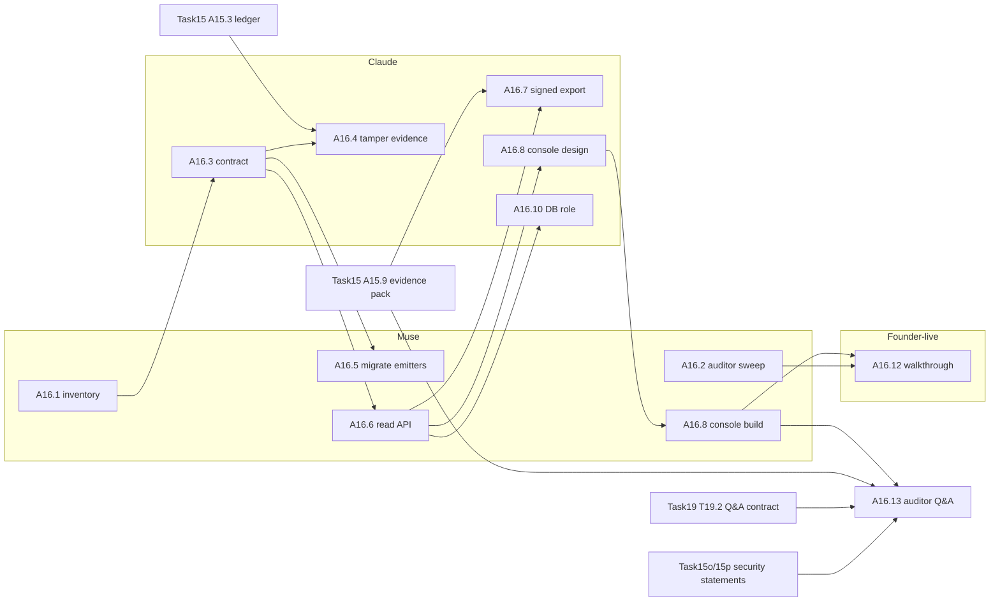

# Task16 — Audit and auditor experience

*Tracker and plan. Written 2026-10-08 by TrackAI-Orchestrator from the founder's notes (`docs/founder/VISION.md` part 3), `docs/plan/PROJECT_MAP.md`, `docs/plan/REUSE_MAP.md` (AU-1, ID-2, RP-1) and `docs/plan/TASK15.md`. Symbols per AGENTS.md §11. Scope is still forming (founder: "not much clarity"); section 1 lists what needs his yes.*

**In one paragraph.** Today TrackAI writes one append-only table, `security_audit_events` (actor, action, target, details, time), from Task4 administration (machines and credentials, grants, backfill, GitHub App, retention, export), Task5 (consent, raw reveal, corrections, purges) and Task6.a (finding reads). It is shown inside Administration, is not tamper-evident, cannot be searched or exported on its own, and new sources (Attesta signing and anchoring, D6.1 activation leases, Task6.b policy bundles, Task14 signed artifacts) have no events yet. Task16 gives audit one home: a catalog of every event, one way to emit them, a tamper-evident log through Attesta, an auditor's own console area, search and signed export, ; auditor lifecycle (invitations, expiry) is Task8 T8.12, built on Task16's audit contract (A16.3).

**Customer story.** Dana is the internal auditor at Acme. She signs in with an auditor invitation that expires after the audit. She opens **Audit** (not Administration), filters "credential revocations and raw-evidence reveals in Q3", sees who did what, when, to which machine or repository, and why. She exports the result as a signed evidence pack and verifies it offline, including that no event was deleted. She can change nothing.

## 1. Decisions (approved 2026-10-08)
| # | Question | Recommendation |
|---|---|---|
| D1 | Is Task16 a separate Task from Attesta? | Yes (founder, 2026-10-08); it consumes Attesta's ledger and evidence-pack format rather than building its own. |
| D2 | Tamper evidence | Chain every audit event into Attesta's per-tenant ledger (A16.4) instead of a second chain. |
| D3 | Audit API for customers' tools (SIEM export, webhooks) | Read API now in TrackAI; SIEM/webhook delivery moves to Task11 (API/SDK). |
| D4 | Auditor invitations | Owned by Task8 T8.12 since 2026-10-12 (ID-2 port: expiring, revocable, membership-based, never by email domain); Task16 supplies the audit contract (A16.3) and the invitation audit events. |
| D5 | Retention of audit events | Never purged by tenant retention; exportable before tenant deletion. Confirm with counsel per market. |

## 2. Subtasks

Sizes against T6. "Who": Claude, Muse, Codex, founder-live.

| ID | Subtask | Who | Size | Depends on | Status |
|---|---|---|---|---|---|
| A16.1 | Audit event inventory: every action written today (file:line, actor, target, details keys) plus the planned ones from Task15, D6.1, Task6.b and T14.7, in `docs/plan/AUDIT_EVENT_CATALOG.md` | Muse | 0.03× | — (now) | ✅ catalog (Task16a, PR #58, merged 2026-10-14) |
| A16.2 | Auditor guard sweep: a test proving every mutating admin route is denied to `tenant_auditor` (route table vs action allow-list), ported from SushiCorp AU-1 | Muse | 0.03× | — (now) | ✅ sweep (Task16a, PR #58, merged 2026-10-14; guard identity since Task16b) |
| A16.3 | Audit contract: event schema v1 (names, required fields, severity, no raw content), one `recordAuditEvent()` emitter, catalog as code | Claude | 0.05× | A16.1 | ✅ contract, emitter and guard-identity sweep (Task16b, PR #61, merged 2026-10-15; `docs/contracts/audit/`; IT-T16b-01 founder-passed) |
| A16.4 | Tamper evidence: audit events sealed into the Attesta ledger (or chained with it), verify report | Claude | 0.1× | A16.3, Task15 A15.3 | ✅ audit seals (`audit_seal` predicate, migration 0023) + `GET /api/audit/verify` (Task16e, PR #66, merged 2026-10-15) |
| A16.5 | Migrate existing emitters to `recordAuditEvent()` (Task4, Task5, Task6 call sites) | Muse | 0.06× | A16.3 | ✅ 37 sites migrated (Task16c, PR #63, merged 2026-10-15; only-writer test) |
| A16.6 | Audit read API: filter by actor, action, resource, time; keyset paging; `no-store`; auditor-reachable | Muse | 0.06× | A16.3 | ✅ `/api/audit` read API (Task16c, PR #63, merged 2026-10-15; IT-T16c-01 founder-passed) |
| A16.7 | Signed audit export (evidence pack, Attesta RP-1 pattern) | Claude | 0.05× | A16.6, Task15 A15.9 | 🟡 signed export API merged (Task16e, PR #66); console card, toggle, offline verifier in Task16f2 (IT-T16f2-01/02 founder runs pending) |
| A16.8 | Auditor console area separate from Administration: search, detail, export, verify card; no write controls (UI-1 rules) | Claude design, Muse build | 0.1× | A16.6 | ✅ Audit view (Task16f, PR #65, IT-T16f-01 founder-passed 2026-10-15); verify/export tab, toggle and Attestation move in Task16f2 (IT pending) |
| A16.9 | ~~Auditor invitations and expiry; membership-based tenant selection~~ moved to Task8 as T8.12 (founder 2026-10-12) | Task8 | — | A16.3 | n/a here |
| A16.10 | Database read-only role for auditor reads (AU-1 layer 4) | Claude | 0.05× | A16.6 | ⬜ Task16e2 (Muse; design from the Task16e handoff) |
| A16.11 | Emitters for new sources: Attesta (key create/rotate/revoke, sign, anchor ok/failed, verify run, pack export), D6.1 lease issue, Task6.b bundle publish/activation, T14.7 artifact signing | owning Tasks | — | A16.3 | n/a here |
| A16.12 | Founder-live auditor walkthrough (Company A/B, admin vs auditor vs developer) | founder-live | 0.02× | A16.8 | ⬜ |
| A16.13 | Auditor Q&A: the auditor-flagged questions in `docs/plan/CUSTOMER_AUDITOR_QA.md` as **verifiable** answers (computed only from signed statements, each listed with time, anchor, verify action and pack export; signed period reports where a figure must be citable); read-only; built on Task19's Q&A contract (T19.2). **A16.13a** code questions (Q1, Q3, Q7–Q9, Q11, Q13, Q14, Q16); **A16.13b** security questions (S1, S6, S7, S9–S12, S15) | Claude design, Muse build | sized when Task19 T19.2 lands | a: A16.8, T19.2, Task15 A15.9; b: also Task15o/15p | ⬜ |

**Total:** about 0.5× T6 before A16.13 (Claude about 0.25×, Muse about 0.25×); auditor invitations (formerly Codex, 0.1×) moved to Task8 T8.12.

## 3. Sub-task graph

**Critical path:** A16.1 → A16.3 → A16.6 → A16.8 → A16.12 (sessions 16a → 16b → 16c → 16f, then the founder walkthrough). **Start at once:** A16.1 + A16.2 (one Muse session). A16.4 and A16.7 wait for Attesta.

## 4. Sessions
| Session | Subtasks | Agent | Estimate | Prompt |
|---|---|---|---|---|
| Task16a-audit-inventory | A16.1, A16.2 | Muse | 0.06× | `docs/prompts/Task16/NEXT_CHAT_Task16a-audit-inventory_PROMPT.md` |
| Task16b-audit-contract | A16.3 | Claude | 0.05× (+0.01× guard-identity sweep); actual about 0.07× | `docs/prompts/Task16/NEXT_CHAT_Task16b-audit-contract_PROMPT.md`; handoff `docs/handoffs/Task16b-audit-contract_HANDOFF.md` (founder 2026-10-15: audit reads are audited, `audit.events.read` reserved) |
| Task16c-audit-emitters-api | A16.5, A16.6 | Muse | 0.12×; actual about 0.13× | after 16b. Prompt: `docs/prompts/Task16/NEXT_CHAT_Task16c-audit-emitters-api_PROMPT.md` (every Task4/5/6/9/15 call site pre-approved by `file:line`; tests read back events written through `recordAuditEvent()`); handoff `docs/handoffs/Task16c-audit-emitters-api_HANDOFF.md` |
| Task16e-audit-tamper | A16.4, A16.7 (A16.10 moved out, founder 2026-10-15) | Claude | 0.2× (re-estimated 0.3× with A16.10, 0.22× without); actual about 0.26× | after 16c. Prompt: `docs/prompts/Task16/NEXT_CHAT_Task16e-audit-tamper_PROMPT.md` (audit seals as an Attesta predicate type, signed audit export, `trackai_audit_reader` role; design checkpoint) |
| Task16f-audit-console | A16.8 | Muse, from the lead's design note inside the prompt | 0.1×; actual about 0.1× | after 16c, alongside 16e. Prompt: `docs/prompts/Task16/NEXT_CHAT_Task16f-audit-console_PROMPT.md` (also stops the 15-second dashboard poll of the now-audited `/api/admin/audit`); handoff `docs/handoffs/Task16f-audit-console_HANDOFF.md` |
| Task16e2-audit-db-role | A16.10 | Muse (founder 2026-10-15; Codex also possible) | about 0.05× | after 16f2 (same Muse worktree). Prompt: `docs/prompts/Task16/NEXT_CHAT_Task16e2-audit-db-role_PROMPT.md` |
| Task16f2-audit-export-ui | A16.7 console card (verify report, signed export), read-receipt toggle (`exclude_action`), Attestation moved into Audit, offline audit-export verifier | Muse | about 0.08×; actual about 0.1× | after 16e and 16f. Prompt: `docs/prompts/Task16/NEXT_CHAT_Task16f2-audit-export-ui_PROMPT.md` (may reuse the Task16f worktree); handoff `docs/handoffs/Task16f2-audit-export-ui_HANDOFF.md` |
| Task16h-auditor-qa | A16.13a, then A16.13b | Claude design note, Muse build | sized later | a: after 16f and Task19 T19.2; b: after Task15o/15p |

## 5. Founder decisions
1. **2026-10-08:** D1–D5 approved as recommended.
2. **2026-10-12:** add A16.13 Auditor Q&A, driven by the question catalogue `docs/plan/ATTESTA_QUESTIONS.md` (founder, in the Task15 lead chat).
3. **2026-10-12:** A16.9 (auditor invitations) moves to Task8 (T8.12); SIEM delivery stays with Task11, now deferred until a customer asks (`docs/plan/TASK11.md`); Task16 applies the AP-1 API conventions to its routes and must not assume a human session (B17).
4. **2026-10-12 (recorded 2026-10-13):** reduce Task16 session overhead. Task16c-audit-emitters and Task16d-audit-api merge into one Muse session, **Task16c-audit-emitters-api** (A16.5 + A16.6, about 0.12×, after 16b); A16.10 (auditor DB read-only role) folds into **Task16e-audit-tamper** (now A16.4 + A16.7 + A16.10, Claude, about 0.2×) and Task16g-audit-db-role is dropped; Task16f-audit-console stays one Muse session built from the lead's design note. Sessions go from eight to six; the total estimate is unchanged.
5. **2026-10-14:** the question catalogue is renamed `docs/plan/CUSTOMER_AUDITOR_QA.md` and owned by the new **Task19** (Q&A delivery, Claude). A16.13 builds on Task19's Q&A contract (T19.2) and splits into A16.13a (code questions, after 16f) and A16.13b (security questions, after Task15's new sessions Task15o `finding_observed` and Task15p `security-period-report/v1`, which follow Task15n). Order: Task16 through A16.12 alongside Task15m/15n; then Task15o, Task15p; then A16.13b (A16.13a may start earlier). Task16b reserves `security.monitor.changed` and `security.finding.triaged`. The auditor gets verifiable and signed answers only, no "live query plus links" hybrid (lead recommendation, confirmed in Task19 §1).
6. **2026-10-15 (lead):** Task16f goes straight to Muse; the lead's design note is inside its prompt, with no separate Claude session. Task16f also stops the dashboard's 15-second poll of `/api/admin/audit`: since Task16c that route is audited, so every open dashboard was writing an audit row every 15 seconds. The export and verify card, and offline checking of the signed audit export, move to a small Muse follow-up, **Task16f2**, after Task16e, so 16e and 16f can run in parallel.
7. **2026-10-15 (founder, at the Task16e checkpoint and the IT-T16f-01 walkthrough):** A16.10 moves to its own session, Task16e2 (Codex, from the design in the Task16e handoff). Read receipts (`audit.events.read`) stay recorded but are hidden by default in the console, behind a toggle (Task16f2, new `exclude_action` filter). Attestation moves from Administration into the Audit view (Task16f2). Hiding Administration from auditors, and the broader data, volume and UX simplification the founder asked for, go to **Task10** (UX/UI), not a new Task. Deploy note from Task16e: sealing needs `attesta:build -- --loop` (or a scheduled `attesta:audit-seal --confirm`); tenants without an active statement key are skipped.
