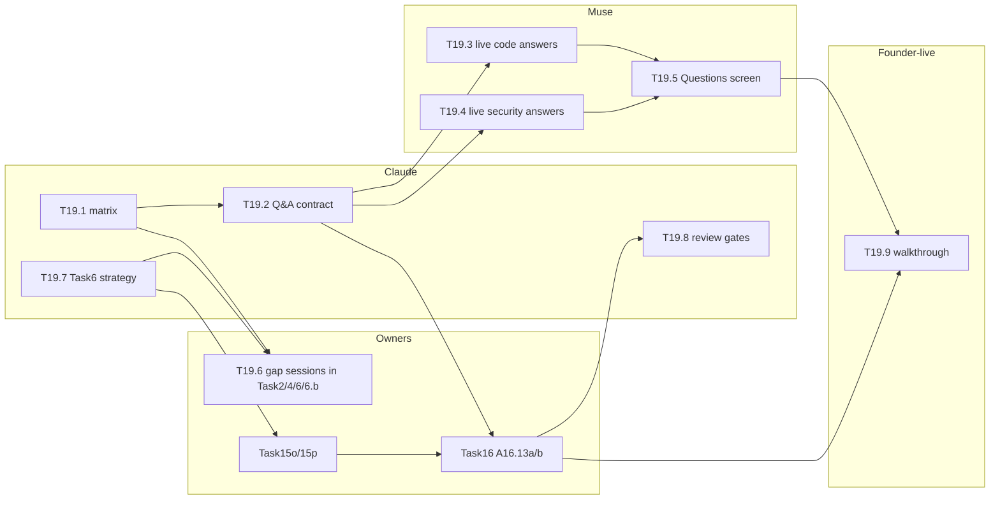

# Task19: Customer and auditor Q&A delivery

*Tracker and plan. Written 2026-10-14 by the Task16 lead (Claude) at the founder's request; session plan added 2026-10-15 by the Task19 lead (Claude). Symbols per AGENTS.md §11. Section 1 was approved by the founder on 2026-10-15; the delivery matrix (§3) is the to-do list, carries the running status, and is confirmed in T19.1.*

**In one paragraph.** `docs/plan/CUSTOMER_AUDITOR_QA.md` lists 38 questions customers and auditors ask: 20 code questions (Q) and 18 security and policy questions (S), ranked. Today no question has a working answer. Some data is missing (gaps G1–G13). No live query or Q&A screen exists. The auditor's verifiable answers (Task16 A16.13) and signed security statements (Task15o/15p) are only planned.

Task19 turns every row into an answerable one. Its own work is:
- the Q&A contract shared by every surface;
- the admin live answers (ex-Task10 T10.9);
- the founder walkthrough.

For everything else it hunts down each row's dependencies (capture gaps, statements, queries, UI) and dispatches them to the owning Task, then reviews each as it lands. It also sets the strategy for Task6.a and Task6.b: what to build, skip or defer, judged by which questions each item answers.

**Customer story.** Maya is the CISO at Acme. She opens **Questions** and picks "Which AI tools and models touched production code, and were they approved?". She gets a chart by model, drills into one PR, sees "approval: not captured yet" stated plainly rather than a guess, and clicks "see the signed evidence". Her auditor Dana asks the same question in **Audit**. Dana gets the verifiable version: each number lists the signed statements behind it, with a verify action and an evidence-pack export.

## 1. Decisions (approved by the founder, 2026-10-15)
| # | Question | Decision |
|---|---|---|
| D1 | Who owns the admin Q&A (T10.9)? | **Task19.** Move T10.9 out of Task10, so one Task owns the questions, the queries and the screen. Task10 keeps the design system Task19 builds on. |
| D2 | Which kinds of answer does the auditor get? | **Verifiable and signed only** (`CUSTOMER_AUDITOR_QA.md`, "Three kinds of answer"). Drop the "live query plus links" hybrid, because live tables can disagree with what was signed. Admins get live answers, with a link to signed evidence where it exists. |
| D3 | How does Task19 change code that other Tasks own? | **Through the owning Task.** For each gap, Task19 writes the session prompt, named under the owning Task (e.g. `Task2-merged-by`), and the owner reviews it. Task19's own code lives in a new `apps/api/src/features/qa/` and its web pages. Nothing else changes in AGENTS.md §4. |
| D4 | Task6 strategy (§5) | Approve the do / defer list in §5 as the starting position. T19.7 refines it with Codex. |
| D5 | Order | Task19's phase 1 (T19.1, T19.2) runs now, alongside Task16, because A16.13 builds on T19.2. Gap sessions are dispatched by rank once the owners have capacity. |

## 2. Subtasks

Sizes against T6. "Who": Claude, Muse, Codex, founder-live.

| ID | Subtask | Who | Size | Depends on | Status |
|---|---|---|---|---|---|
| T19.1 | Confirm the delivery matrix (§3) against the code, with `file:line`: which rows Task2's dashboards already half-answer; final owner per gap | Claude | 0.02× | — | ⬜ |
| T19.2 | **Q&A contract:** question registry as code (id, rank, audience, kinds of answer, availability rules, gaps); one answer envelope (value, availability, kind `live`/`verifiable`/`signed`, backing statement digests, `as_of`); `/api/qa/*` routes under AP-1, admin and auditor guards; frozen under `docs/contracts/qa/` | Claude | 0.06× | T19.1 | ⬜ |
| T19.3 | Live answers, code rows with data today (Q3, Q9, Q13, Q14, Q10, Q19, Q1's changed-lines share, Q11) | Muse | 0.08× | T19.2 | ⬜ |
| T19.4 | Live answers, security rows with data today (S7, S9, S11, S12, S17; S5, S8, S10 partly) | Muse | 0.06× | T19.2 | ⬜ |
| T19.5 | Admin **Questions** screen (ex-T10.9): question list by rank, charts, drill-down, `Unavailable` states, no-surveillance defaults, "see the signed evidence" | Claude design, Muse build | 0.1× | T19.3, Task10 design system (or UI-1 rules until it exists) | ⬜ |
| T19.6 | **Gap dispatch:** a prompt per gap for its owning Task, then review and close. See §4 | lead (prompts); owners build | per gap | T19.1 | ⬜ |
| T19.7 | **Task6 strategy:** the §5 position refined with Codex. Includes the founder acceptance walkthrough of Task6.a (7 steps, `CUSTOMER_AUDITOR_QA.md`; it runs as gate 6 of Task15n, `docs/prompts/Task15/NEXT_CHAT_Task15n-attesta-live-gates_PROMPT.md`), rule wave 2 selection, and the Task6.b MVP scope | Claude + Codex + founder-live | 0.03× | — | ⬜ |
| T19.8 | **Review gates:** A16.13a/b and Task15o/15p reviewed for fit with the Q&A contract and the questions they claim | lead | 0.02× | each lands | ⬜ |
| T19.9 | Founder walkthrough: the ten top-ranked questions, as admin and as auditor, Company A/B | founder-live | 0.02× | T19.5, A16.13a | ⬜ |

**Total (Task19's own work):** about 0.4× T6. Gap work is sized in its owning Task.

## 3. Delivery matrix (the to-do list; confirmed in T19.1)

Columns:
- **Status (capture · live · auditor):** the running status, three symbols in that order (AGENTS.md §11): ✅ done, 🟡 partly or waiting on a live gate, ⬜ not done, n/a not applicable or deferred.
  - **Capture** follows "Data today" in `CUSTOMER_AUDITOR_QA.md`. Q7, Q8 and Q16 stay 🟡 until Task15n proves Attesta on real KMS, Rekor and TSA.
  - **Live** turns ✅ when the admin answer ships through the Q&A contract (T19.3–T19.5).
  - **Auditor** turns ✅ when the verifiable or signed answer ships (A16.13, Task15 reports).
  - A row is answered when no symbol is ⬜ and every applicable one is ✅. The lead updates the symbols after each merge, together with the matching row in `CUSTOMER_AUDITOR_QA.md`.
  - S15 is answered outside the Q&A contract today (Task16c's audit read API and Audit view; Task16e's sealed, signed export), so it is 🟡 until it joins the contract (T19.4, A16.13b). T19.1 confirms every symbol against the code.
- **Capture:** what must be stored first (gap → owner), or "stored".
- **Live:** the admin answer (T19.3–T19.5).
- **Auditor:** the verifiable or signed answer (A16.13; reports in Task15).

**Running total (2026-10-15):** 0 of 38 rows answered. Capture: 11 ✅, 19 🟡, 7 ⬜, 1 n/a.

| Rank | Q | Status (capture · live · auditor) | Capture | Live | Auditor | Next step |
|---|---|---|---|---|---|---|
| 1 | Q3 | ✅ ⬜ ⬜ | stored | T19.3 | A16.13a | T19.2 |
| 2 | Q1 | 🟡 ⬜ ⬜ | changed lines: stored; whole repository: G1 → Task2 + GitAI | T19.3 (changed lines) | A16.13a via the Task15i4 period report; repository share after G1 | G1 prompt |
| 3 | Q4 | 🟡 ⬜ ⬜ | models: stored; approval: G2 → Task6.b | T19.3 (models) | A16.13a (models); approval `Unavailable` until G2 | Task6.b MVP (§5) |
| 4 | Q11 | 🟡 ⬜ ⬜ | stored (session link is a text join, G10) | T19.3 | A16.13a partly | G10 |
| 5 | Q7 | 🟡 n/a ⬜ | Attesta built | n/a | A16.13a; production proof Task15n | Task15n |
| 6 | Q16 | 🟡 n/a ⬜ | Attesta built | n/a | A16.13a; clean machine Task15n | Task15n |
| 7 | Q5 | ⬜ ⬜ ⬜ | G3 → Task2 (semantics), Task4 (delivery) | after G3 | after G3 (predicate field ready) | G3 prompt (before production) |
| 8 | Q13 | ✅ ⬜ ⬜ | stored | T19.3 | A16.13a | T19.2 |
| 9 | Q9 | ✅ ⬜ ⬜ | stored | T19.3 | A16.13a | T19.2 |
| 10 | Q14 | ✅ ⬜ ⬜ | stored | T19.3 | A16.13a | T19.2 |
| 11 | Q12 | 🟡 ⬜ ⬜ | partly; org policy G2 → Task6.b | T19.3 (partly) | partly, then after G2 | Task6.b MVP |
| 12 | Q2 | ✅ ⬜ ⬜ | stored; hard query (ranges plus lineage walk) | T19.3b (own session) | later (file paths are hashed in the predicate) | size in T19.1 |
| 13 | Q6 | 🟡 ⬜ ⬜ | committer stored; merger G4 → Task2 | after G4 | after G4 (predicate v1.x) | G4 prompt (small) |
| 14 | Q8 | 🟡 n/a ⬜ | stored + Attesta | n/a | A16.13a | — |
| 15 | Q15 | ⬜ ⬜ ⬜ | G5 → Task4 (capture), Task16 (expose) | after G5 | after G5 (count in a batch statement) | G5 prompt |
| 16 | Q10 | ✅ ⬜ n/a | stored (Churned always `Unavailable`) | T19.3 | n/a (count only) | T19.2 |
| 17 | Q19 | ✅ ⬜ n/a | stored | T19.3 | n/a | T19.2 |
| 18 | Q18 | 🟡 ⬜ n/a | stored; vendor gaps permanent | T19.3 | n/a | T19.2 |
| 19 | Q20 | 🟡 ⬜ n/a | identity linking partial (T2.20) | T19.3 aggregated | n/a | T19.2 |
| 20 | Q17 | n/a n/a n/a | phase 2 (SCANOSS) | phase 2 | phase 2 | customer trigger |
| 1 | S1 | 🟡 ⬜ ⬜ | stored for 3 rules; signing G6 → Task15o; rule coverage G9 → Task6.a | T19.4 | A16.13b via Task15p | Task15o after Task15n |
| 2 | S2 | 🟡 ⬜ ⬜ | G7 → Task6 + Task9 | after G7 | after G7 (coverage figures in Task15p) | G7 prompt |
| 3 | S3 | ⬜ ⬜ ⬜ | G8 → Task6 (writer) + Task16 (event reserved); G9 tamper rules → Task6.a | after G8/G9 | after G8/G9 | G8 prompt; T19.7 rule wave 2 |
| 4 | S4 | ⬜ ⬜ ⬜ | G9 secrets and exfiltration rules → Task6.a | after G9 | after G9 + Task15o | T19.7 rule wave 2 |
| 5 | S5 | 🟡 ⬜ ⬜ | partly; G10 → Task6 + Task2 | T19.4 partly | A16.13b partly | G10 prompt |
| 6 | S6 | 🟡 ⬜ ⬜ | stored in commit statements (partial link) | T19.4 | A16.13b | — |
| 7 | S7 | ✅ ⬜ ⬜ | stored | T19.4 | A16.13b via Task15p | — |
| 8 | S8 | 🟡 ⬜ ⬜ | agent stored; model G10 | T19.4 (agent) | A16.13b (agent) | G10 |
| 9 | S9 | 🟡 ⬜ ⬜ | stored; macOS only until D6.2 | T19.4 | A16.13b | — |
| 10 | S10 | 🟡 ⬜ ⬜ | partly; G7 | T19.4 partly | A16.13b partly | G7 |
| 11 | S11 | ✅ ⬜ ⬜ | stored | T19.4 | A16.13b | — |
| 12 | S12 | ✅ ⬜ ⬜ | stored ("none blocked") | T19.4 | A16.13b | — |
| 13 | S13 | ⬜ ⬜ ⬜ | G2, G11 → Task6.b | after Task6.b | after Task6.b | Task6.b MVP |
| 14 | S14 | ⬜ ⬜ ⬜ | G12 → Task6.b | after Task6.b | after Task6.b | deferred with Task6.b exceptions |
| 15 | S15 | ✅ 🟡 🟡 | stored (audit events) | Task16 audit read API | Task16e (sealed) | Task16 |
| 16 | S16 | ⬜ ⬜ ⬜ | G13 → Task6 + Task16 (event reserved) | after G13 | after G13 | phase 2 unless a customer asks |
| 17 | S17 | 🟡 ⬜ n/a | stored | T19.4 | n/a (partly) | — |
| 18 | S18 | 🟡 ⬜ n/a | counts stored; disposition G13 | T19.4 counts | n/a | after G13 |

## 4. Gap dispatch order (T19.6)
1. **G4** (merged-by, Task2, small).
2. **G8** (monitor writer and audit event, Task6, small).
3. **G10** (finding to session key, Task6 + Task2).
4. **G7** (coverage history, Task6 + Task9).
5. **G5** (rejection audit event, Task4).
6. **G3** (PR reviews, Task2 + Task4; before production).
7. **G1** (repository snapshot, Task2 + GitAI).
8. **G9** (rule wave 2, Task6.a, per T19.7).
9. **G2, G11, G12** (Task6.b MVP).
10. **G13** (triage state, phase 2).

Items 1–3 are small; G7 and G10 come before Task15o, so the first signed findings carry them.

## 5. Task6.a and Task6.b strategy (starting position, refined in T19.7)
Based on Codex's report (`CUSTOMER_AUDITOR_QA.md`, "Task6.a status"):

| Item | Decision | Why (questions served) |
|---|---|---|
| Founder acceptance walkthrough of Task6.a (7 steps) | **Do now** (founder + Codex, about 0.01×) | Closes the acceptance gap before Task15o signs findings |
| G8, G10, G7 captures | **Do next** (one small Task6 wave, Codex) | S2, S3, S5, S8, S10; makes the signed findings complete |
| Rule wave 2 (monitor only) | **Do, small and evidence-led:** 4–6 rules chosen with Codex for S3/S4 value and acceptable false positives, e.g. `secrets.read_private_key`, `secrets.cloud_credential_read`, `exfil.curl_post_file`, `persistence.ssh_authorized_keys`, `tamper.agent_config_write` | S3, S4 (the CISO's top risks) |
| Rules that conflict with normal development (`.env` reads, git hooks, remote changes) | **Defer**, or ship later as low-severity informational findings after a severity contract change | High false-alarm risk |
| Multi-step `chain.*` rules | **Defer** until single rules are proven | Codex: needs safe correlation over time |
| D6.1 signed, machine-bound activation | **Do** (Task6.b, first item, on Task15's trust layer A15.12) | Production blocker; S2, S13 |
| Task6.b policy MVP: approved agents and models list | **Do** after D6.1 | Q4, Q12, S13 |
| Exceptions and waivers | **Next**, after the MVP | S14 |
| Blocking | **Defer:** a one-rule, one-route pilot only after Task13 synchronous hooks, D6.2 for that route, Task9 rollback and an emergency bypass; Task14 certifies | S12; a false block stops customer work |
| Policy simulation, inheritance, dynamic rule distribution | **Defer** until a customer asks | No question needs them yet |
| Other platforms and agents | **Defer** to Task13 / D6.2 | S9 says "not monitored" honestly meanwhile |

## 6. Sessions
Written 2026-10-15 in Task19's phase 2 (`docs/agents/TASK_LEAD_PROCEDURE.md`). Each session's prompt is `docs/prompts/Task19/NEXT_CHAT_<name>_PROMPT.md` (gap sessions: under the owning Task's prompt folder), written by the lead. A Muse prompt is written only once everything it builds on has merged, so every decision can be made upfront. Muse estimates include the 1.3× factor (`TASK_LEAD_PROCEDURE.md` Phase 2). Each session edits only its own row here (AGENTS.md §9 item 23).

### 6.1 Task19's own sessions

| # | Session | Subtasks | Agent | Estimate | Starts when | Main files | Status |
|---|---|---|---|---|---|---|---|
| 1 | `Task19a-qa-matrix-contract` | T19.1, T19.2 | Claude | about 0.08× (if it passes 0.11×, the routes move to a follow-up) | now, alongside Task16 | `docs/plan/TASK19.md` §3, `docs/plan/CUSTOMER_AUDITOR_QA.md`, `docs/contracts/qa/` (new), `apps/api/src/features/qa/` (new), one admin action, the router mount; a pure move of three Task2 lifecycle read functions out of `read.routes.ts` (Codex reviews) | ⬜ prompt ready |
| 2 | `Task19b-qa-live-code` | T19.3: Q3, Q9, Q13, Q14, Q10, Q19, Q1 (changed lines), Q11, Q18, Q20 | Muse | about 0.1× | Task19a merged | `features/qa/` answer modules for code questions | ⬜ prompt after Task19a |
| 3 | `Task19c-qa-live-security` | T19.4: S7, S9, S11, S12, S17; S5, S6, S8, S10 partly; S18 counts; S15 linked to the Audit view | Muse | about 0.08× | Task19b merged (one Muse session at a time) | `features/qa/` answer modules for security questions | ⬜ |
| 4 | `Task19d-qa-line-walk` | Q2 (point-in-time line attribution: ranges plus lineage walk) | Codex or Muse, decided in T19.1 | sized in T19.1 | Task19a merged | `features/qa/` | ⬜ |
| 5 | `Task19e-qa-questions-screen` | T19.5: a design note by the lead (about 0.02×), then the build | Claude design, Muse build | about 0.12× | Task19b and Task19c merged; Task10's design system, or the UI-1 rules until it exists | `apps/web/src/app/dashboard/questions-workspace.tsx` (new); the dashboard navigation (shared, pre-approved in its prompt) | ⬜ |
| — | Lead work | T19.6 prompts and reviews, T19.7, T19.8 | Claude (lead chat) | about 0.05× | ongoing | prompts, this file, `CUSTOMER_AUDITOR_QA.md` | 🟡 plan written |
| — | Founder walkthrough | T19.9 | founder-live | about 0.02× | Task19e merged; A16.13a merged | — | ⬜ |

**Total:** about 0.45× T6 for Task19's own work, against the 0.4× plan. The difference is the Muse factor and Q2, which is not sized yet.

**Critical path:** Task19a → Task19b → Task19c → Task19e → T19.9. Two things can start at once: Task19a, and the Task6.a acceptance walkthrough (Task15n gate 6). Task16's A16.13a can start as soon as Task19a merges.

### 6.2 Gap sessions (T19.6), in the order of §4

Each gap session runs in its owning Task. The lead writes the prompt, the owner reviews it, and the session moves the matrix rows named here. Estimates are the lead's; the owner confirms them.

| Order | Session | Gap | Owner (agent) | Estimate | Starts when | Rows it moves |
|---|---|---|---|---|---|---|
| 1 | `Task2-merged-by` | G4 | Task2 (Codex) | about 0.05× (migration, parser, backfill from retained deliveries) | T19.1 confirms the gap | Q6 |
| 2 | `Task6-monitor-audit` | G8 | Task6 (Codex) | about 0.04× | T19.1; Task16b's reserved `security.monitor.changed` is merged | S3 (setting changes) |
| 3 | `Task6-finding-session-key` | G10 | Task6 + Task2 (Codex) | about 0.06× | before Task15o | S5, S8, Q11 |
| 4 | `Task6-coverage-history` | G7 | Task6 + Task9 (Codex) | about 0.1× | before Task15o | S2, S10 |
| 5 | `Task4-rejection-audit` | G5 | Task4 (Codex) | about 0.06× | after 1–4 | Q15 |
| 6 | `Task2-pr-reviews` | G3 | Task2 + Task4 (Codex) | about 0.1× | before production | Q5 |
| 7 | `Task2-repo-snapshot` and `Task2-repo-snapshot-gitai` | G1 | Task2 + GitAI (Codex) | about 0.15× (two sessions) | after 6 | Q1 (whole repository) |
| 8 | `Task6a-rule-wave2` | G9 | Task6.a (Codex) | sized in T19.7 | Task15n gate 6 passed; rules chosen in T19.7 | S3, S4 |
| 9 | Task6.b MVP (D6.1 first, then the approved agents and models list) | G2, G11, G12 | Task6.b (its own lead and plan) | Task6.b plan | D6.1 on Task15's trust layer | Q4, Q12, S13, S14 |
| 10 | Triage state | G13 | Task6 + Task16 + Task10 | n/a phase 2 | a customer asks | S16, S18 |

G8, G10 and G7 may run as one Codex wave if Codex prefers (§5). They come before Task15o, so the first signed findings carry them.

## 7. Founder decisions
1. **2026-10-14:** Task19 created, led by Claude: turn every question in `CUSTOMER_AUDITOR_QA.md` into an answerable one, hunting down groundwork gaps and finishing work (queries, UI, signing), managing the Q&A interface through reviews with the owning Tasks, and overseeing the Task6.a/6.b strategy.
2. **2026-10-15:** D1–D5 approved as recommended. The founder runs T19.1 and T19.2 as one Claude session (`Task19a-qa-matrix-contract`). The delivery matrix gets a running-status column (capture · live · auditor).
