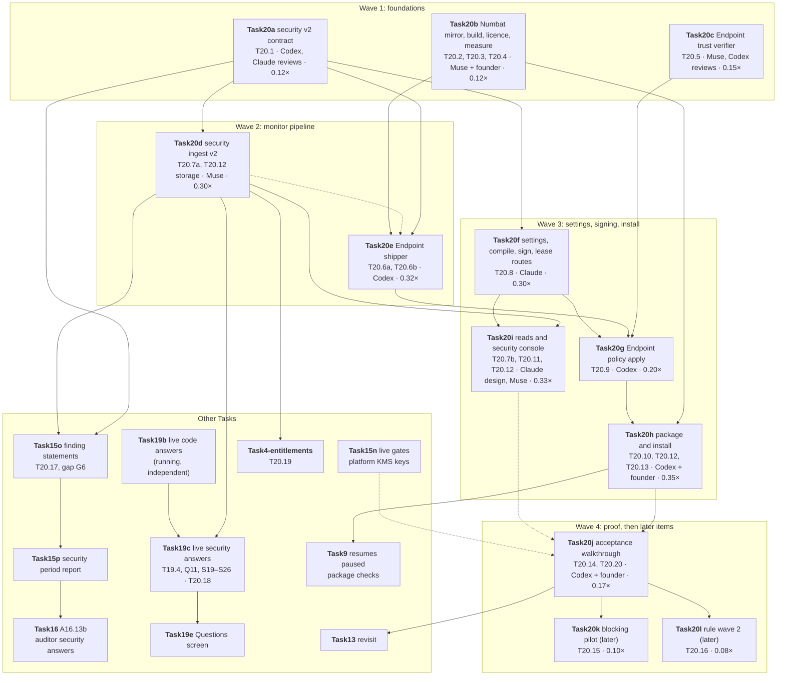

# Task20: coding-agent security with Numbat

*Tracker and session plan. Written 2026-10-16 by Claude (Task20 lead) from the founder-approved [`Task20_PRIMER.md`](primers/Task20_PRIMER.md) (checkpoint 1, 2026-10-16) and the decision record [`NUMBAT_ADOPTION_REVIEW.md`](NUMBAT_ADOPTION_REVIEW.md) §13–§15. Symbols per AGENTS.md §11. Each session edits only its own rows here (AGENTS.md §9 item 23).*

**Goal.** Monitor the AI coding agents on customers' Macs with Numbat, run unchanged, and give the CISO the enterprise layer around it:
- the TrackAI Endpoint installs and updates Numbat and ships its records;
- the server stores them per tenant;
- the CISO controls rule and data settings through switches, delivered as two separately signed documents;
- coverage, inventory, a day-one scan and, later, an opt-in blocking pilot.

**Completion claim.** An agent and platform are "monitored" only after their row in the acceptance walkthrough (E20) passes on a real machine. Everything else is "not monitored". Customer wording is always "observed", "requested", "denied by request", never "prevented".

**Simplicity rule (founder, 2026-10-16).** If carrying out a recommendation gets stuck, that item moves to phase 2 (or waits for a customer request) instead of growing. The fallbacks are in the primer's "Founder decisions" table; a session that uses one says so in its handoff and in §8 below.

---

## 1. Approved boundaries

1. **Numbat unchanged.** It is built from the TrackAI mirror fork at `20a5a52` (tag `v0.2.0-trackai.1`), with no product changes, and synced monthly. Before the first customer build, the pin moves to the first upstream release that contains `20a5a52`, after Numbat's own tests and TrackAI's fixtures pass; if there is no such release, the mirror tag ships.
2. **Platforms and agents.** macOS on the founder's Intel Mac first. Agents in this order: Claude Code and Codex, then Cursor and Gemini CLI, then Copilot CLI, on managed hooks. Windows and Linux come with Task9g and the Linux wave. OpenCode is not an enterprise route.
3. **Monitor is the product.** Blocking is opt-in, a few rules at a time (Task20k), after monitor mode is proven. Fail-open is accepted.
4. **What leaves the machine.** Only what the tenant's security data settings allow. The default allows no command, path or URL previews, and replaces the host name and user name with TrackAI's machine id. Raw content and full bodies never leave the machine; Task5's reveal stays the only raw path (rule 6). The server re-checks every upload (rule 9).
5. **Monitoring is machine-wide** (Q5). A finding outside an enrolled repository carries `repository: not_enrolled` and no path. Activation is fail-closed and bound to the tenant and machine (AGENTS.md §9 item 9 is rewritten in Task20j).
6. **Two signed documents, verified separately** (`docs/contracts/attesta/trust.md` "Consumers"):
   - the **rule bundle**, signed with the `policy_bundle` key. If it is rejected, the bundle is refused; if verification is unavailable, the Endpoint keeps the last good bundle.
   - the **activation lease**, per machine, signed with the `activation_lease` key. It carries the agents, the mode, the expiry, the bundle digest and the security data settings. If it is rejected, unavailable or expired, monitoring is off: nothing is uploaded, and the Endpoint falls back to the monitor-only bundle.

   Task20 consumes Task15's trust layer and never builds its own keys.
7. **Rule settings are switches only:** on/off, severity, and monitor or block per agent. There are no customer rules, no rule editor and no allow-lists (Q6). The first wave is 44 rules, with 7 noisy ones off; Task6.a's three Rust rules are retired.
8. **Tamper resistance.**
   - Phase 1 is **tamper-evident at the server**: the server sees missing records, a wrong bundle digest or a stale lease.
   - It is not tamper-resistant, because the record file, the rules folder and the Endpoint run in the developer's profile (Q1, Q2).
   - A root helper is a precondition for the blocking pilot.
9. **Licence.** Apache-2.0 notices and Numbat's `THIRD_PARTY_LICENSES.txt` ship inside the Endpoint package (`docs/TASK6_SECURITY_NUMBAT_LICENSE_PLAN.md`). TrackAI says "powered by Numbat"; TrackAI is never branded as Numbat.
10. **Out of scope:**
    - Task13's adapter reuse, hook de-duplication and session linking;
    - `customerPolicyForDataAccess` (ex-Task6.b);
    - customer rules and a rule editor;
    - OpenCode.

## 2. Master subtask matrix

| ID | Outcome | Implemented | Automated evidence | Founder-live evidence | Session | Completion boundary |
|---|---|---:|---:|---:|---|---|
| T20.1 | Security v2 contract: upload kinds (finding, enforcement, indicator, scan summary, permission event, Endpoint security status, agent inventory), rule-bundle manifest, activation lease v2, the lease reference in the fleet configuration, the machine-authenticated retrieval routes, data settings, error codes, fixtures from Numbat 0.5.0 | ✅ | ✅ 41 focused / 1,098 repository tests after merging main; full `npm run check` | n/a | Task20a | Frozen under `docs/contracts/security-v2/`; fixtures validate against the contract schemas and reproduce pinned Numbat IDs/joins |
| T20.2 | Mirror fork, reproducible build, checksums, monthly-sync runbook, coverage-table extraction | ⬜ | ⬜ | ⬜ founder creates the mirror | Task20b | Two builds give identical bytes; Numbat's own tests pass at the pin |
| T20.3 | Licence and notices for the binary | 🟡 plan doc updated in the plan PR | n/a | n/a | plan PR, Task20b | Notices inside the package |
| T20.4 | Size and hook-latency budgets; Git AI release build stripped or not | ⬜ | ⬜ script | ⬜ measured on the Mac | Task20b | Budgets written into this tracker (§6) |
| T20.5 | Rust trust verifier: same status and code as `verifyTrusted` on all 82 vectors | ⬜ | ⬜ | n/a | Task20c | Production hard-codes `production: true`; `lastTrusted` persisted |
| T20.6a | Shipper read side: tail with checkpoint, schema 0.5.0 only, minimize per lease, machine id, repository mapping, content-free permission events | ⬜ | ⬜ | n/a | Task20e | Fixture streams from Numbat's tests; no field beyond the data settings is queued |
| T20.6b | Shipper send side: generalized queue and uploader, local-file rotation (7 days), evaluator and its three rules retired | ⬜ | ⬜ | n/a | Task20e | Offline, restart and rotation cases; `src/security/mod.rs` evaluator removed |
| T20.7a | Ingest v2: migration widening `security_findings`, new tables, `/worker/security` v2 route, server re-check, Task6.a rows readable, Company A/B | 🟡 | 🟡 IT-T20d-01 (agent-verified 2026-10-17) · ⬜ founder run | n/a | Task20d | Attesta builder query (`builder.ts:409-424`) still returns Task6.a and v2 rows |
| T20.7b | Admin and auditor reads, AP-1, `no-store`, audited | ⬜ | ⬜ | n/a | Task20i-a (reads, in review), Task20i-b (console, next) | Previews only to admin/auditor roles when the tenant allows them |
| T20.8 | Settings (audited writer, G8), pinned catalogue, compiler (one folder per agent), signed bundle, signed per-machine lease with history (G7 part 1) and lease-issued events (G11, issued part), default policy | ✅ merged 2026-10-18 (PRs #81, #82): settings, catalogue, compiler, signed bundle, admin API, migration 0026; leases, machine routes, real authority, fleet v3, `app.ts` parser skip | ✅ IT-T20f-01 (founder run 2026-10-18) | ⬜ IT-T20f-02 (real KMS keys) | Task20f | Dev signer in tests; production keys from Task15n |
| T20.9 | Apply on the machine: verify lease and bundle, `numbat rules check`, atomic swap, last-known-good, off and monitor-only fallback, refusal reported as a `fleet.lease.refused` event (G11, refused part) | ⬜ | ⬜ | ⬜ IT-T20g-01 | Task20g | Tampered, expired, replayed and broken bundles never activate |
| T20.10 | Package and install: Numbat at a fixed path with checksum, managed hooks per agent, record-file location, four-layer health check, Endpoint security status reported (G7 part 2, stored per machine and day by Task20i), offboarding; re-run of Task9's paused package checks | ⬜ | ⬜ | ⬜ IT-T20h-01 | Task20h | Health check green for each agent in the walkthrough |
| T20.11 | Console: Settings, Findings, Coverage | 🟡 implemented; browser walkthrough pending | ✅ web build, typecheck, lint and 1,223 tests pass (an earlier full run hit the inherited Attesta timing flake) | ⬜ browser walkthrough; non-blocking for Task20i-b merge | Task20i | Settings switches publish a new bundle; honest states shown |
| T20.12 | Agent inventory (S19) and coverage inventory: Endpoint side (Task20h), server storage (Task20d), views (Task20i) | ⬜ | ⬜ | ⬜ | Task20h, Task20d, Task20i | Inventory under the same data settings |
| T20.13 | Day-one scan (S20), opt-in, findings only | ⬜ | ⬜ | ⬜ | Task20h | Findings marked "found at rest" |
| T20.14 | Rule wave 1 proof and acceptance walkthrough E20-01…E20-12 | 🟡 runbook written; live checks pending | ⬜ | ⬜ | Task20j | Each agent's row passed or explicitly "not monitored"; [runbook](TASK20_ACCEPTANCE.md) |
| T20.15 | Blocking pilot (3–5 rules) | n/a later | n/a | n/a | Task20k | Needs the root helper (Q2) and a passed Task20j |
| T20.16 | Rule wave 2 (7 noisy rules, tuned) | n/a later | n/a | n/a | Task20l | After Task20j |
| T20.17 | Task15o/15p redesigned on Numbat's finding schema; signed case bundles (S25) | n/a other Task | n/a | n/a | Task15o, Task15p | Task15 lead's plan |
| T20.18 | Q&A feed to Task19 (S1–S26) | 🟡 TASK19.md updated in the plan PR | n/a | n/a | lead | S19–S26 ranked with the founder |
| T20.19 | Module switches (entitlements) | n/a other Task | n/a | n/a | Task4-entitlements | Task20 adds only the `security` guard to its routes |
| T20.20 | AGENTS.md §4 (done in the plan PR), §9 items 9 and 11, Task6.a tracker superseded | 🟡 wording updated; E20 results pending | n/a | n/a | plan PR, Task20j | Wording matches E20 results |

## 3. Interfaces to freeze first (Task20a)

The exact JSON and table names are decided in Task20a; these meanings are fixed now:

- **Upload kinds.** One versioned envelope, `trackai.security-upload/2`, carries any mix of the kinds below. The server derives tenant and machine from the machine credential, never from the body.
  - `finding`: rule id, rule version, severity, source agent, model, session, sub-agent, timing and phase, confidence, repository (`{id}` or `not_enrolled`), occurred-at, Numbat schema version, bundle digest, plus the previews the lease allows;
  - `enforcement`: decision `deny` or `no_override`, the finding ids it covers, the rule;
  - `indicator`: type, value (redacted, subject to the URL setting), count, first and last seen;
  - `scan_summary`;
  - `permission_event`: `requested`, `approved` or `denied`, the tool name, a `join` of `exact`, `same_session_window` or `unavailable`, no content;
  - `security_status`: Numbat version, wired agents, active bundle digest, lease id, last record time, health-check layer results;
  - `agent_inventory`: the agents installed and their versions.
- **Data settings.** Five field groups, each on or off: command previews, file paths, URLs, host identity, user identity. All are off by default.
- **Rule bundle manifest.** It names:
  - the tenant, the bundle version and epoch, and the Numbat pin;
  - for each agent, one folder with each file's path and SHA-256;
  - the enabled set, and the compiler version.

  The bundle is signed as a whole and verified as a whole.
- **Activation lease v2.** It names:
  - the tenant, the machine and the lease id;
  - when it was issued and when it expires (short-lived, renewed);
  - the mode (`off`, `monitor`, `monitor_and_pilot_block`), the agents and the bundle digest;
  - the data settings and the day-one-scan switch.

  It replaces Task9's `securityActivation {mode, version}` field; Task9's fleet configuration carries a reference to the lease.
- **Lease reference in the fleet configuration.** It is a new schema version of Task9's configuration. In place of `securityActivation` it carries `securityLease: {leaseId, bundleDigest, expiresAt}`. Schema v1 and v2 configurations stay readable, and their `securityActivation` is treated as `off`, which is fail-closed. The server half is built in Task20f, the Endpoint half in Task20g.
- **Retrieval routes (machine-authenticated, under `/worker/security`).**
  - `GET` the current lease for this machine;
  - `GET` a bundle by its digest;
  - `POST` an acknowledgement or a refusal.

  Tenant and machine come **only from the machine credential**. No path, query or body field names a tenant or a machine. A digest belonging to another tenant, or a lease for another machine, answers the same safe "not found" as a missing one, and the server audits it. Responses are `no-store` and carry the signed bytes exactly as signed. Task20a freezes the shapes, Task20f implements them, and Task20f's tests include Company A/B and machine X/Y cases.
- **Errors.** Safe codes only, in RFC 7807 form; no raw values are echoed back.

## 4. Waves and exit gates

### Wave 1: foundations (Task20a, Task20b, Task20c)
- The contract PR is merged, and its fixtures validate against Numbat's 0.5.0 schema.
- The mirror tag builds reproducibly, and Numbat's own tests pass at `20a5a52`.
- The Rust verifier matches all 82 vectors.
- Budgets for binary size and hook latency are recorded in §6.

### Wave 2: monitor pipeline (Task20d, Task20e)
- The migration has been generated, inspected and applied once through `scripts/it-db.sh`; `drizzle-kit check` is clean.
- Task6.a rows still read, and the Attesta builder query still works.
- Company A/B isolation is tested on every new table and route.
- An upload beyond the data settings is refused with a safe code.
- On the Endpoint, offline time, restarts, rotation and partial lines lose no record and duplicate none (at-least-once delivery, with server idempotency).
- The evaluator is removed.

### Wave 3: settings, signing, install (Task20f, Task20g, Task20h, Task20i)
- Bundles and leases are signed through Task15's signer contract and verified by the Rust verifier.
- Rejected, unavailable, expired and replayed cases follow `trust.md` "Consumers".
- A broken bundle never replaces a good one.
- The PKG installs Numbat and managed hooks for Claude Code and Codex on the Intel Mac, and the four-layer health check is green.
- Offboarding removes the hooks.
- The console never shows "prevented", and never shows zero where the value is `Unavailable`.

### Wave 4: proof (Task20j), then the later sessions (Task20k, Task20l)
- Walkthrough rows E20-01…E20-12 are passed or explicitly marked "not monitored".
- Day 1's live E20-R proof covers all eight rule groups with matching local/server record IDs and `found_at_rest=false`; the 200-run hook latency measurements meet the recorded budget.
- The founder sitting passes E20-01…06 and E20-08…12, Task19 T19.9 and the disposable-database IT sweep; E20-07 passes last, after the signed lease expires with the API down and renewal is confirmed on restart. Each agent claimed monitored still needs its own applicable E20 evidence.
- E20-W continues as an ongoing noise/false-positive soak feeding Task20l; it is not a Task20 close-out gate. Triage critical findings promptly and record every installed Endpoint build change.
- AGENTS.md §9 items 9 and 11 are rewritten to match the evidence.

## 5. Sessions and file ownership

TrackAI and GitAI-repository work are separate sessions and PRs. Endpoint code is in GitAI; those branches are `task/<name>-gitai`, worktree `make gitai-worktree M=<name>`. Estimates: Muse's include the 1.3× factor. Migrations take the next free number when generated, on a fresh `main`.

| Session | Repository / agent | Pieces | Estimate | Depends on | Owned or pre-approved files |
|---|---|---|---:|---|---|
| **Task20a-security-v2-contract** | TrackAI / Codex (Claude, the Task20 lead, reviews; founder 2026-10-17) | T20.1 | about 0.12× estimate; about 0.16× actual | plan merged; prompt `docs/prompts/Task20/NEXT_CHAT_Task20a-security-v2-contract_PROMPT.md` | new `docs/contracts/security-v2/` (README, JSON Schemas, fixtures with an Apache-2.0 notice where derived from Numbat), new `apps/api/src/features/security-findings/v2-contract.ts` (frozen types, stubs that throw), its contract tests, `apps/api/package.json` (test script entry) |
| **Task20b-numbat-mirror-build** | GitAI / Muse + founder-live | T20.2, T20.3 (package side), T20.4 | about 0.12× | plan merged; founder has created the mirror fork and pushed tag `v0.2.0-trackai.1` | new `packaging/numbat/` in GitAI (build script, `SHA256SUMS` recipe, `LICENSE`, `THIRD_PARTY_LICENSES.txt`, `measure.sh`, sync runbook); no change to the Numbat mirror beyond the tag |
| **Task20c-endpoint-trust-verifier** | GitAI / Muse (Codex reviews; every answer is fixed by the 82 vectors) | T20.5 | about 0.15× | plan merged (vectors are on `main`) | new `src/trust/` module and tests; copied vectors under `tests/fixtures/trust/`; `Cargo.toml` / `Cargo.lock` (an ECDSA P-256 crate such as `p256`, pre-approved by merging this plan); closes GitAI backlog row G8 |
| **Task20d-security-ingest-v2** | TrackAI / Muse (Codex reviews the migration) | T20.7a for all seven kinds, including status and inventory storage (T20.12 server); the reads (T20.7b) moved to Task20i (lead, 2026-10-17) | about 0.30× estimate; about 0.35× actual | Task20a merged; prompt `docs/prompts/Task20/NEXT_CHAT_Task20d-security-ingest-v2_PROMPT.md` | as listed in its prompt §2.3: `schema.ts` (`security_findings` widened, seven new tables), one migration + `meta/`, `features/security-findings/` v2 files and the `/v2` mount line, `package.json` scripts; a fail-closed `SecurityV2Authority` that Task20f implements |
| **Task20e-endpoint-shipper** | GitAI / Codex | T20.6a, T20.6b | about 0.32× | Task20a and Task20b merged (contract fixtures and the pinned Numbat build); the run against the real Task20d route is IT-M20-02, not a merge gate | `src/security/` (new tail, records, minimize modules; `delivery.rs`, `delivery_queue.rs` generalized; evaluator in `mod.rs` removed; `activation.rs` reduced to the lease interface), `src/daemon.rs` and `src/daemon/telemetry_worker.rs` (wiring only), `src/commands/checkpoint_agent/orchestrator.rs` (remove `submit_activated_command` call) |
| **Task20f-security-settings-signing** | TrackAI / Claude | T20.8 | about 0.30× planned; re-estimated 0.45× and split (founder, 2026-10-17): part a about 0.25× actual, part b about 0.23× estimate, about 0.20× actual | Task20a merged | new `apps/api/src/features/security/` (settings, catalogue data from the pin with notices, compiler, bundle, lease, the machine-authenticated retrieval routes with Company A/B and machine X/Y tests, `task20f-signing-live-verify.ts`); the server half of the lease reference in Task9's files, pre-approved with Codex as Task9's owner reviewing: `features/fleet/{contract,service}.ts` and `fleet.test.ts` (new configuration schema version, v1/v2 compatibility), fleet audit details; `schema.ts`: the new security settings, bundle and lease tables, **and** the `fleet_configurations` schema-version type and its check `fleet_configurations_schema_version_check` (`schema.ts:350`, today versions 1 and 2 only), widened to the new lease-reference version, and `fleet_configurations_release_contract_check` (`schema.ts:352`) extended so the new version carries version 2's release fields; **one migration + `meta/`, always generated**, which creates the security tables and widens that check; `app.ts` (mount only), imports of `features/attesta/signer-contract.ts` and the KMS adapters (read-only use), `core/audit/catalog.ts` (only after a Task16 contract PR to the frozen `docs/contracts/audit/catalog.md` that flips the reserved `fleet.lease.*`, `policy.bundle.*` and `security.monitor.changed` events to active, gives them Task20 as owner, widens `security.monitor.changed`'s mode to `monitor_and_pilot_block`, and adds `security.enforce_mode.changed`) |
| **Task20g-endpoint-policy-apply** | GitAI / Codex | T20.9 | about 0.20× | Task20c, Task20e, Task20f merged | new `src/security/policy_apply.rs` (fetch the lease and bundle through Task20a's retrieval routes, verify, apply, acknowledge or refuse), lease handling in `src/security/activation.rs`, `src/fleet/` (parse the new configuration schema version's `securityLease`; Task9-owned, same agent) |
| **Task20h-endpoint-package-install** | GitAI / Codex + founder-live | T20.10, T20.12 (Endpoint), T20.13 | about 0.35× | Task20b, Task20g merged | `packaging/macos/` (PKG adds Numbat and managed hooks), `mdm/` scripts, `src/security/` (status, inventory, day-one scan), offboarding cleanup; then the re-run of Task9's paused package checks; Task9's tracker rows (TrackAI repository) are updated in a separate small docs PR, `docs/Task20h-task9-resume`, by Codex as Task9's owner |
| **Task20i-security-console** | TrackAI / Claude design note, Muse build | T20.7b (admin and auditor reads), T20.11, T20.12 (views) | about 0.33× | Task20d, Task20f merged | new `apps/web/src/app/dashboard/security-workspace.tsx`, `apps/web/src/lib/api.ts`, minimal `dashboard/page.tsx` navigation, read routes and service in `features/security-findings/` (keyset paging, previews decrypted only for admin/auditor, audited, `no-store`) |
| **Task20j-acceptance** | TrackAI docs + founder-live, Codex for Endpoint runs | T20.14, T20.20 | about 0.17× | Task20h merged (Task20i for the console rows); Task15n keys for IT-T20f-02 | `docs/plan/TASK20.md` §6–§8, `AGENTS.md` §9 items 9 and 11, `TASK6_SECURITY.md` (superseded note), runbook `docs/plan/TASK20_ACCEPTANCE.md` |
| Task20k-enforce-pilot (later) | Codex + founder-live; its prompt splits it into a GitAI session and a TrackAI session | T20.15 | about 0.10× | Task20j passed; root helper designed (Q2) | named in its prompt |
| Task20l-rule-wave-2 (later) | TrackAI / Muse | T20.16 | about 0.08× | Task20j passed | `features/security/` default policy and tests |

**Total:** about 2.55× T6 for Task20's own sessions (Task20a–Task20l). Task15o/15p, Task19c and Task4-entitlements are sized in their own Tasks.

**Parallel work** (one session per agent at a time):
- Claude: Task20a review → Task20f → the Task20i design note.
- Codex: Task20a → Task20e → Task20g → Task20h → Task20j.
- Muse: Task20b → Task20d → Task20c → Task20i build (Task20d first: it unblocks Task20i, Task19c and Task15o, while Task20c is needed only at Task20g, which also waits for Claude's Task20f).

GitAI sessions never overlap in files: Task20c is `src/trust/`, Task20e is `src/security/` delivery. Task13 is held, so it does not compete for the hook or `mdm/` files.

### Session graph

**Critical path:** Task20a (or Task20b) → Task20e → Task20g → Task20h → Task20j (about 1.2×); Task20d is off it because Task20e merges against Task20a's schemas and meets the real route only in IT-M20-02. **Start at once:** Task20a, Task20c and Task20b (once the mirror exists).

## 6. Budgets (filled by Task20b)

| Item | Measured | Budget | Status |
|---|---|---|---|
| Numbat binary, darwin/arm64, v0.2.0 release | 17.5 MB (founder's tarball, 2026-10-16) | to set | 🟡 |
| Numbat binary at `20a5a52`, darwin/amd64 and arm64 | stripped release artifact sizes pending | record both stripped release sizes | ⬜ |
| Git AI binary (installed) | 69 MB was unstripped; stripped release artifact size pending | record stripped release size | ⬜ |
| Added latency per tool call, Numbat hook (median / p95) | Intel debug-package benign p95 27.0 ms; matching p95 25.4 ms (200 runs each, Task20h-a) | **p95 ≤ 50 ms** (founder approved 2026-10-21) | 🟡 needs E20 fixed-build measurement |
| Added latency per tool call, both hooks together | Endpoint hook p95 27.0 ms alone (200 runs, Task20h-a); combined p95 pending | **each hook p95 ≤ 50 ms** on Intel Mac | ⬜ |

## 7. Integration and founder-live evidence

**Task20j fixed build and install baseline (2026-11-17):** GitAI fork `main` at `e6bfe77b66ee70396a08632a23868030b208b16c`; Intel macOS debug Endpoint `1.6.19`, Numbat `v0.2.0-trackai.1` built with Go `1.26.9`. The unsigned development-trust package is `trackai-endpoint-macos-x64-debug.pkg`, SHA-256 `34ccd4cd60f079d4d6e863d2a8de58f4214f859099aba7af3e7c159eadb69c74`. The installer succeeded; the installed `com.git-ai.git-ai` receipt reports `1.6.19`, matching the installed Endpoint. All five managed hooks reported `installed`, the rule pointer remained `placeholder`, the Company A machine credential was available, and the daemon reported running. The kept local PostgreSQL, auth, API and web health checks passed; Company A/B and one Company A machine were seeded. The signed monitor lease, four health layers, local record and upload remain untested, so E20-01 is not yet passed and no agent is claimed monitored.

**Day-one scan consent and rule-suite check:** On 2026-11-17 the founder explicitly consented to a one-time scan of the everyday account's prior agent session history into the kept local stack. The pinned Numbat `packaging/numbat/test-pin.sh` passed (`numbat-tests: ok 17 packages`). This establishes only E20-R's pinned-suite portion; the compiled-bundle checks and live group triggers remain pending. The consent does not establish a completed scan or signed monitor lease.

The initial Company A security settings dry run reported zero rule overrides, off → monitor, a first bundle at version 1/epoch 1, and one active machine; it wrote nothing. The founder's publish and Endpoint acknowledgement remain pending.

**Day-1 activation, partial observation:** The founder published the development-signed monitor setting and bundle v1/epoch 1, digest `393ac27e8ac0799ccf20a59b484505e84c5213d1fc80a188d228e1249099c29f`. After a hard daemon restart, the rule pointer named `1-393ac27e8ac0`, and `numbat rules check` passed with **44 compiled** rules in each of the five agent folders. Company A Coverage reported monitor lease expiring `2026-11-20T09:02:54.277Z`, an `applied` acknowledgement, `hook_status=ok`, `local_record=ok`, `agent_effective_view=unavailable` (requires hand checks), and `forwarder_ack=unavailable` at its first status. The day-one scan marker was still pending at this observation. Three Company A findings were counted (`exec.download_pipe_shell`/Codex, `lateral.workload_exec`/Codex, `tamper.guardrails_off`/Claude Code); their at-rest status, severity and triage remain pending. Do not mark E20-01, E20-09 or E20-W passed from this snapshot.

The first scan attempt left `day-one-scan-attempts` at one failed attempt for Cursor; the done marker is absent. The Endpoint retries no sooner than the next hourly attempt, up to its bounded 24-attempt cap. Diagnose Cursor locally without recording session content; other agent summaries and the three findings do not turn this into an E20-09 pass.

The manual Cursor diagnostic scan returned exit 1, a scan summary with `status=error`, zero artifacts and zero findings, and two diagnostics (one informational parsing notice and one no-artifacts error). The Endpoint's current zero-artifact exception expects exactly one diagnostic with a different message prefix, so this result cannot be counted as a successful no-files scan. Keep Cursor's E20-09 result open; no session content or diagnostic text is copied here.

The founder confirmed the three findings appear in the local console but does not recall the underlying activity. Database metadata confirms all three are `found_at_rest=true`, with severities high, medium and low respectively. Their triage is **uncertain**, not classified as false or true positives; review the high finding's local historical context and timestamps before disposition. No critical finding is in this set.

A proposed harmless Cursor action coincided with the local Numbat file growing from 108 to 113 lines, but the five trailing records at inspection were labelled `source_agent=codex`. The count-only comparison cannot prove Cursor execution in the everyday account; its live-hook check remains pending a Cursor-filtered before/after count. The earlier Task20h-a guest-account Cursor live pass is separate evidence.

A subsequent Cursor-filtered comparison rose from **5 to 9** local Numbat records around the founder's harmless Cursor Agent action. This establishes that the managed Cursor hook emitted records in the everyday account. The action's completion without a hook error still needs the founder's explicit observation; a Cursor rule finding, server upload, E20-09 scan summary and full monitored claim remain unproven.

**Day-one scan delivery update:** The local done marker was written at 2026-11-17T11:04:16Z with `partial=false` and no failed agents. The founder queried the kept database: five scan summaries, all `complete`. The prior two Cursor attempts remain retry history. This establishes the day-one scan delivery observation; E20-09's later off/on no-repeat check, E20-R live triggers and per-agent E20 claims remain open. The Admin → Security findings null-repository crash was fixed in the web code and the founder confirmed the view now renders the same rows as Security → Findings.

**Task20 lead Checkpoint 2 review (2026-11-17):** The failed zero-artifact Cursor scan with two diagnostics is an E20-09 mismatch even though a later retry completed. The successful retry followed a real Cursor action, but its artifact count is still needed to confirm why the outcome changed. After the fixed-build week, GitAI should accept Numbat's actual zero-artifact Cursor diagnostics, with a regression fixture. Do not rebuild the installed package during E20-W. E20-R live group triggers move to working days 1–2: prove `found_at_rest=false` and matching local/server record IDs for Claude Code, Codex and Cursor before relying on normal-work observations.

**Live-trigger correction:** The first Claude Code `cat .env` action emitted local command and result events but no finding, because `secrets.agent_read_env` belongs to the seven rules disabled by default. Copilot CLI refused the same request before its terminal hook. A diagnostic of installed Numbat with synthetic `head -c 0 kubeconfig` emitted `secrets.read_private_key`, an enabled rule; its real-agent and server path remains to be checked. The disposable `kubeconfig` contains no credential and the command reads zero bytes. The package and signed bundle are unchanged.

Claude Code's real managed hook then emitted `secrets.read_private_key`, visible as a new Company A finding. The requested `head -c 0` action failed in macOS `head` after the pre-action observation. The local finding's expected server record ID is `sha256:292b613cc9273e3a9919fdd3b88a25e4aa587878403e436fa3f2b6b7d0926a9a`; compare it to the kept server row and `found_at_rest=false` before closing the upload proof. A corrected `head -c 1 kubeconfig >/dev/null` reads one byte of the synthetic file without displaying it; macOS and installed-Numbat diagnostic checks passed. The seven disabled noisy rules remain off under the fixed 44-rule baseline.

The founder then saw new Company A `secrets.read_private_key` rows for Claude Code (12:15 UTC) and Cursor (12:20 UTC) after the corrected synthetic request. Their local Numbat findings derive server record IDs `sha256:562ec6ddfffc6096ef3ade73267fe60188ffdde06e9ef40c7cb254dbcb606dd4` and `sha256:29b2faa7107759f1a94d6d3b1856ee0bc1961958fbbb3054afb6a35baa3dcb1e`, respectively. Cursor's command result has exit code 0. A Codex finding at 12:13 UTC came from this Codex session's own shell verification, not a founder-run Codex CLI action; do not count it as that E20 agent row. Verify the three exact server record IDs and `found_at_rest=false` in the kept database before closing live-upload evidence.

The founder installed Codex CLI and ran the corrected synthetic request; a new local `secrets.read_private_key` finding at 12:31 UTC derived server record ID `sha256:6b9177d82cd2ee7833b91498139fea375dfde833f81ce362716b92578ba3adf8`, and the founder saw its separate Company A row. The fifth complete scan summary had `artifacts_scanned=1`, `findings_emitted=0`, `diagnostics=1`, consistent with a new Cursor artifact after the earlier zero-artifact failures; the summary table itself lacks an agent field, so the precise cause is inferred. E20-09 retains the mismatch. The first enabled live rule group now has UI observations from Claude Code, Cursor and founder-run Codex CLI; exact server record IDs and `found_at_rest=false` remain to verify.

The founder's kept-database query matched all five new `secrets.read_private_key` server IDs to locally derived IDs and showed `found_at_rest=false` for each. The corrected Claude Code, Cursor Agent and founder-run Codex CLI rows close the first (secrets) live hook-to-server rule-group observation. The initial failed Claude action and Codex desktop-session diagnostic are kept separate. Seven live groups, E20-R latency/size proof and the per-agent E20 checks remain open.

The founder then observed a Claude Code `exfil.curl_post_file` finding from a synthetic `kubeconfig` request to local port 1. Curl exited 7 on connection refusal, so this is a detected pre-action request with no successful upload. The local finding derives server ID `sha256:cff1154b50a81c9018562608638d59df6f8e6ed9123cc92f4f4c1555bd358ddc`; exact server ID and `found_at_rest=false` are pending a batched query. This is a benign synthetic true positive. An isolated installed-Numbat diagnostic matched `exec.encoded_payload_shell` for a base64 decode of only `true`; live execution is pending.

The founder then ran that exec-group `true` payload through Claude Code; it exited 0, and Company A showed `exec.encoded_payload_shell`. The local finding derives server ID `sha256:d616bacff2cf73d61e7d4ef8babbda54f3fe799b31fd4e51e62f14da0e13515f`; exact server metadata remains to check. The secrets, exfil and exec groups now have live UI observations; persistence, integrity, impact, chains and tamper still need live proof. The earlier secrets and exfil actions were in different Claude sessions, so they do not establish a sequence-rule finding.

Claude Opus 5.5 refused the synthetic `launchctl load` persistence request before its terminal hook, so no finding or scheduler action is claimed. Do not switch to an older model merely to bypass that safeguard. An isolated Numbat diagnostic matched `persistence.shell_profile_write` for a synthetic `HOME`-scoped profile write; any live run must verify the target stays inside the disposable directory and record the agent route separately.

Codex CLI then ran that synthetic `HOME`-scoped profile write and Company A displayed `persistence.shell_profile_write`. The only observed target is the disposable `.zshrc` with nine dummy bytes. Its local finding derives server ID `sha256:925995bf22a3a63ad38782942ac6d69d039931a59d7f1abc14f6e74f1388cdda`; exact server metadata remains to verify. Persistence joins secrets, exfil and exec as a live UI-observed rule group; integrity, impact, chains and tamper remain.

Codex CLI's `HISTSIZE=0 true` synthetic action produced `integrity.history_tamper` in Company A. Its local finding derives server ID `sha256:71b9c42bd457db5912dbb5c5998a7418e66e031d411d70707dacc3b9a8021e20`; server metadata remains to verify. The assignment affects only one child process and clears no history file. Impact, chains and tamper remain live-unproven. An isolated installed-Numbat diagnostic matched `impact.cryptomining_launch` for a disposable `xmrig` stub with an explicit PATH prefix; no real miner is present.

Codex CLI then produced a Company A `impact.cryptomining_launch` row from the explicit-PATH synthetic `xmrig` stub request. The CLI transcript confirms a successful exit and `Task20j synthetic stub only` output, establishing that the disposable stub ran. Its local finding derives server ID `sha256:0437880f8e801fb7288a09faee9170db5472db97b9ca86308fb4502dd9a6514e`; exact server metadata remains to verify. This establishes a live UI rule match, not execution of actual mining software. Chains and tamper remain live-unproven. An isolated installed-Numbat fixture matched `tamper.detector_state_write` for a write under a disposable `HOME`, without changing the real detector state.

The founder then ran a synthetic one-byte secret read and a forced-loopback curl in the same Codex CLI session. Curl exited 7 on connection refusal, without uploading the dummy file. Local Numbat records in one session contain `secrets.read_private_key`, `exfil.curl_post_file`, and `chain.secret_read_then_egress`; the chain finding derives server ID `sha256:27f1530d82931726380d6bb1f6856637ab2903258114c6a6b0f472a89e8c55f8`. Company A showed both the exfil and chain findings at 18:32 IST. Exact server IDs and `found_at_rest=false` remain to verify. Tamper remains the only live-unproven group.

The founder then ran a Codex CLI synthetic `HOME`-scoped write to `.numbat/probe` (exit 0, nine dummy bytes) and Company A showed `tamper.detector_state_write` at 18:37 IST. Its local finding derives server ID `sha256:4b952b2f81eb46aa46e9ca3364606e86cc7b14fd5f77e1ce469e09f0b119235f`. The target was the disposable directory, not the real Numbat state. All eight rule groups have live UI observations; exact server ID and `found_at_rest=false` checks beyond the secrets group, latency, release sizes and per-agent E20 checks remain open.

The founder queried the kept database for ten live findings since 12:30 UTC: all had `found_at_rest=false` and each server `record_id` matched the locally derived ID for its source agent and rule. Combined with the earlier five-row secrets query covering Claude Code, Cursor and Codex CLI, this completes the eight-group live hook-to-server identity proof for the particular rules triggered. E20-R latency and stripped release sizes, the remaining rules' pinned-test reliance, and per-agent E20-01…12 checks remain open. The three older at-rest findings retain `uncertain` dispositions.

**Day 1 E20-W snapshot (2026-11-17):** The post-trigger daily triage reported 17 Company A findings (14 synthetic live matches plus three historical at-rest rows). Coverage at 13:02:56 UTC had signed monitor lease `c24bab9d-49bc-4e90-ba96-dccde904ca9b`, expiry 2026-11-20T13:02:56Z, `applied` acknowledgement, hook/local/forwarder `ok`, and `agent_effective_view=unavailable` for the hand check. Its lease ID differs from the earlier 09:02 UTC lease, showing at least one renewal. The three historical findings remain `uncertain`; queue/rotation, slowdown and normal-work evidence still require review. The daily table in `TASK20_ACCEPTANCE.md` records the safe snapshot.

**E20-R latency snapshot:** On the fixed Intel build, 200 timed runs per case after 10 warm-ups gave Numbat benign median/p95 21.1/23.7 ms, Numbat matching 20.9/29.8 ms, and Endpoint hook entry 15.1/16.6 ms. Each p95 is below the 50 ms gate. Maximums were 27.9, 37.7 and 69.8 ms respectively; the gate is p95, not maximum. The measurement script reported 18,727,904-byte Numbat and 75,176,600-byte Endpoint, both `stripped=no`; these are not the stripped release size evidence required by E20-R. The package and installed binaries remain unchanged.

**Gemini CLI day-one extension:** The distinct `gemini` CLI 0.22.5 ran the synthetic one-byte `kubeconfig` read successfully and Company A showed a `secrets.read_private_key` row at 22:02 IST. Local Numbat recorded a Gemini CLI command, finding and result in one session. The kept database matched the locally derived record ID `sha256:a5f30f7a24bc24ce1fcb717ba2d7f7ae7cb502598f45dd2fc5f6ed3d27040377` with `found_at_rest=false`, closing Gemini CLI's live hook-to-server proof. The console's model is “Not reported,” to revisit in E20-02. Earlier `agy` Antigravity CLI ran the synthetic command without a new Company A finding; it is a separate route and is not counted as Gemini CLI acceptance.

**Copilot CLI boundary:** Its first synthetic `kubeconfig` read request was refused before terminal execution because the fixture was in a different worktree. This follows an earlier `.env` refusal; neither is an Endpoint failure or live finding. A same-worktree relative-path retry was then prepared without changing models, hooks or the fixed build; its result follows below.

**Copilot CLI same-worktree retry:** Launched from the disposable synthetic git repository, Copilot's Shell tool ran the relative one-byte `kubeconfig` read successfully. Company A showed `secrets.read_private_key` at 22:10 IST. Local Numbat recorded a Copilot command, finding and result in one session; the finding derives server ID `sha256:048297ebdbd3f7ce041ba3c4ecb1e52e09f45fda2c5f923cff29e356ce75ff64`. Exact server ID and `found_at_rest=false` are deferred to a later bounded metadata check. Copilot chose GPT-6 Luna but the console says model “Not reported”; revisit under E20-02. This is live UI/local evidence, not a full agent acceptance verdict.

**Day 2 E20-W snapshot (2026-11-18 UTC):** The kept PostgreSQL, auth, API and web were healthy; the API process and database container started Nov 17, while the Mac's last boot was Nov 16, so the suspected Nov 18 reboot did not occur according to system boot time. Day 2 triage reported zero findings and an applied renewed monitor lease `a7a7ea3b-703f-427e-9704-eb7dcfdfe812`; hook/local `ok`, effective view `unavailable`, forwarder ack `unavailable`. The last local upload ack was Nov 17 at 16:40 UTC, >24 hours before the Day 2 status; the local finding queue is empty and no refusal is recorded. Under the Endpoint's freshness logic, `unavailable` is an idle state here, not a failed upload. Local Numbat counted 24 Codex events on Nov 18 UTC; founder normal-work and slowdown notes are pending. The separate restart/reboot gate remains open.

**Nov 21 E20-06 mismatch and outage classification:** The Mac rebooted Nov 19 at 07:09 IST. The everyday account has neither the expected per-user `com.usegitai.bg.plist` nor a `launchctl` service, so login start did not resume the Endpoint after reboot. The first new daemon log starts Nov 21 11:53 IST, before the founder's explicit 12:25 hard restart; its initiating action is not established, but it was not this missing launchd service. Task9/Task20 own the login-start fix after the sitting, without replacing the installed build beforehand. In the local Numbat archive rotated Nov 21, six records dated Nov 19–20 UTC are session start/end events (five on Nov 19; one Nov 20); the security shipper does not upload ordinary session events. There are no eligible dated findings to compare for at-least-once delivery, so E20-06's planned offline queue test is still needed. The Nov 19–20 zero Company A status snapshots remain an honest monitoring gap, not evidence of a running-but-silent daemon. See the Task20j handoff for counts-only evidence.

**Nov 24 E20-W count-only follow-up:** A second Mac reboot occurred Nov 22 02:01 IST; the founder restarted the same kept PostgreSQL container, local auth/API and Endpoint daemon on Nov 24. The Company A Security console API returned zero v2 findings for each of Nov 22–24 UTC, and Coverage showed a fresh applied monitor lease at 2026-11-24T09:53:39Z expiring Nov 27T09:53:36Z. All retrospective outputs repeated that Nov 24 status, so they do not prove Nov 22/23 status continuity. The local record archives contained Nov 23 Claude Code 440 ordinary events and Codex events; no eligible finding was observed in the local Nov 22–24 archive counts. Current queue count was zero and no upload refusal was recorded; forwarder ack remains `unavailable` on a quiet day. The installed build is unchanged; E20-W stays nonblocking. The sitting, T19.9, IT sweep, E20-07 and E20-06 login-start mismatch remain open; see handoff for counts and exact status/lease evidence.

| ID | What it proves | In plain words | Prerequisites | Gating | Status |
|---|---|---|---|---|---|
| IT-T20b-01 | Two builds of the mirror tag give identical bytes; Numbat's tests pass at the pin | We can rebuild the same detector and get the same program. | Go toolchain | Blocking: Task20b | ⬜ |
| IT-T20d-01 | Real PostgreSQL: v2 upload of each kind, refusal beyond data settings, idempotent replay, Task6.a rows readable, Attesta builder query, Company A/B | The server stores every security record correctly and keeps companies apart. | `scripts/it-db.sh` | Blocking: Task20d merge | ⬜ |
| IT-T20e-01 | The real Numbat binary writes a fixture session's records; the Endpoint tails, minimizes, queues and uploads to a local receiver that validates every body against Task20a's schemas; restart and rotation lose nothing | The Endpoint delivers allowed detector records after restart or file rotation. | Numbat build from Task20b | Blocking: Task20e merge | ⬜ |
| IT-T20f-01 | Settings → compiled bundle → signed bundle and lease (dev signer) → TypeScript `verifyTrusted` accepts; tampering rejected; machine routes, ingest under a lease, expiry and `off`; fleet v3; audit events; Company A/B, machine X/Y | The server issues signed settings to the right machine and refuses bad ones. | `scripts/it-db.sh` | Blocking: Task20f merge | ✅ founder run passed 2026-10-18 |
| IT-T20f-02 | The same with the platform `policy_bundle` and `activation_lease` KMS keys | Production keys sign and verify the same settings as the development test. | Task15n root ceremony and keys | Blocking: first customer build | ⬜ |
| IT-T20g-01 | Intel Mac: tampered, expired, replayed and broken bundle and lease never activate; last-known-good kept; off means nothing uploaded | A Mac refuses invalid instructions and stops uploads when off. | founder's Mac, throwaway tenant | Blocking: Task20g merge | ⬜ |
| IT-T20h-01 | Intel Mac: PKG installs Numbat and managed hooks (Claude Code, Codex), the four-layer health check is green, offboarding removes them | The Mac package installs, reports health and can be removed. | founder's Mac | Blocking: Task20h merge | 🟡 2026-10-20 Intel debug run passed install, Claude finding, off and manual offboard; Codex CLI absent, Claude/Cursor lists omitted Numbat despite execution, and unattended locked-Keychain cleanup unproven. Repeat on Task20j build. |
| E20-01…E20-12, E20-R | Acceptance walkthrough per agent: monitor, off, offline, lease expiry, restart, tampered bundle, data settings, day-one scan, inventory, console, Company A/B; eight-group live rule proof and measured latency | The sitting and E20-07 bound the monitored-agent claim. E20-W continues as a nonblocking noise soak feeding Task20l. | Task20h (+ Task20i) merged; [runbook](TASK20_ACCEPTANCE.md) | Blocking: any "monitored" claim, except E20-W | ⬜ |
| IT-M20-01 | Task15o signs v2 findings; Task19c answers S rows from v2 tables | Security findings reach both signed evidence and Questions. | Task15o, Task19c | Cross-Task | ⬜ |
| IT-M20-02 | The same Endpoint against the real Task20d route on `scripts/it-db.sh` | The Endpoint sends real detector records to the real server route. | Task20d and Task20e merged | Blocking: Task20h merge | ⬜ |

## 8. Completion and deferral boundary

Task20 is complete when Task20a–Task20j have merged and E20 has passed for at least Claude Code and Codex on the Intel Mac. It can close with these conditional rows:

**E20 claim ledger (Task20j, pending founder sitting).** These are debug-package/development-trust claims only. Each cell remains "not monitored" until the matching real-machine E20-01…12 checks and E20-R are recorded in §7 using the [runbook](TASK20_ACCEPTANCE.md). E20-W is a separate ongoing noise soak. The separate T19.9 verdict stays in `TASK19.md`.

| Platform | Claude Code | Codex | Cursor | Gemini CLI | Copilot CLI | Build / evidence |
|---|---|---|---|---|---|---|
| Intel macOS | not monitored | not monitored | not monitored | not monitored | not monitored | E20 founder sitting, IT sweep and E20-07 pending; ongoing E20-W soak is nonblocking |
| Apple Silicon macOS | not monitored | not monitored | not monitored | not monitored | not monitored | Task9f second-Mac gate pending |
| Windows, Linux, WSL | not monitored | not monitored | not monitored | not monitored | not monitored | Task9g and Linux wave pending |

| If this is still missing | The claim becomes |
|---|---|
| Cursor, Gemini CLI or Copilot CLI | "not monitored" for that agent (phase 2) |
| Apple Silicon, Windows, Linux | "not monitored" for that platform (Task9 and Task9g, the Linux wave) |
| Task15n keys | Production signing waits; engineering is complete; IT-T20f-02 stays ⬜ |
| ACL spike (Q1) not adopted | Record file stays in the profile |
| Root helper (Q2) | Task20k waits |

Task20k and Task20l start on the founder's go, not on the calendar.

## 9. Founder decisions

**2026-11-17 acceptance duration:** The founder set E20-W to five consecutive working days with real agent work, at least one lease renewal and one restart or reboot. Day 1 is Tuesday 2026-11-17 and day 5 is Monday 2026-11-23; the joint sitting follows, with E20-07 last. The fixed package remains unchanged throughout.

**2026-11-21 acceptance re-scope (founder and Task20 lead; supersedes the Nov 17 duration decision):** Task20 acceptance does not wait for five or seven working days. Close-out requires Day 1's eight-group live proof with matching local/server IDs and `found_at_rest=false`, the 200-run latency measurements, the founder sitting (E20-01…06, E20-08…12, T19.9 and the disposable-database IT sweep), then E20-07 after signed-lease expiry and restart. E20-W is a nonblocking, ongoing noise/false-positive soak for Task20l while the founder works with Claude Code's desktop Code tab and CLI agents; collect safe triage counts every 2–3 days, inspect critical findings, and record each *installed* Endpoint build change in the soak log. GitAI `main` may receive merges during the soak; they do not change the installed Endpoint. Do not reinstall or replace the Endpoint on the Intel Mac's everyday account until the sitting and E20-07 finish. The sitting is planned for Nov 22 or 23, followed immediately by starting E20-07 (the API stays down until actual lease expiry); write Stage 5 close-out after E20-07. Nov 19–20 had no Company A status snapshots; Mac boot history confirms a reboot Nov 19 at 07:09 IST and daemon logs show a post-reboot gap until Nov 21 recovery. Status is hourly when the shipper is active, not change-only; do not treat either day as healthy or claim a running-but-silent daemon defect without process/API uptime evidence.

1. **2026-10-16:** review §10 Q1–Q10 and §13 approved (decision record).
2. **2026-10-16 (round 2):**
   - develop on the pin `20a5a52`;
   - 44 rules in the first wave;
   - binary sizes as measured;
   - Task15n gate 6 removed, replaced by E20;
   - Task9's package validation paused until Task20h.
3. **2026-10-16 (checkpoint 1):**
   - the primer approved as written;
   - primer Q1–Q10 approved as recommended, with the simplicity rule;
   - the TrackAI Endpoint naming (AGENTS.md §2);
   - session graphs instead of sub-task graphs;
   - the Task20 lead updates TASK19.md.
