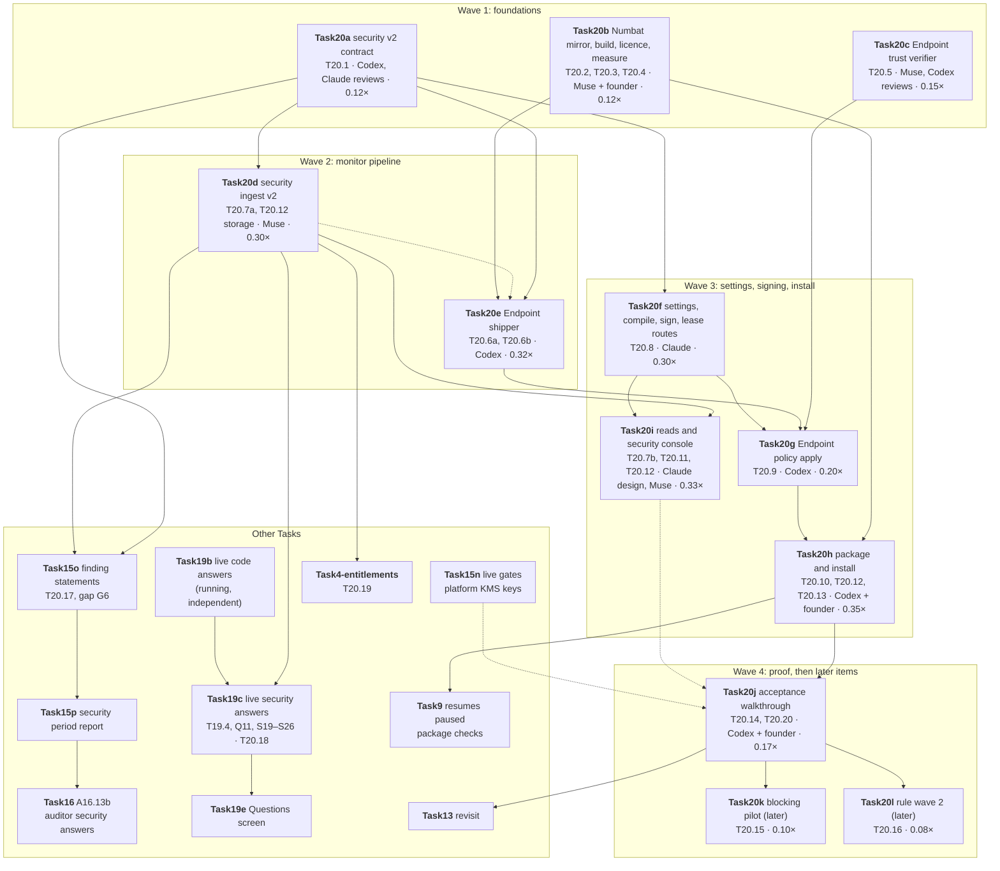

# Task20: coding-agent security with Numbat

*Tracker and session plan. Written 2026-10-16 by Claude (Task20 lead) from the founder-approved [`Task20_PRIMER.md`](primers/Task20_PRIMER.md) (checkpoint 1, 2026-10-16) and the decision record [`NUMBAT_ADOPTION_REVIEW.md`](NUMBAT_ADOPTION_REVIEW.md) §13–§15. Symbols per AGENTS.md §11. Each session edits only its own rows here (AGENTS.md §9 item 23).*

**Goal.** Monitor the AI coding agents on customers' Macs with Numbat, run unchanged, and give the CISO the enterprise layer around it:
- the TrackAI Endpoint installs and updates Numbat and ships its records;
- the server stores them per tenant;
- the CISO controls rule and data settings through switches, delivered as two separately signed documents;
- coverage, inventory, a day-one scan and, later, an opt-in blocking pilot.

**Completion claim.** An agent and platform are "monitored" only after their row in the acceptance walkthrough (E20) passes on a real machine. Everything else is "not monitored". Customer wording is always "observed", "requested", "denied by request", never "prevented".

**Simplicity rule (founder, 2026-10-16).** If carrying out a recommendation gets stuck, that item moves to phase 2 (or waits for a customer request) instead of growing. The fallbacks are in the primer's "Founder decisions" table; a session that uses one says so in its handoff and in §8 below.

---

## 1. Approved boundaries

1. **Numbat unchanged.** It is built from the TrackAI mirror fork at `20a5a52` (tag `v0.2.0-trackai.1`), with no product changes, and synced monthly. Before the first customer build, the pin moves to the first upstream release that contains `20a5a52`, after Numbat's own tests and TrackAI's fixtures pass; if there is no such release, the mirror tag ships.
2. **Platforms and agents.** macOS on the founder's Intel Mac first. Agents in this order: Claude Code and Codex, then Cursor and Gemini CLI, then Copilot CLI, on managed hooks. Windows and Linux come with Task9g and the Linux wave. OpenCode is not an enterprise route.
3. **Monitor is the product.** Blocking is opt-in, a few rules at a time (Task20k), after monitor mode is proven. Fail-open is accepted.
4. **What leaves the machine.** Only what the tenant's security data settings allow. The default allows no command, path or URL previews, and replaces the host name and user name with TrackAI's machine id. Raw content and full bodies never leave the machine; Task5's reveal stays the only raw path (rule 6). The server re-checks every upload (rule 9).
5. **Monitoring is machine-wide** (Q5). A finding outside an enrolled repository carries `repository: not_enrolled` and no path. Activation is fail-closed and bound to the tenant and machine (AGENTS.md §9 item 9 is rewritten in Task20j).
6. **Two signed documents, verified separately** (`docs/contracts/attesta/trust.md` "Consumers"):
   - the **rule bundle**, signed with the `policy_bundle` key. If it is rejected, the bundle is refused; if verification is unavailable, the Endpoint keeps the last good bundle.
   - the **activation lease**, per machine, signed with the `activation_lease` key. It carries the agents, the mode, the expiry, the bundle digest and the security data settings. If it is rejected, unavailable or expired, monitoring is off: nothing is uploaded, and the Endpoint falls back to the monitor-only bundle.

   Task20 consumes Task15's trust layer and never builds its own keys.
7. **Rule settings are switches only:** on/off, severity, and monitor or block per agent. There are no customer rules, no rule editor and no allow-lists (Q6). The first wave is 44 rules, with 7 noisy ones off; Task6.a's three Rust rules are retired.
8. **Tamper resistance.**
   - Phase 1 is **tamper-evident at the server**: the server sees missing records, a wrong bundle digest or a stale lease.
   - It is not tamper-resistant, because the record file, the rules folder and the Endpoint run in the developer's profile (Q1, Q2).
   - A root helper is a precondition for the blocking pilot.
9. **Licence.** Apache-2.0 notices and Numbat's `THIRD_PARTY_LICENSES.txt` ship inside the Endpoint package (`docs/TASK6_SECURITY_NUMBAT_LICENSE_PLAN.md`). TrackAI says "powered by Numbat"; TrackAI is never branded as Numbat.
10. **Out of scope:**
    - Task13's adapter reuse, hook de-duplication and session linking;
    - `customerPolicyForDataAccess` (ex-Task6.b);
    - customer rules and a rule editor;
    - OpenCode.

## 2. Master subtask matrix

| ID | Outcome | Implemented | Automated evidence | Founder-live evidence | Session | Completion boundary |
|---|---|---:|---:|---:|---|---|
| T20.1 | Security v2 contract: upload kinds (finding, enforcement, indicator, scan summary, permission event, Endpoint security status, agent inventory), rule-bundle manifest, activation lease v2, the lease reference in the fleet configuration, the machine-authenticated retrieval routes, data settings, error codes, fixtures from Numbat 0.5.0 | ✅ | ✅ 41 focused / 1,098 repository tests after merging main; full `npm run check` | n/a | Task20a | Frozen under `docs/contracts/security-v2/`; fixtures validate against the contract schemas and reproduce pinned Numbat IDs/joins |
| T20.2 | Mirror fork, reproducible build, checksums, monthly-sync runbook, coverage-table extraction | ⬜ | ⬜ | ⬜ founder creates the mirror | Task20b | Two builds give identical bytes; Numbat's own tests pass at the pin |
| T20.3 | Licence and notices for the binary | 🟡 plan doc updated in the plan PR | n/a | n/a | plan PR, Task20b | Notices inside the package |
| T20.4 | Size and hook-latency budgets; Git AI release build stripped or not | ⬜ | ⬜ script | ⬜ measured on the Mac | Task20b | Budgets written into this tracker (§6) |
| T20.5 | Rust trust verifier: same status and code as `verifyTrusted` on all 82 vectors | ⬜ | ⬜ | n/a | Task20c | Production hard-codes `production: true`; `lastTrusted` persisted |
| T20.6a | Shipper read side: tail with checkpoint, schema 0.5.0 only, minimize per lease, machine id, repository mapping, content-free permission events | ⬜ | ⬜ | n/a | Task20e | Fixture streams from Numbat's tests; no field beyond the data settings is queued |
| T20.6b | Shipper send side: generalized queue and uploader, local-file rotation (7 days), evaluator and its three rules retired | ⬜ | ⬜ | n/a | Task20e | Offline, restart and rotation cases; `src/security/mod.rs` evaluator removed |
| T20.7a | Ingest v2: migration widening `security_findings`, new tables, `/worker/security` v2 route, server re-check, Task6.a rows readable, Company A/B | 🟡 | 🟡 IT-T20d-01 (agent-verified 2026-10-17) · ⬜ founder run | n/a | Task20d | Attesta builder query (`builder.ts:409-424`) still returns Task6.a and v2 rows |
| T20.7b | Admin and auditor reads, AP-1, `no-store`, audited | ⬜ | ⬜ | n/a | Task20i | Previews only to admin/auditor roles when the tenant allows them |
| T20.8 | Settings (audited writer, G8), pinned catalogue, compiler (one folder per agent), signed bundle, signed per-machine lease with history (G7 part 1) and lease-issued events (G11, issued part), default policy | ✅ merged 2026-10-18 (PRs #81, #82): settings, catalogue, compiler, signed bundle, admin API, migration 0026; leases, machine routes, real authority, fleet v3, `app.ts` parser skip | ✅ IT-T20f-01 (founder run 2026-10-18) | ⬜ IT-T20f-02 (real KMS keys) | Task20f | Dev signer in tests; production keys from Task15n |
| T20.9 | Apply on the machine: verify lease and bundle, `numbat rules check`, atomic swap, last-known-good, off and monitor-only fallback, refusal reported as a `fleet.lease.refused` event (G11, refused part) | ⬜ | ⬜ | ⬜ IT-T20g-01 | Task20g | Tampered, expired, replayed and broken bundles never activate |
| T20.10 | Package and install: Numbat at a fixed path with checksum, managed hooks per agent, record-file location, four-layer health check, Endpoint security status reported (G7 part 2, stored per machine and day by Task20i), offboarding; re-run of Task9's paused package checks | ⬜ | ⬜ | ⬜ IT-T20h-01 | Task20h | Health check green for each agent in the walkthrough |
| T20.11 | Console: Settings, Findings, Coverage | ⬜ | ⬜ | ⬜ browser walkthrough | Task20i | Settings switches publish a new bundle; honest states shown |
| T20.12 | Agent inventory (S19) and coverage inventory: Endpoint side (Task20h), server storage (Task20d), views (Task20i) | ⬜ | ⬜ | ⬜ | Task20h, Task20d, Task20i | Inventory under the same data settings |
| T20.13 | Day-one scan (S20), opt-in, findings only | ⬜ | ⬜ | ⬜ | Task20h | Findings marked "found at rest" |
| T20.14 | Rule wave 1 proof and acceptance walkthrough E20-01…E20-12 | ⬜ | ⬜ | ⬜ | Task20j | Each agent's row passed or explicitly "not monitored" |
| T20.15 | Blocking pilot (3–5 rules) | n/a later | n/a | n/a | Task20k | Needs the root helper (Q2) and a passed Task20j |
| T20.16 | Rule wave 2 (7 noisy rules, tuned) | n/a later | n/a | n/a | Task20l | After Task20j |
| T20.17 | Task15o/15p redesigned on Numbat's finding schema; signed case bundles (S25) | n/a other Task | n/a | n/a | Task15o, Task15p | Task15 lead's plan |
| T20.18 | Q&A feed to Task19 (S1–S26) | 🟡 TASK19.md updated in the plan PR | n/a | n/a | lead | S19–S26 ranked with the founder |
| T20.19 | Module switches (entitlements) | n/a other Task | n/a | n/a | Task4-entitlements | Task20 adds only the `security` guard to its routes |
| T20.20 | AGENTS.md §4 (done in the plan PR), §9 items 9 and 11, Task6.a tracker superseded | 🟡 | n/a | n/a | plan PR, Task20j | Wording matches E20 results |

## 3. Interfaces to freeze first (Task20a)

The exact JSON and table names are decided in Task20a; these meanings are fixed now:

- **Upload kinds.** One versioned envelope, `trackai.security-upload/2`, carries any mix of the kinds below. The server derives tenant and machine from the machine credential, never from the body.
  - `finding`: rule id, rule version, severity, source agent, model, session, sub-agent, timing and phase, confidence, repository (`{id}` or `not_enrolled`), occurred-at, Numbat schema version, bundle digest, plus the previews the lease allows;
  - `enforcement`: decision `deny` or `no_override`, the finding ids it covers, the rule;
  - `indicator`: type, value (redacted, subject to the URL setting), count, first and last seen;
  - `scan_summary`;
  - `permission_event`: `requested`, `approved` or `denied`, the tool name, a `join` of `exact`, `same_session_window` or `unavailable`, no content;
  - `security_status`: Numbat version, wired agents, active bundle digest, lease id, last record time, health-check layer results;
  - `agent_inventory`: the agents installed and their versions.
- **Data settings.** Five field groups, each on or off: command previews, file paths, URLs, host identity, user identity. All are off by default.
- **Rule bundle manifest.** It names:
  - the tenant, the bundle version and epoch, and the Numbat pin;
  - for each agent, one folder with each file's path and SHA-256;
  - the enabled set, and the compiler version.

  The bundle is signed as a whole and verified as a whole.
- **Activation lease v2.** It names:
  - the tenant, the machine and the lease id;
  - when it was issued and when it expires (short-lived, renewed);
  - the mode (`off`, `monitor`, `monitor_and_pilot_block`), the agents and the bundle digest;
  - the data settings and the day-one-scan switch.

  It replaces Task9's `securityActivation {mode, version}` field; Task9's fleet configuration carries a reference to the lease.
- **Lease reference in the fleet configuration.** It is a new schema version of Task9's configuration. In place of `securityActivation` it carries `securityLease: {leaseId, bundleDigest, expiresAt}`. Schema v1 and v2 configurations stay readable, and their `securityActivation` is treated as `off`, which is fail-closed. The server half is built in Task20f, the Endpoint half in Task20g.
- **Retrieval routes (machine-authenticated, under `/worker/security`).**
  - `GET` the current lease for this machine;
  - `GET` a bundle by its digest;
  - `POST` an acknowledgement or a refusal.

  Tenant and machine come **only from the machine credential**. No path, query or body field names a tenant or a machine. A digest belonging to another tenant, or a lease for another machine, answers the same safe "not found" as a missing one, and the server audits it. Responses are `no-store` and carry the signed bytes exactly as signed. Task20a freezes the shapes, Task20f implements them, and Task20f's tests include Company A/B and machine X/Y cases.
- **Errors.** Safe codes only, in RFC 7807 form; no raw values are echoed back.

## 4. Waves and exit gates

### Wave 1: foundations (Task20a, Task20b, Task20c)
- The contract PR is merged, and its fixtures validate against Numbat's 0.5.0 schema.
- The mirror tag builds reproducibly, and Numbat's own tests pass at `20a5a52`.
- The Rust verifier matches all 82 vectors.
- Budgets for binary size and hook latency are recorded in §6.

### Wave 2: monitor pipeline (Task20d, Task20e)
- The migration has been generated, inspected and applied once through `scripts/it-db.sh`; `drizzle-kit check` is clean.
- Task6.a rows still read, and the Attesta builder query still works.
- Company A/B isolation is tested on every new table and route.
- An upload beyond the data settings is refused with a safe code.
- On the Endpoint, offline time, restarts, rotation and partial lines lose no record and duplicate none (at-least-once delivery, with server idempotency).
- The evaluator is removed.

### Wave 3: settings, signing, install (Task20f, Task20g, Task20h, Task20i)
- Bundles and leases are signed through Task15's signer contract and verified by the Rust verifier.
- Rejected, unavailable, expired and replayed cases follow `trust.md` "Consumers".
- A broken bundle never replaces a good one.
- The PKG installs Numbat and managed hooks for Claude Code and Codex on the Intel Mac, and the four-layer health check is green.
- Offboarding removes the hooks.
- The console never shows "prevented", and never shows zero where the value is `Unavailable`.

### Wave 4: proof (Task20j), then the later sessions (Task20k, Task20l)
- Walkthrough rows E20-01…E20-12 are passed or explicitly marked "not monitored".
- The 44 rules have run on the founder's normal work for a week, with no critical false positive left untriaged.
- AGENTS.md §9 items 9 and 11 are rewritten to match the evidence.

## 5. Sessions and file ownership

TrackAI and GitAI-repository work are separate sessions and PRs. Endpoint code is in GitAI; those branches are `task/<name>-gitai`, worktree `make gitai-worktree M=<name>`. Estimates: Muse's include the 1.3× factor. Migrations take the next free number when generated, on a fresh `main`.

| Session | Repository / agent | Pieces | Estimate | Depends on | Owned or pre-approved files |
|---|---|---|---:|---|---|
| **Task20a-security-v2-contract** | TrackAI / Codex (Claude, the Task20 lead, reviews; founder 2026-10-17) | T20.1 | about 0.12× estimate; about 0.16× actual | plan merged; prompt `docs/prompts/Task20/NEXT_CHAT_Task20a-security-v2-contract_PROMPT.md` | new `docs/contracts/security-v2/` (README, JSON Schemas, fixtures with an Apache-2.0 notice where derived from Numbat), new `apps/api/src/features/security-findings/v2-contract.ts` (frozen types, stubs that throw), its contract tests, `apps/api/package.json` (test script entry) |
| **Task20b-numbat-mirror-build** | GitAI / Muse + founder-live | T20.2, T20.3 (package side), T20.4 | about 0.12× | plan merged; founder has created the mirror fork and pushed tag `v0.2.0-trackai.1` | new `packaging/numbat/` in GitAI (build script, `SHA256SUMS` recipe, `LICENSE`, `THIRD_PARTY_LICENSES.txt`, `measure.sh`, sync runbook); no change to the Numbat mirror beyond the tag |
| **Task20c-endpoint-trust-verifier** | GitAI / Muse (Codex reviews; every answer is fixed by the 82 vectors) | T20.5 | about 0.15× | plan merged (vectors are on `main`) | new `src/trust/` module and tests; copied vectors under `tests/fixtures/trust/`; `Cargo.toml` / `Cargo.lock` (an ECDSA P-256 crate such as `p256`, pre-approved by merging this plan); closes GitAI backlog row G8 |
| **Task20d-security-ingest-v2** | TrackAI / Muse (Codex reviews the migration) | T20.7a for all seven kinds, including status and inventory storage (T20.12 server); the reads (T20.7b) moved to Task20i (lead, 2026-10-17) | about 0.30× estimate; about 0.35× actual | Task20a merged; prompt `docs/prompts/Task20/NEXT_CHAT_Task20d-security-ingest-v2_PROMPT.md` | as listed in its prompt §2.3: `schema.ts` (`security_findings` widened, seven new tables), one migration + `meta/`, `features/security-findings/` v2 files and the `/v2` mount line, `package.json` scripts; a fail-closed `SecurityV2Authority` that Task20f implements |
| **Task20e-endpoint-shipper** | GitAI / Codex | T20.6a, T20.6b | about 0.32× | Task20a and Task20b merged (contract fixtures and the pinned Numbat build); the run against the real Task20d route is IT-M20-02, not a merge gate | `src/security/` (new tail, records, minimize modules; `delivery.rs`, `delivery_queue.rs` generalized; evaluator in `mod.rs` removed; `activation.rs` reduced to the lease interface), `src/daemon.rs` and `src/daemon/telemetry_worker.rs` (wiring only), `src/commands/checkpoint_agent/orchestrator.rs` (remove `submit_activated_command` call) |
| **Task20f-security-settings-signing** | TrackAI / Claude | T20.8 | about 0.30× planned; re-estimated 0.45× and split (founder, 2026-10-17): part a about 0.25× actual, part b about 0.23× estimate, about 0.20× actual | Task20a merged | new `apps/api/src/features/security/` (settings, catalogue data from the pin with notices, compiler, bundle, lease, the machine-authenticated retrieval routes with Company A/B and machine X/Y tests, `task20f-signing-live-verify.ts`); the server half of the lease reference in Task9's files, pre-approved with Codex as Task9's owner reviewing: `features/fleet/{contract,service}.ts` and `fleet.test.ts` (new configuration schema version, v1/v2 compatibility), fleet audit details; `schema.ts`: the new security settings, bundle and lease tables, **and** the `fleet_configurations` schema-version type and its check `fleet_configurations_schema_version_check` (`schema.ts:350`, today versions 1 and 2 only), widened to the new lease-reference version, and `fleet_configurations_release_contract_check` (`schema.ts:352`) extended so the new version carries version 2's release fields; **one migration + `meta/`, always generated**, which creates the security tables and widens that check; `app.ts` (mount only), imports of `features/attesta/signer-contract.ts` and the KMS adapters (read-only use), `core/audit/catalog.ts` (only after a Task16 contract PR to the frozen `docs/contracts/audit/catalog.md` that flips the reserved `fleet.lease.*`, `policy.bundle.*` and `security.monitor.changed` events to active, gives them Task20 as owner, widens `security.monitor.changed`'s mode to `monitor_and_pilot_block`, and adds `security.enforce_mode.changed`) |
| **Task20g-endpoint-policy-apply** | GitAI / Codex | T20.9 | about 0.20× | Task20c, Task20e, Task20f merged | new `src/security/policy_apply.rs` (fetch the lease and bundle through Task20a's retrieval routes, verify, apply, acknowledge or refuse), lease handling in `src/security/activation.rs`, `src/fleet/` (parse the new configuration schema version's `securityLease`; Task9-owned, same agent) |
| **Task20h-endpoint-package-install** | GitAI / Codex + founder-live | T20.10, T20.12 (Endpoint), T20.13 | about 0.35× | Task20b, Task20g merged | `packaging/macos/` (PKG adds Numbat and managed hooks), `mdm/` scripts, `src/security/` (status, inventory, day-one scan), offboarding cleanup; then the re-run of Task9's paused package checks; Task9's tracker rows (TrackAI repository) are updated in a separate small docs PR, `docs/Task20h-task9-resume`, by Codex as Task9's owner |
| **Task20i-security-console** | TrackAI / Claude design note, Muse build | T20.7b (admin and auditor reads), T20.11, T20.12 (views) | about 0.33× | Task20d, Task20f merged | new `apps/web/src/app/dashboard/security-workspace.tsx`, `apps/web/src/lib/api.ts`, minimal `dashboard/page.tsx` navigation, read routes and service in `features/security-findings/` (keyset paging, previews decrypted only for admin/auditor, audited, `no-store`) |
| **Task20j-acceptance** | TrackAI docs + founder-live, Codex for Endpoint runs | T20.14, T20.20 | about 0.17× | Task20h merged (Task20i for the console rows); Task15n keys for IT-T20f-02 | `docs/plan/TASK20.md` §6–§8, `AGENTS.md` §9 items 9 and 11, `TASK6_SECURITY.md` (superseded note), runbook `docs/plan/TASK20_ACCEPTANCE.md` |
| Task20k-enforce-pilot (later) | Codex + founder-live; its prompt splits it into a GitAI session and a TrackAI session | T20.15 | about 0.10× | Task20j passed; root helper designed (Q2) | named in its prompt |
| Task20l-rule-wave-2 (later) | TrackAI / Muse | T20.16 | about 0.08× | Task20j passed | `features/security/` default policy and tests |

**Total:** about 2.55× T6 for Task20's own sessions (Task20a–Task20l). Task15o/15p, Task19c and Task4-entitlements are sized in their own Tasks.

**Parallel work** (one session per agent at a time):
- Claude: Task20a review → Task20f → the Task20i design note.
- Codex: Task20a → Task20e → Task20g → Task20h → Task20j.
- Muse: Task20b → Task20d → Task20c → Task20i build (Task20d first: it unblocks Task20i, Task19c and Task15o, while Task20c is needed only at Task20g, which also waits for Claude's Task20f).

GitAI sessions never overlap in files: Task20c is `src/trust/`, Task20e is `src/security/` delivery. Task13 is held, so it does not compete for the hook or `mdm/` files.

### Session graph

**Critical path:** Task20a (or Task20b) → Task20e → Task20g → Task20h → Task20j (about 1.2×); Task20d is off it because Task20e merges against Task20a's schemas and meets the real route only in IT-M20-02. **Start at once:** Task20a, Task20c and Task20b (once the mirror exists).

## 6. Budgets (filled by Task20b)

| Item | Measured | Budget | Status |
|---|---|---|---|
| Numbat binary, darwin/arm64, v0.2.0 release | 17.5 MB (founder's tarball, 2026-10-16) | to set | 🟡 |
| Numbat binary at `20a5a52`, darwin/amd64 and arm64 | — | to set | ⬜ |
| Git AI binary (installed) | 69 MB; stripped? | to set | ⬜ |
| Added latency per tool call, Numbat hook (median / p95) | — | to set (proposal: p95 ≤ 100 ms) | ⬜ |
| Added latency per tool call, both hooks together | — | to set | ⬜ |

## 7. Integration and founder-live evidence

| ID | What it proves | Prerequisites | Gating | Status |
|---|---|---|---|---|
| IT-T20b-01 | Two builds of the mirror tag give identical bytes; Numbat's tests pass at the pin | Go toolchain | Blocking: Task20b | ⬜ |
| IT-T20d-01 | Real PostgreSQL: v2 upload of each kind, refusal beyond data settings, idempotent replay, Task6.a rows readable, Attesta builder query, Company A/B | `scripts/it-db.sh` | Blocking: Task20d merge | ⬜ |
| IT-T20e-01 | The real Numbat binary writes a fixture session's records; the Endpoint tails, minimizes, queues and uploads to a local receiver that validates every body against Task20a's schemas; restart and rotation lose nothing | Numbat build from Task20b | Blocking: Task20e merge | ⬜ |
| IT-T20f-01 | Settings → compiled bundle → signed bundle and lease (dev signer) → TypeScript `verifyTrusted` accepts; tampering rejected; machine routes, ingest under a lease, expiry and `off`; fleet v3; audit events; Company A/B, machine X/Y | `scripts/it-db.sh` | Blocking: Task20f merge | ✅ founder run passed 2026-10-18 |
| IT-T20f-02 | The same with the platform `policy_bundle` and `activation_lease` KMS keys | Task15n root ceremony and keys | Blocking: first customer build | ⬜ |
| IT-T20g-01 | Intel Mac: tampered, expired, replayed and broken bundle and lease never activate; last-known-good kept; off means nothing uploaded | founder's Mac, throwaway tenant | Blocking: Task20g merge | ⬜ |
| IT-T20h-01 | Intel Mac: PKG installs Numbat and managed hooks (Claude Code, Codex), the four-layer health check is green, offboarding removes them | founder's Mac | Blocking: Task20h merge | ⬜ |
| E20-01…E20-12 | Acceptance walkthrough per agent: monitor, off, offline, lease expiry, restart, tampered bundle, data settings, day-one scan, inventory, console, Company A/B | Task20h (+ Task20i) merged | Blocking: any "monitored" claim | ⬜ |
| IT-M20-01 | Task15o signs v2 findings; Task19c answers S rows from v2 tables | Task15o, Task19c | Cross-Task | ⬜ |
| IT-M20-02 | The same Endpoint against the real Task20d route on `scripts/it-db.sh` | Task20d and Task20e merged | Blocking: Task20h merge | ⬜ |

## 8. Completion and deferral boundary

Task20 is complete when Task20a–Task20j have merged and E20 has passed for at least Claude Code and Codex on the Intel Mac. It can close with these conditional rows:

| If this is still missing | The claim becomes |
|---|---|
| Cursor, Gemini CLI or Copilot CLI | "not monitored" for that agent (phase 2) |
| Apple Silicon, Windows, Linux | "not monitored" for that platform (Task9 and Task9g, the Linux wave) |
| Task15n keys | Production signing waits; engineering is complete; IT-T20f-02 stays ⬜ |
| ACL spike (Q1) not adopted | Record file stays in the profile |
| Root helper (Q2) | Task20k waits |

Task20k and Task20l start on the founder's go, not on the calendar.

## 9. Founder decisions

1. **2026-10-16:** review §10 Q1–Q10 and §13 approved (decision record).
2. **2026-10-16 (round 2):**
   - develop on the pin `20a5a52`;
   - 44 rules in the first wave;
   - binary sizes as measured;
   - Task15n gate 6 removed, replaced by E20;
   - Task9's package validation paused until Task20h.
3. **2026-10-16 (checkpoint 1):**
   - the primer approved as written;
   - primer Q1–Q10 approved as recommended, with the simplicity rule;
   - the TrackAI Endpoint naming (AGENTS.md §2);
   - session graphs instead of sub-task graphs;
   - the Task20 lead updates TASK19.md.
