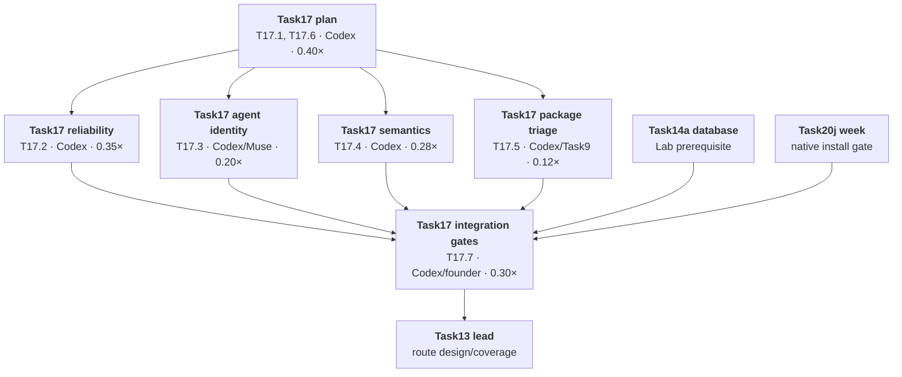

# Task17 primer: choose which public Git AI changes TrackAI should take

*Written 2026-10-22 by Codex. Founder decisions: pending checkpoint 1. All ledger dispositions below are proposals.*

## In one paragraph

TrackAI will review the public Git AI changes since its last imported snapshot and take only the fixes and features that improve the Endpoint without weakening TrackAI's attribution, privacy, security or delivery promises. Each upstream commit has an explicit proposed decision in [`GITAI_UPSTREAM_LEDGER_2026-10.tsv`](../GITAI_UPSTREAM_LEDGER_2026-10.tsv). A clean trial application means only that Git can apply a patch; it is not approval to ship it.

## A customer story

Priya, the security lead at Acme, needs developer machines to keep recording trustworthy AI provenance even when a daemon is busy or an agent changes its model. A stalled Git process and a missing or duplicate model count make her dashboard less reliable. After this Task, selected upstream fixes are integrated with tests and a Lifecycle Lab comparison, while the dashboard still distinguishes what it observed from what it cannot know. Task13 later expands the supported agent and host routes; this Task alone does not make a new route supported.

## Words you will see

| Word | Means |
|---|---|
| Upstream | The public `git-ai-project/git-ai` project; read-only for Task17. |
| Fork | TrackAI's `mahamannu-ux/git-ai`, which has its own product rules and code. |
| Port | Implement the useful behavior in the fork, usually adapting it to current code. |
| Trace2 | Git's event stream that the Endpoint uses to discover Git operations asynchronously. |
| Authorship note | The Git note recording which code lines have AI, known-human or untracked evidence. |
| Lifecycle Lab | Controlled Task2 scenarios that compare attribution and metric meaning before and after a change. |
| Route | A specific agent, host surface and operating system combination, such as Codex CLI on macOS. |
| Trial apply | A `cherry-pick --no-commit` in a disposable worktree, reset immediately afterward; it tests textual applicability only. |

## Starting facts and the change from the handoff

The refs were refreshed on 2026-10-22. The common imported snapshot is `a751efd64d12`; public `upstream/main` is `8a6184a3a8fc`, and fork `origin/main` is `980ef3ef31b0`. The upstream range contains **304 commits: 242 non-merge commits and 62 merge bookkeeping commits**. The fork has **149 non-merge commits** since the same snapshot, two more than the handoff's 147. The two sides changed **41 of the same paths**. Upstream did not change `LICENSE` in this range. The large TokenUsage v2 series says it ports parsing ideas from **ccusage (MIT)**, so any selected port needs a source/license record in addition to Git AI's Apache-2.0 provenance.

Every non-merge upstream commit was trial-applied independently to a disposable worktree at fork `origin/main`: **50 clean, 192 textual conflicts**. The 62 merge rows were not applied because they have no independent feature to port. An isolated conflict can reflect a missing preceding commit as well as a fork edit. The ledger records touched paths, overlap, trial result, potential semantic collision, feature or issue, customer impact and Codex's proposed decision. It does **not** claim that a clean patch is semantically safe.

The old [`TASK17.md`](../TASK17.md) and [`GITAI_UPSTREAM_INVENTORY_2026-10-09.md`](../GITAI_UPSTREAM_INVENTORY_2026-10-09.md) still describe the 302-commit snapshot. Updating the tracker is Phase 2, after your decisions. The prompt also calls the Lifecycle Lab status-board row “7i”; in the current board, 7i belongs to Task19, so Phase 2 must give the Lab row a distinct ID.

## The pieces for your checkpoint

Size is relative to all of Task6.a = 1.0×. The estimate is for selected TrackAI work and review; native runs depend on available machines and the Task20j/Task14a gates.

| # | Piece in plain words | Example and customer value | Size | Who | Cheaper choice and cost | Founder: keep / simplify / defer / reorder |
|---|---|---|---:|---|---|---|
| T17.1 | Finish the commit ledger and fork regression map | Every public fix or feature has a reasoned decision; the team can audit why it was taken or skipped. High trust value. | 0.28× | Codex | Review only group heads; loses per-commit accountability, so I do not recommend it. | |
| T17.2 | Port selected daemon stall and latency fixes | A wedged trace listener no longer leaves Git blocked; checkpoints remain ordered. High reliability value. | 0.35× | Codex | Take only small isolated fixes; leaves the documented #2157/#2252 stall classes. | |
| T17.3 | Port selected agent/model identity fixes | Codex fork streams are not ingested twice, and Copilot's selected model is attributed correctly. Medium value now; high Task13 value. | 0.20× | Codex or Muse for one isolated fix | Defer all to Task13; Task13 starts from weaker identity data. | |
| T17.4 | Review attribution, notes and local metric correctness against Task2 | Human/AI recovery and usage corrections do not silently rewrite lifecycle numbers. High correctness value. | 0.28× | Codex | Port only obvious parser fixes; postpones contested semantics to Task2. | |
| T17.5 | Review package, config and release fixes with their owners | Installer permission/version mistakes and WSL credential exposure get an explicit Task9/14 owner. Medium value. | 0.12× | Codex + Task9/14 review | Record and defer without porting now; native fixes wait for their own acceptance. Recommended for most rows. | |
| T17.6 | Decide the new TokenUsage v2 feature as a single contract | Deduplicated Claude/Codex tokens, cost and per-subagent usage could improve spend reporting. High potential value; high schema/privacy cost. | 0.12× decision only; implementation estimated separately at 0.45–0.70× | Codex + Task2/13/Claude | Recommend deferring implementation to Task13 after T13.2 and a server wire/privacy design. Token reporting remains as today. | |
| T17.7 | Integrate, review and run the Task17 gates | One fork branch, full Rust suites, Lab comparison and bounded native checks support a single fork PR. High release confidence. | 0.30× plus founder-live time | Codex + founder-live | Split native claims: code may be reviewed, but no package or route claim before its live gate. | |

**Initial implementation estimate: about 1.65× T6, plus founder-live time.** Taking TokenUsage v2 inside Task17 would raise it to about 2.1–2.35× and add a TrackAI server contract and privacy review. These are planning estimates, not completed effort.

## Review groups: Codex's current recommendations

Counts below are **proposals over all 304 rows**, including 62 merge bookkeeping rows proposed as `reject` because they have no independent patch. “Adapt” means implement the behavior with current fork tests, not blindly apply the upstream SHA. The ledger holds the row-level feature/issue and reasoning.

| Group | Proposal counts | Five important commits and what they bring | Main risk and recommendation |
|---|---|---|---|
| Daemon/runtime | 20 adapt; 16 reject; 6 defer Task2; 2 defer Task14 | `c40c82dca` moves work off the trace accept loop; `6a7d25a75` probes actual trace draining to recover a stalled daemon; `648f8e92f` filters unused trace frames; `7e8713726` moves slow family side effects off ingestion; `2b2920b94` bounds causal fences. | Highest operational value. Port the failure fixes as a tested series against current Task20 daemon wiring. Do not accept queue loss or new synthetic provenance. |
| Attribution/notes | 2 adapt; 4 defer Task2; 2 defer Task14; 7 reject | `1e400d552` labels remaining untracked lines human; `4dc3b1ccf` corrects human additions in range stats; `2cbdfd3b5` introduces lite rewrite mode; `4f3586c60` forces C locale for internal Git; `1f09b1772` defaults API-key users to HTTP notes. | Human/AI meaning and note transport can change. Require a before/after Lab scenario; defer HTTP notes default to Task14 privacy/credential review. |
| Metrics/telemetry | 7 adapt; 11 defer Task2; 4 reject | `d0f864c57` removes a SQLite operation from each checkpoint; `7b0eead75` isolates telemetry but drops batches on full queue; `7e71f693c` exposes silent ingest loss; `120bcf25c` supplies model on recovered-edge metrics; `ce5c08ceb` adds daemon health to heartbeat. | Preserve the fork's durable metric queue. Adapt the isolation and health ideas only with bounded no-loss behavior and an agreed server event shape. |
| Agent/editor | 10 adapt; 12 defer Task13; 16 reject | `f17bf9177` resolves Codex model from incomplete hooks; `79cb2e83a` reads selected Copilot model; `2b7dc3b18` accepts mixed-case Claude tool names; `7ace11b09` keys Codex streams by rollout file to prevent duplicate ingestion; `9af568ff1` tests that identity on macOS. | Take focused correctness fixes with route fixtures. They do not by themselves make any Task13 route live-supported. |
| TokenUsage v2 | 92 defer Task13; 3 reject merge rows | `6626f6b19` parses Claude/Codex transcript usage; `aac4bbc49` persists deduped entries and bucket revisions; `493805c22` emits new event 9; `262201056` removes replayed Codex fork usage; `120f6ded5` attributes child usage to its own session. | This is a large **new feature**, not routine metric maintenance. It changes wire format, cost estimates, retention, transcript reads and session identity. Upstream documents an accepted risk of lost first emissions during a long outage. Recommend one Task13 design decision after its host contract, with Task2/privacy sign-off; no default-on flip in Task17. |
| MDM login start | 15 reject | `fb48f9530` adds scripts; `42fc263c8` rejects unsafe paths; `edbd6d80f` retries login start; `805bdda44` runs hosted tests; `7e0dd3455` launches the binary directly. | Task9b already selected and ported the macOS/Windows end state, including bounded `bg start --retry-secs`; Linux and upstream credential transport are outside the approved package scope. No second port. |
| Packaging/release | 14 defer Task9; 2 defer Task14; 5 reject | `acbac7ef8` fixes installer version metadata; `5b25b11a6` fixes macOS payload mode; `5a79c60e2` adds `install-hooks --env`; `3b3d01e48` avoids credentials in WSL process arguments; `635b6f29b` enables WSL by default. | Task9 owns packages and native acceptance; Task14 owns release trust. Do not enable WSL or change secret transport from this sync alone. |
| Config/auth | 6 adapt; 2 reject | `16655f8fb` corrects config command streams; `6adc1f264` caches Git author identity to avoid a spawn every three seconds; `2c321c143` handles lowercase HEAD; `878775205` normalizes Unicode paths; `656ede16d` post-filters non-ASCII pathspecs. | Small, useful correctness work, but test the current config/credential defaults and Unicode cases. |
| CI/deps/docs and other bookkeeping | 41 CI/deps/docs rows: 38 reject, 3 defer Task14; 5 other merge rows reject | `411cf7456` adds a workflow security gate; `c08de56df` hardens Actions; `96a8ba2e1` pauses nightly issue creation; `0670e7ef2` bumps 1.7.6; `8a6184a3a` merges a CI PR. | Version churn and upstream-specific workflows bring little fork value. Task14 may take the workflow security pattern with its release work. |

### Three decisions with an especially important product effect

1. **Reject synthetic “untraced commit fixup” as proposed** (`33b1c701c` and its follow-ups). It creates commit attribution from reflogs when no Trace2 command was observed. That may fill a coverage gap, but it crosses the fork's Trace2-only source rule (`AGENTS.md` §9.7) and risks turning unknown activity into a claimed provenance event. Task13 can study the missing route without describing it as exact evidence.
2. **Adapt, never cherry-pick, telemetry isolation** (`7b0eead75`). Its bounded in-memory queue discards metric batches under pressure. The fork has a durable offline queue and a restart regression at `tests/integration/commit_metric_metadata.rs:211`; discard would break that guarantee. The safe port must move slow uploads off the daemon path while retaining persistent retry and explicit loss/health reporting.
3. **Treat TokenUsage v2 as a product feature decision.** It promises better token counts, cost and subagent reporting, but it adds event id 9, a new SQLite database and revised price semantics. Current TrackAI stores session usage in `apps/api/src/features/telemetry/service.ts:1165-1194`; it does not have a frozen v2 event contract. Recommend designing that with Task13 T13.2/T13.9 and Task2 before any Endpoint default-on change.

## What the fork already delivers and what guards it

The 149 fork-side non-merge commits are grouped by their owning behavior: Task2 **2**, Task4 **8**, Task5 **2**, Task6.a **55**, Task9 **24**, and Task20 **58**. These counts assign each commit once by the behavior it added; some cross-cutting commits span two Tasks, so the owner of the affected behavior still reviews a port.

| Fork work since the common base | Behavior that must survive | Existing guard or gap |
|---|---|---|
| Task2 and Task4: lifecycle and metric delivery | Generated/Committed and model linkage keep their meanings; offline metrics survive daemon restart. | `tests/integration/commit_metric_metadata.rs:142,211,377`; TrackAI `Task2.md:63-67` and `AGENTS.md` §1.8. A full Lab run is still required for semantics. |
| Task5 evidence | OpenCode evidence is collected through a governed path with explicit privacy boundaries. | Fork `src/commands/evidence.rs:226`; server `apps/api/src/features/telemetry/service.ts:1147-1194`. Raw-content policy is in TrackAI `AGENTS.md` §1.6; no single fork test proves the full server privacy boundary. |
| Task6.a and Task20 security | Monitor findings, lease gating, trust verification, reduced records, durable delivery, day-one scan and health stay inert or fail closed when authority is absent. | `src/security/lease_state.rs:339`, `src/security/delivery_queue.rs:559,583`, `src/security/day_one_scan.rs:515,543,669`, `src/trust/verify.rs:642-718`, `tests/security_v2_contract.rs:18-66`. |
| Task9 Endpoint packages and fleet | Native secret store, no secret in packages, managed login start, pinned release, clean removal. | `tests/mdm_scripts.rs:222,287`; `src/security/policy_apply.rs:1697,2330`; Task9 live IT-T9-02 remains a separate gate. |
| Trace2 core across all Tasks | No new Git wrapper processing, no per-commit Git spawn, bounded ingest work and exact evidence only when supported. | GitAI `AGENTS.md` rules 1–4 and `src/daemon/trace_normalizer.rs:1446-1473`; any selected daemon port needs focused `TestRepo` cases and latency evidence. |

## Task13 and later dependencies

- Task13's `AGENT_COVERAGE.md` requires exact agent, model, host surface and capture channel. Codex, Copilot and Claude fixes can improve inputs to AC-CLI-02, AC-IDE-01/02 and their desktop variants, but Task13's route conformance and live host gates remain independent.
- Task2 `T2.25–T2.29` and `E21–E25` keep lifecycle acceptance for Cursor, Xcode, Codex desktop, Claude Desktop and native OSes. No upstream commit proves those routes by itself.
- Task14a's fully migrated database is needed for the Lifecycle Lab regression. Task9f's signed package and Task20j's seven-day run gate native package checks. During that run there is no install on the founder's everyday account; a separate macOS account and per-user debug binary may be used only after verifying the daemon's database.
- Task14 receives package/release provenance, credential and workflow hardening candidates. Task18 receives real-world validation gaps; it does not inherit an untested support claim.

## Session graph proposed for Phase 2

Critical path: group approval → daemon integration → full regression and Lab/native gates → one fork PR → Task13. Agent identity and package triage can proceed in separate, non-overlapping files after the group approvals; any Task20 daemon/security hotspot needs the Task20 lead's review before integration.

## What we reuse

Reuse the fork's `TestRepo` trace-driven harness, the Task2 Lifecycle Lab, Task4's durable metric queue, Task9's package contracts, Task20's security/trust tests and the Task13 route matrix. The upstream is a source of behavior and regression examples, not a replacement for these contracts. No SushiCorp component appears to lower effort for this Rust upstream sync.

## Risks and decisions for you

- **Recommend keep:** the high-value trace drain, checkpoint and model-identity fixes, with adaptation and focused tests. The ledger's `adapt` rows are a review queue, not automatic approval of every port.
- **Recommend defer:** TokenUsage v2 to Task13 design with Task2/privacy review; package/WSL changes to Task9; release and HTTP-notes defaults to Task14. This keeps new feature scope visible instead of smuggling it into a sync.
- **Recommend reject:** independent merge rows, already-ported MDM behavior, upstream version churn, and synthetic untraced commit attribution under the current Trace2-only rule.
- **Founder decision at checkpoint 1:** mark each T17 row and each review group keep/simplify/defer/reorder; decide whether TokenUsage v2 should remain a Task13 feature, and whether the Trace2-only rejection stands. My recommendation is **yes** to both.
- **Claude group review:** send each approved group summary and its relevant ledger rows to Claude before any port. A semantic or privacy change needs explicit product sign-off and a named before/after scenario.

## Baseline and evidence limits

`npm ci` passed in the new planning worktree. The full `npm test` run did not finish: localhost-binding tests failed under the sandbox, and `attesta-api.test.ts` had not completed after seven minutes, so I stopped it. A focused rerun of `app-cors.test.ts` with localhost binding allowed passed 2/2; its earlier `EPERM` was a sandbox failure, not a product failure. The GitAI trial worktree contained only throwaway cherry-pick attempts, was reset after each attempt and has been removed. No Endpoint package was built or installed.

## Suggested sessions (finalize only after your marks)

| Session | Pieces | Agent | Estimate | Why this agent |
|---|---|---:|---:|---|
| Task17a-plan | T17.1, T17.6 | Codex | 0.40× | Evidence, conflict and product decisions need one lead. |
| Task17b-daemon-reliability | T17.2 | Codex | 0.35× | Heavy overlap with Task20 and trace ordering. |
| Task17c-agent-identity | T17.3 | Codex; one bounded Muse port possible | 0.20× | Route evidence needs Task13 continuity. |
| Task17d-attribution-metrics | T17.4 | Codex | 0.28× | Task2 semantics and Lab are central. |
| Task17e-package-triage | T17.5 | Codex with Task9 review | 0.12× | Avoid conflicting package ownership. |
| Task17f-integration | T17.7 | Codex + founder-live | 0.30× | One branch, one regression and native-gate record. |

## Founder decisions

Pending checkpoint 1. No upstream code is ported until the group decision and Claude review are recorded.
