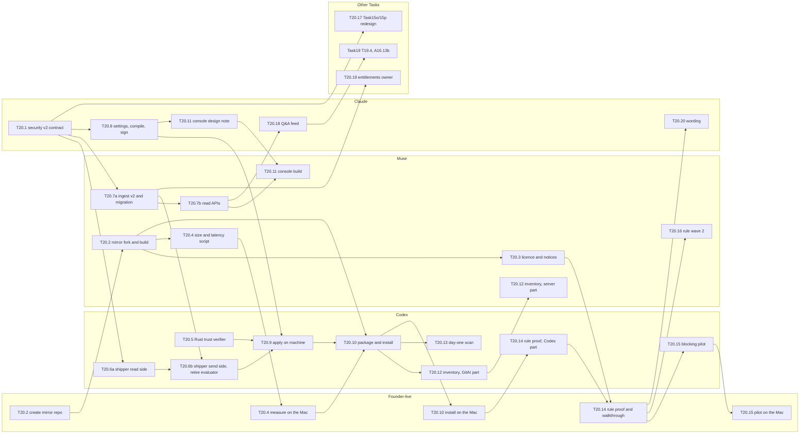

# Task20 primer: coding-agent security with Numbat

*Written 2026-10-16 by Claude (Task20 lead) from `docs/plan/NUMBAT_ADOPTION_REVIEW.md` (the decision record, §13–§15), Numbat at `20a5a52`, TrackAI `main` at `6b6156c` and GitAI fork `main` at `d1838619c`. Numbat facts are cited as `numbat@20a5a52:path:line`. Founder decisions recorded: pending (checkpoint 1).*

## In one paragraph

When Task20 is done, a security team can switch on monitoring of the AI coding agents on its developers' Macs (Claude Code, Codex, Cursor, Copilot CLI and Gemini CLI) and see, in TrackAI, the risky actions Numbat observed those agents asking to take: reading SSH keys or cloud credentials, piping a download into a shell, opening a reverse shell, editing agent settings, a secret read followed by a network upload, and 44 kinds of such patterns in all. Each finding says which machine, agent, model and session, when, which rule and which rule version, and whether the developer was asked for permission. The CISO chooses, with switches in the console, which rules are on, how severe each one is and, for a few rules, whether the agent should be asked to refuse the action. TrackAI installs and updates the detector on every machine, keeps a signed record of what each machine was told to do, keeps companies' data apart, and never takes prompts, code or command text off the machine unless the customer has switched that on. The detector is Numbat, an open-source project TrackAI runs unchanged.

## A customer story

Priya is the CISO at Acme, 120 developers on Macs. Today TrackAI can tell her almost nothing about agent security: Task6.a watched one agent (OpenCode in a terminal) for three command patterns.

After Task20 she opens **Security → Settings**, keeps TrackAI's recommended rule set (44 rules on, 7 noisy ones off), leaves "command previews" switched off, and publishes. Within a minute the 120 Macs have a new signed rule bundle. Next morning she sees: Codex on Sam's laptop read `~/.aws/credentials` and then ran `curl` to an unknown domain (one "secret read, then egress" finding, high); two Cursor sessions wrote to `~/.ssh/authorized_keys` (critical); Claude Code ran in a reduced-approval mode four times this week (`tamper.guardrails_off`, severity low). On **Security → Coverage** she sees which agents are installed on which machines, which are monitored, and that six machines have Gemini CLI installed although Acme's rollout list (the agents it chose to hook in Task9) does not include it. At enrolment she also ran a one-off **day-one scan** of past agent sessions: three machines had already read private keys last month.

What she still cannot do after Task20: stop an action for sure (Numbat asks the agent to refuse, the agent decides, and any error lets the action through); see what the command was unless she switches previews on; monitor Windows or Linux machines (later, with Task9g and the Linux wave); write her own rules; and, for most agents, link a finding to the developer's "yes, allow it" click (see question Q3).

## Words you will see

| Word | Means |
|---|---|
| Numbat | An open-source (Apache-2.0) program by Perplexity that watches AI coding agents through their hooks and applies security rules. TrackAI runs it unchanged. |
| Hook | A small program an agent runs before or after each tool call (for example before running a shell command). Numbat installs itself as one. |
| Managed hook | A hook written into the agent's machine-wide, administrator-owned settings file, which the developer cannot simply remove. |
| Rule | One security pattern, such as "an agent wrote to `authorized_keys`". Numbat ships 51. |
| Finding | One rule match: what, where, when, which agent. |
| Monitor / block | Monitor records a finding. Block also asks the agent to refuse the action; the agent decides. |
| Fail-open | If Numbat crashes or times out, the action goes ahead and no refusal is sent. |
| Record file | The file on the machine where Numbat writes its findings (NDJSON: one JSON record per line). |
| Shipper | The part of GitAI that reads the record file and uploads records to TrackAI. |
| Security rule settings | The CISO's switches: which rules are on, their severity, monitor or block. |
| Security data settings | The CISO's switches for what may leave the machine (command previews, file paths, URLs, host name and user name). Default: none of these. |
| Rule bundle | The rule settings turned into Numbat's own rule files, signed by TrackAI's server. |
| Activation lease | A short-lived, signed note to one machine: "monitoring is on (or off), in this mode, with this bundle and these data settings, until this time". It is D6.1. |
| Trust verifier | The code that checks a signature against TrackAI's key hierarchy (Task15's trust layer) and answers verified, rejected or unavailable. |
| Day-one scan | A one-off Numbat scan of the agent session files already on a machine, to find risky actions that happened before TrackAI arrived. |
| Coverage inventory | Which agents Numbat supports, per agent and platform, copied from Numbat's own coverage table at each monthly update. |
| Mirror fork | TrackAI's own copy of the Numbat repository, with no changes, from which TrackAI builds the binary it ships. |
| T6 | The size unit: all of Task6.a = 1.0×. |

## Facts from the code that change the plan

Phase 0 checked the review's design against Numbat's code and docs and TrackAI's and GitAI's `main`. Ten facts matter; questions Q1–Q10 below come from them.

1. **The record file cannot simply be admin-owned.** Hooks run inside the developer's own agent process and append to the file (`numbat@20a5a52:internal/output/filesink_nofollow.go:18-25`); Numbat's managed example writes to `$HOME/.numbat/…` (`numbat@20a5a52:docs/deployment.md:180-186`) and itself says such a file "remains in the user's profile unless its ACL says otherwise, so forward records promptly" (`numbat@20a5a52:docs/deployment.md:378-381`). Numbat does not rotate the file (`numbat@20a5a52:docs/live-capture.md:122-123`). → Q1.
2. **Nothing on the machine runs as administrator after install.** GitAI installs per user into `~/.git-ai/bin` from a root PKG script (`git-ai@d1838619c:packaging/macos/scripts/postinstall:29-36`) and starts from a per-user LaunchAgent (`git-ai@d1838619c:mdm/README.md:10`). An admin-owned rules directory, Numbat binary or managed hook file can be written at PKG install, but not by GitAI later when a new rule bundle arrives. → Q2.
3. **Numbat reads the rules directory on every hook call and does not check signatures** (`numbat@20a5a52:docs/rules.md:640-646`). An invalid replacement rule makes the whole load fail (`numbat@20a5a52:docs/rules.md:633-634`), and a hook's handled errors fail open (`numbat@20a5a52:docs/cli.md:927-928`), so a bad bundle would most likely mean no detection at all; T20.9 proves this with a broken bundle. So GitAI must verify the bundle, run `numbat rules check` on the staged copy, and only then swap it in atomically.
4. **GitAI has no real trust verifier yet.** Production uses `UnavailableVerifier` (`git-ai@d1838619c:src/fleet/mod.rs:221-230`, wired in at `src/daemon.rs:8473`; `src/fleet/managed_update.rs:25`); the Rust port that must match Task15's 82 vectors is an unowned backlog row (`docs/plan/GITAI_FUTURE_TODO.md:14`, G8). Both signed documents depend on it, and so does Task9's IT-M9-01. → Q4.
5. **Findings carry no repository, only an unsalted hash of the project path** (`numbat@20a5a52:docs/schema/v0.5.0/finding-record.schema.json`, field `project_path_hash`; `numbat@20a5a52:SECURITY.md:52-53`), while TrackAI's table requires a repository (`apps/api/src/core/db/schema.ts:478`, NOT NULL with a tenant foreign key at 516-519) and Task6.a's activation is per repository. Many risky actions (reading `~/.aws/credentials`) happen outside any repository. → Q5.
6. **Linking a finding to the developer's approval mostly does not work for the first five agents.** Numbat's per-action id exists for Claude Code only on `PermissionDenied` (an automatic denial, not an approval); Codex and Copilot CLI hooks have "none verified"; Cursor and Gemini CLI report no permission events at all (`numbat@20a5a52:docs/agent-coverage.md:117-141`). → Q3.
7. **Permission events need the full local event stream.** They are events, not findings, so the hooks must run with `--emit all` (`numbat@20a5a52:docs/live-capture.md:107-113`). The local file then holds a preview of every agent action (redacted, at most 200 characters; `numbat@20a5a52:docs/cli.md:230`); only the shipper's filter keeps it local.
8. **Copilot CLI refuses actions when a hook crashes**, even in monitor mode (`numbat@20a5a52:docs/enforcement.md:116-120`, `numbat@20a5a52:docs/agent-coverage.md:182-184`). A broken Numbat install would stop Copilot CLI users working.
9. **Rule changes are whole-file copies, and blocking is chosen per install, not per agent inside one directory.** A severity change or a block switch means copying the pinned rule's complete YAML, changing it and bumping its version (`numbat@20a5a52:docs/enforcement.md:54-66`); `enabled: false` turns a rule off (`numbat@20a5a52:docs/rules.md:636-638`). "Block on Codex but monitor on Cursor" therefore needs one compiled directory per agent. Numbat has **no allow-list field** (`numbat@20a5a52:docs/rules.md:100-113`): an allow-list means editing the rule's CEL expression. The review lists allow-lists in the rule settings (§14), so deferring them narrows that decision. → Q6.
10. **Smaller points:** S21 (bypass modes) leans on `exec.agent_runtime_bypass_flags`, which is one of the 7 rules deferred as noisy (`docs/TASK6_SECURITY_RULE_INVENTORY.md:55`), so S21 is only partly answered in wave 1 (`tamper.guardrails_off`, `chain.permission_denied_then_runtime_bypass` and the `permission.*` events remain). Attesta's statement builder reads `security_findings` by repository and session (`apps/api/src/features/attesta/builder.ts:409-424`), so the migration must keep those columns working. Task9's fleet configuration already carries a `securityActivation: {mode, version}` field (`git-ai@d1838619c:src/fleet/mod.rs:65-68`, used at `:91` and `:124`) that the new lease replaces. The frozen trust contract labels the `policy_bundle` consumer "Task6.b P6.8" (`docs/contracts/attesta/trust.md:113`); Task20 reuses that row unchanged now that Task6.b is shelved. Numbat v0.2.0 for darwin/arm64 unpacks to a **17.5 MB** binary (17,455,698 bytes, read by Claude with `tar -tzvf` from `~/AIProjects/_bundles/numbat-rel/numbat_0.2.0_darwin_arm64.tar.gz` on 2026-10-16; `20a5a52` is measured in T20.4); GitAI's installed binary is 69 MB (review §15 item 3).

## The pieces (waves and subtasks)

Sizes against T6 (1.0× = all of Task6.a). Muse sizes include the 1.3× factor. "Who" is who builds; Codex reviews GitAI and server work, Claude reviews Muse's.

### Wave 1: foundations (T20.1, T20.2 and T20.5 start at once; T20.3 and T20.4 follow T20.2's build)

| # | Piece, in plain words | Example of what it does | Value to the customer | Size | Who | Could we simplify or defer it? What would we lose? | Founder: keep / simplify / defer / reorder |
|---|---|---|---|---|---|---|---|
| T20.1 | **Security v2 contract**: the shapes of everything that crosses machine → server and server → machine, frozen first | A finding upload has `rule_id`, `rule_version`, `source_agent`, `severity`, `session_id`, `repository: {id or "not_enrolled"}`, no host name; a lease has machine, agents, mode, expiry, bundle digest, data settings | High: every other piece builds against it, in parallel | about 0.12× | Claude | No; it is what lets Codex and Muse work at once. Fixtures come from Numbat's own schema and test fixtures | |
| T20.2 | **Mirror fork and reproducible build** of Numbat at `20a5a52` (tag `v0.2.0-trackai.1`), with checksums; runs Numbat's own tests; monthly-sync runbook | A CI job builds the same `numbat` bytes for darwin/arm64 and darwin/amd64 twice and publishes `SHA256SUMS` | High: we ship exactly what we audited | about 0.06× | Muse + founder-live (create the GitHub repo) | Could ship Perplexity's own release binary, but no release contains `20a5a52` yet. Plan step: before the first customer build, move to the first upstream release containing `20a5a52`, re-running Numbat's tests and TrackAI's fixtures, or ship the mirror tag if none exists (review §13 item 4) | |
| T20.3 | **Licence and notices** for shipping the Numbat binary, by updating `docs/TASK6_SECURITY_NUMBAT_LICENSE_PLAN.md`: Apache-2.0 text, its `THIRD_PARTY_LICENSES.txt` (we now ship its Go dependencies too), the pin, "powered by Numbat" wording | `THIRD_PARTY_NOTICES.md` names Numbat `20a5a52` and the binary's dependencies | Medium: required before any customer build | about 0.02× | Muse | No | |
| T20.4 | **Size and latency budgets**: measure both binaries per platform (and check whether GitAI's release build is stripped of debug symbols) and the time two hooks (Git AI and Numbat) add to each agent tool call | "Numbat hook adds a median 25 ms, 95th percentile 60 ms on the Intel Mac; budget 100 ms" (numbers illustrative until measured) | Medium: developers notice slow agents; sets a gate for Task9 | about 0.04× | Muse (script) + founder-live (runs) | Measure only on the Intel Mac now; Apple Silicon when Task9 has one | |
| T20.5 | **Rust trust verifier** in GitAI (G8): the same answers as Task15's TypeScript verifier on all 82 vectors | A lease signed by an unknown key → `rejected`; no key set held → `unavailable` | Very high: without it neither signed document can be trusted on the machine, and Task9's IT-M9-01 stays blocked | about 0.15× | Codex | No, unless production stays unsigned. It is Task15's design and Task20's code (Q4) | |

### Wave 2: the monitor pipeline

| # | Piece, in plain words | Example of what it does | Value to the customer | Size | Who | Could we simplify or defer it? What would we lose? | Founder: keep / simplify / defer / reorder |
|---|---|---|---|---|---|---|---|
| T20.6a | **Shipper, read side**: GitAI tails the record file with a checkpoint (handles restarts, rotation, partial lines), accepts schema 0.5.0 only, applies the data settings, swaps host and user for TrackAI's machine id, maps the project-path hash to an enrolled repository, keeps permission events content-free, and queues. It uses the existing machine credential; Numbat's HTTP output and its secrets (`NUMBAT_HTTP_TOKEN`, HMAC) are never used | Sam's file gets 3 findings and 40 events; 3 findings and 2 permission events are queued, with no command text | Very high: the only path off the machine | about 0.20× | Codex | Ship findings only first (no permission events, no indicators): saves about 0.03×, loses S21/S26 and the approval join | |
| T20.6b | **Shipper, send side**: generalize the existing SQLite queue and uploader to the v2 kinds, rotate and trim the local file, retire Task6.a's Rust evaluator and its three rules | Laptop offline for a day: records wait in the queue and upload in order next morning | High | about 0.12× | Codex | No; the evaluator must go or two detectors would disagree | |
| T20.7a | **Server ingest v2**: one migration widening `security_findings` (rule id from the pinned catalogue instead of a three-rule check, all five severities, agent, repository optional) plus tables for enforcement decisions, indicators, scan summaries and permission events; the `/worker/security` v2 route; the server re-checks every upload against the tenant's data settings; Task6.a findings stay readable; Company A/B tests | An upload carrying a command preview while the tenant has previews off is refused with a safe code | Very high | about 0.25× | Muse (Codex reviews) | Leave indicators and scan summaries for wave 3: saves about 0.04× | |
| T20.7b | **Read APIs**: admin and auditor reads of findings, enforcement and permission events, keyset paging, `no-store` | Priya filters "critical, last 7 days, Codex". Where a tenant has switched previews on, previews are returned only to administrator and auditor roles, `no-store`, with the read audited; they are redacted metadata under the founder's rule-6 change for security findings (review §10 Q1), and raw content still goes only through Task5's reveal | High | about 0.08× | Muse | Fold into T20.7a if small | |

### Wave 3: settings, signing and install

| # | Piece, in plain words | Example of what it does | Value to the customer | Size | Who | Could we simplify or defer it? What would we lose? | Founder: keep / simplify / defer / reorder |
|---|---|---|---|---|---|---|---|
| T20.8 | **Rule and data settings, compiled and signed** (server): versioned tenant settings, the 51 pinned rule files stored as data, a compiler to Numbat override files (one directory per agent), the bundle manifest signed with the `policy_bundle` key, a per-machine lease signed with the `activation_lease` key, audit events, the recommended default (44 on, 7 off, no previews) | Priya turns `secrets.agent_read_env` on at severity low: the compiler writes its full YAML with `severity: low`, version `1.3-trackai.1`, and a new bundle digest | Very high: the CISO's control, and D6.1 | about 0.25× | Claude (security-critical: signing and activation) | Ship the default policy only, with no settings tables or console: saves about 0.10×, the CISO cannot change anything | |
| T20.9 | **Apply on the machine**: GitAI verifies the lease and the bundle, runs `numbat rules check` on the staged bundle, swaps it in atomically, keeps the last good one; a rejected, unavailable or expired lease means **off** as `trust.md:111` requires: nothing is uploaded and records stay local. Numbat itself cannot be stopped without administrator rights (fact 2), so GitAI also swaps in the monitor-only variant of the bundle, which drops any block switch | A tampered bundle is refused and the last good one stays; the lease expires on a laptop left offline for a week, uploads stop and resume when a fresh lease arrives | Very high | about 0.20× | Codex | Depends on Q2 (who may write admin-owned files) | |
| T20.10 | **Package and install** (Task9's PKG): the Numbat binary at a fixed admin path with its checksum, managed hooks for the five agents, the record-file location from Q1, the four-layer health check (`numbat@20a5a52:docs/deployment.md:348-356`) reported as fleet posture, offboarding removes hooks. Afterwards Task9's paused endpoint-package checks are re-run once (review §15 item 5) | Fleet view shows "Numbat 0.2.0-trackai.1 · Claude Code hooked (managed) · last record 2 min ago" | Very high: without it nothing runs on real machines | about 0.25× | Codex (owns Task9) + founder-live | Start with Claude Code and Codex only, add Cursor, Gemini CLI, Copilot CLI after: lower risk (fact 8), same total | |
| T20.11 | **Security console**: Settings (rule switches, severity, data-settings switches, publish), Findings (agent, model, rule version, permission events), Coverage (which agents are installed, hooked and monitored, per machine) | Priya publishes v3 of her settings and sees 117 of 120 machines on it | High: what the CISO actually uses | about 0.25× | Claude design note, Muse build | Settings read-only in the first release (show the default, change it by request): saves about 0.08× | |

### Wave 4: proof, extra signals and blocking

| # | Piece, in plain words | Example of what it does | Value to the customer | Size | Who | Could we simplify or defer it? What would we lose? | Founder: keep / simplify / defer / reorder |
|---|---|---|---|---|---|---|---|
| T20.12 | **Agent inventory (S19) and coverage inventory**: GitAI uploads `numbat agents --format json` daily; at each monthly sync the server imports Numbat's coverage table | "Gemini CLI installed on 6 machines, not approved" | High: day-one visibility, shadow AI. The data settings and the server re-check apply to inventory uploads too | about 0.08× | Codex (GitAI) + Muse (server) | Coverage table as a document only, no import: saves about 0.02× | |
| T20.13 | **Day-one scan (S20)**: opt-in per tenant; at enrolment GitAI runs `numbat scan --emit findings` over the default agent folders once and uploads findings marked "found at rest" plus the scan summary, under the same data settings and server re-check | "3 private-key reads in sessions from last month, found by the enrolment scan" | High: a strong sales motion | about 0.06× | Codex | Defer to after the first customer: loses the "were we already exposed?" answer | |
| T20.14 | **Rule wave 1 proof and acceptance walkthrough** (replaces Task15n gate 6): the 44 rules with Numbat's own tests, TrackAI's false-positive checks on the founder's normal work (Git AI's own hook installs among them), then the end-to-end walkthrough on the Intel Mac for each agent: monitor, off, offline, lease expiry, restart, tampered bundle | `E20-01…E20-12` evidence rows, each passed by the founder | Very high: turns code into a claim we may make | about 0.15× | Codex + founder-live | Fewer agents in the first walkthrough (Claude Code, Codex), the rest as conditional rows | |
| T20.15 | **Blocking pilot**: 3–5 high-signal rules (`persistence.ssh_authorized_keys`, `exec.reverse_shell`, `exec.download_pipe_shell`) set to block on managed hooks, after monitor is proven; rollback through Task9 | Codex is asked to refuse `curl … \| sh`; the console says "denied by request", never "prevented" | Medium now, high later (S12, S24) | about 0.10× | Codex + founder-live | Defer until a customer asks: loses S12/S24 | |
| T20.16 | **Rule wave 2**: the 7 noisy rules, with per-tenant tuning, after TrackAI's own development no longer trips them | `persistence.git_hook_write` on, with Git AI's hook path known to be benign | Medium | about 0.08× | Muse | Defer (founder already decided: later wave) | |

### Coordination items (other Tasks build; Task20 supplies input)

| # | Piece, in plain words | Example | Value | Size (Task20's share) | Who | Could we simplify or defer it? | Founder |
|---|---|---|---|---|---|---|---|
| T20.17 | **Attesta for findings**: Task15o (`finding_observed`) and Task15p (security period report) redesigned against Numbat's finding schema, plus signed case bundles (S25) | An auditor checks that the high/critical register for Q3 was not changed | Very high for auditors | about 0.02× (contract input and review) | Task15 lead (Claude) | No signing inside Task20 | |
| T20.18 | **Q&A feed**: S1–S18 statuses updated and S19–S26 proposed to Task19 (T19.4 live, A16.13b auditor); Task19c (security answers, including Q11) waits for T20.1's ingest contract (review §15 item 6) | S4 "secrets read, then egress" moves from "not captured" to "live" | High | about 0.02× | Claude (doc) → Task19 lead ranks with the founder | No | |
| T20.19 | **Module switches (entitlements)**: per-tenant on/off for attribution, evidence, security, Attesta; Task20 gates only its own routes on `security` | A security-only customer sees no attribution screens | High for selling modules | Task20 share about 0.02× (a guard stub); the real work belongs to its owner | Owner per Q9 | Accept the principle, build after Task20 | |
| T20.20 | **Rule and support wording**: AGENTS.md §4 row for Task20, §9 item 9 (activation is no longer repository-bound, if Q5 is approved) and §9 item 11's support boundary rewritten after T20.14, Task6.a tracker marked superseded | "Validated: Claude Code and Codex on macOS 15, monitor" | Medium: keeps every agent honest | about 0.02× | Claude | No | |

**Total:** about **2.5× T6** for everything above (wave 1 0.39×, wave 2 0.65×, wave 3 0.95×, wave 4 0.47×, coordination 0.08×; Codex about 1.3×, Muse about 0.8×, Claude about 0.4×, founder-live inside the rows). The **smallest useful release** (T20.1–T20.10 without the console, T20.14 for two agents) is about **1.85× T6**; adding a read-only console (the cheaper T20.11 option) makes it about 2.0×. Codex's lane is the bottleneck: T20.5, T20.6a/b, T20.9, T20.10 and T20.14 run one after another (about 1.0×), which is why ingest goes to Muse.

## Sub-task graph

**Critical path:** T20.1 contract → T20.6a and T20.6b shipper → T20.9 apply on the machine → T20.10 package and install → T20.14 walkthrough (about 1.0×); T20.8 settings and signing and T20.5 trust verifier feed T20.9 just behind it.
**Can start at once:** T20.1 (Claude), T20.5 (Codex, needs only Task15's vectors), T20.2 (Muse, after the founder creates the mirror repository).

## What we reuse

- **Numbat itself**: the engine, 51 rules, 27 agent adapters, its rule test framework and its schema files, run unchanged (review §2).
- **Task6.a's server**: the findings table (widened, not replaced), `/worker/security` (new version beside the old), tenant activation, admin and auditor reads, audit events and the honest-state wording.
- **Task6.a's GitAI delivery**: `src/security/delivery.rs` and `delivery_queue.rs` (about 550 lines) become the shipper's queue and uploader; `activation.rs` is reworked for the signed lease.
- **Task15's trust layer**: the key hierarchy, the `policy_bundle` and `activation_lease` purposes and failure rules (`docs/contracts/attesta/trust.md` "Consumers"), the KMS signer adapters (A15.6) and the 82 cross-language vectors.
- **Task9**: the PKG, the fleet configuration channel, posture, rollout rings, rollback and offboarding.
- **Numbat's `ship` design** (checkpoint after acknowledgement, at-least-once, rotation handling; `numbat@20a5a52:docs/cli.md:481-490`) as the behaviour contract for GitAI's shipper, rewritten in Rust with the source and pin recorded (AGENTS.md §5a).
- **SushiCorp:** nothing new beyond what Task15 already ported (TR-1, SG-1); it has no endpoint detector.

**New:** the v2 contract and migration, the settings compiler and signed bundle, the signed per-machine lease, the Rust trust verifier, the record-file shipper, the console screens.

## Risks in plain words

- **Upstream moves fast** (schema 0.2 to 0.5 in eleven weeks). Likely. We pin one schema version, test against Numbat's own fixtures, and every monthly sync is a small reviewed session.
- **Noise on day one.** Likely without tuning. The 7 noisy rules stay off, T20.14 runs the 44 on the founder's real work first, and severity can be lowered per tenant.
- **Slower agents.** Each tool call now starts two short programs. T20.4 sets a budget before T20.10 ships.
- **A broken install stops Copilot CLI users** (fact 8). Copilot CLI goes last, behind the health check.
- **Tampering.** A developer who owns the record file, GitAI's binary or user-scope hooks can interfere (fact 1, fact 2). Wording stays "observed", "requested", "denied by request"; the server flags machines that stop reporting or report the wrong bundle digest. Real resistance needs Q1 and Q2.
- **Privacy creep.** Command previews are useful in an incident and dangerous in a database. They stay off by default, the setting is inside the signed lease, and the server re-checks every upload.
- **Codex is the bottleneck** (about 1.0× of serial work). Muse takes the server ingest and the console; the trust verifier could also go to Muse if the founder prefers (the vectors make it well specified).
- **The approval join is weak** for these five agents (fact 6). We say "join unavailable" rather than guess.

## Questions for the founder

Each has my recommendation.

**Q1. Where does the record file live, and how protected is it?** It cannot be plain admin-owned, because the hook writes it as the developer (fact 1).
*Recommendation:* phase 1 uses `~/.numbat/` in the developer's profile, GitAI ships within seconds and keeps a checkpoint, and the wording stays "tamper-evident at the server, not tamper-resistant". In T20.10, try a root-created directory with a macOS ACL that lets the developer append but not delete or truncate; adopt it if it survives the T20.14 walkthrough.

**Q2. Who writes admin-owned files after install?** New bundles arrive often; GitAI runs as the developer (fact 2).
*Recommendation:* phase 1 (monitor only) keeps the rules directory in the developer's profile and makes it **tamper-evident**: GitAI reports the active bundle digest and Numbat's effective rule list in posture, and the server flags a mismatch. Before the blocking pilot (T20.15), add a small root helper installed by the PKG that only verifies and installs bundles and managed hooks (a security-critical piece Claude designs). The cheaper alternative, re-running a root script through Jamf on every change, depends on MDM and is slow.

**Q3. Approvals: accept a weak join?** Only Claude Code links some events to an action, and only for automatic denials (fact 6).
*Recommendation:* still ship content-free permission events (they answer S26 and "how often were agents denied"), with a `join` field that says `exact`, `same_session_window` or `unavailable`, never a guess. Revisit with Numbat's OTLP collector (Claude Code and Codex send ids there) in Task13.

**Q4. Who builds the Rust trust verifier (G8)?**
*Recommendation:* Task20 builds it (T20.5, Codex, in GitAI), reviewed by the Task15 lead, because it is on Task20's critical path; Task9's IT-M9-01 and Task14 reuse it.

**Q5. Machine-wide or repository-only monitoring?** Task6.a only watched enrolled repositories; Numbat sees the whole machine (fact 5).
*Recommendation:* machine-wide. A finding outside an enrolled repository is uploaded with `repository: not_enrolled` and no path (the project-path hash stays on the machine, as it can be reversed by guessing). This changes Task6.a's repository binding and AGENTS.md §9 item 9 ("activation is fail-closed and tenant/repository-bound"): activation becomes fail-closed and tenant/machine-bound. It needs your OK; T20.20 updates the rule.

**Q6. Per-agent blocking and allow-lists.**
*Recommendation:* per-agent monitor or block is built as one compiled directory per agent (cheap, T20.8). Allow-lists are deferred: Numbat has no allow-list field, so they would mean TrackAI editing rule logic. The review (§14) listed allow-lists in the rule settings, so this narrows that decision; the alternative is lowering severity or switching the rule off for the tenant.

**Q7. Local event stream.** Permission events need `--emit all`, so the local file holds a preview of every action (fact 7).
*Recommendation:* accept, with Numbat's default preview mode (never `full` or `raw`), and GitAI keeps at most 7 days of the local file. If you prefer less on the disk, drop permission events from phase 1 (loses S26 and the approval join).

**Q8. Agent order.**
*Recommendation:* Claude Code and Codex first (managed hooks, strongest telemetry), then Cursor and Gemini CLI, Copilot CLI last (fact 8).

**Q9. Who owns module switches (entitlements)?**
*Recommendation:* a small Task4 session for Codex after T20.7a ("Task4-entitlements": a `tenant_modules` table, a route guard, the lease carries the security switch, the console hides switched-off sections). Task20 only adds the `security` guard to its own routes.

**Q10. How much console in the first release?**
*Recommendation:* rule switches (on/off, severity) and data-settings switches in the first release; per-agent block switches arrive with the blocking pilot. If time is short, ship the settings read-only first (saves about 0.08×).

## Suggested sessions (after the founder marks the table)

TrackAI and GitAI work are separate sessions (AGENTS.md §3). Estimates include the 1.3× factor for Muse.

| Session | Pieces | Agent | Estimate (× T6) | Why this agent |
|---|---|---|---|---|
| Task20a-security-v2-contract | T20.1 | Claude | about 0.12× | Cross-cutting contract; lands first as its own PR |
| Task20b-numbat-mirror-build | T20.2, T20.3, T20.4 script | Muse + founder-live | about 0.12× | Every decision can be written down; CI and docs |
| Task20c-gitai-trust-verifier | T20.5 | Codex | about 0.15× | Rust in GitAI, security-critical, vector-driven |
| Task20d-security-ingest-v2 | T20.7a, T20.7b | Muse (Codex reviews) | about 0.33× | Fully specified by Task20a; frees Codex |
| Task20e-gitai-numbat-shipper | T20.6a, T20.6b | Codex | about 0.32× | Deep GitAI context (its own queue and evaluator) |
| Task20f-security-settings-signing | T20.8 | Claude | about 0.25× | Signing and activation are security-critical cores |
| Task20g-gitai-policy-apply | T20.9 | Codex | about 0.20× | GitAI, on Task20c's verifier |
| Task20h-numbat-package-install | T20.10, T20.12 (GitAI), T20.13 | Codex + founder-live | about 0.35× | Task9's owner; real machines |
| Task20i-security-console | T20.11, T20.12 (server) | Muse after Claude's design note | about 0.29× | UI against a fixed API |
| Task20j-acceptance | T20.14, T20.20 | Codex + founder-live, Claude for wording | about 0.17× | Evidence back-and-forth with the founder |
| Task20k-enforce-pilot (later) | T20.15 | Codex + founder-live | about 0.10× | After Task20j |
| Task20l-rule-wave-2 (later) | T20.16 | Muse | about 0.08× | After Task20j |

Task15o/15p (T20.17) stay Task15 sessions; T20.18 is a short documentation session for the Task19 lead; T20.19 belongs to its owner (Q9).

## Founder decisions

*Pending checkpoint 1.*
